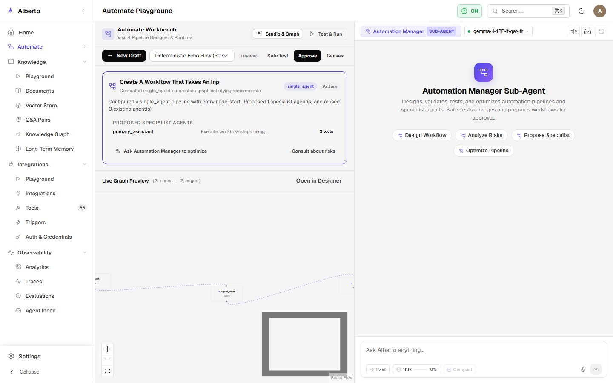
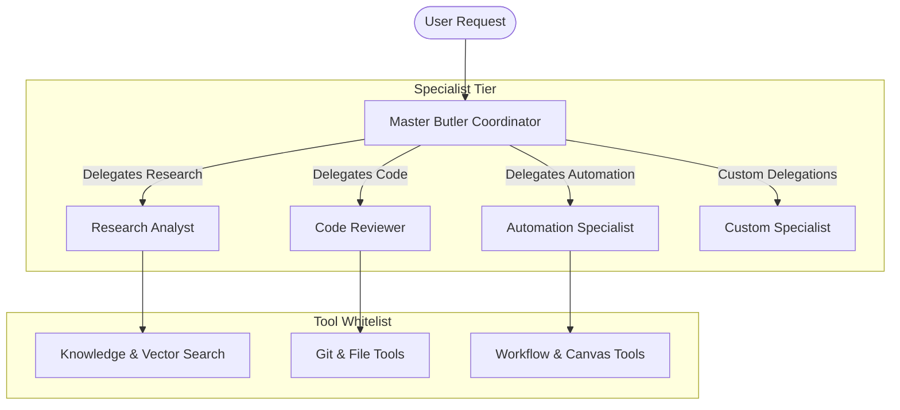

# Agents & AI Intelligence

Alberto's intelligence layer combines a central conversational Butler with configurable specialist agents operating across distinct domains.

{: .doc-screenshot }

Figure 4.1: Specialist agent management console displaying agent presets, models, and assigned tool sets.

---

## Agent Hierarchy

---

## Agent Architectural Components

| Component | Source File | Purpose |
| :--- | :--- | :--- |
| **Master Coordinator** | `backend/alberto/services/assistant.py` | Conversational persona, context synthesis, user intent parsing, and tool execution. |
| **Specialist Agents** | `backend/alberto/services/agents.py` | Pre-configured agent archetypes with dedicated prompts, models, and tools. |
| **Intent Router** | `backend/alberto/services/assistant.py` | Semantic classification engine evaluating which subagent or workflow to invoke. |
| **ReAct Loop** | `backend/alberto/services/assistant.py` | Dynamic reasoning and tool-calling execution cycle. |
| **Guardrails & Middleware** | `backend/alberto/services/tool_policy.py` | Pre- and post-execution validation, approval checking, and output formatting. |

---

## In This Section

- [Master Coordinator](master-coordinator.md) — The central Butler assistant persona, system instructions, and routing capabilities.
- [Specialist Agents](specialist-agents.md) — Creating, editing, and managing specialized subagent presets.
- [Intent Router](intent-router.md) — Deterministic and semantic classification mechanisms for task delegation.
- [ReAct Execution Loop](react-loop.md) — The cyclical reasoning, action, observation loop driving tool execution.
