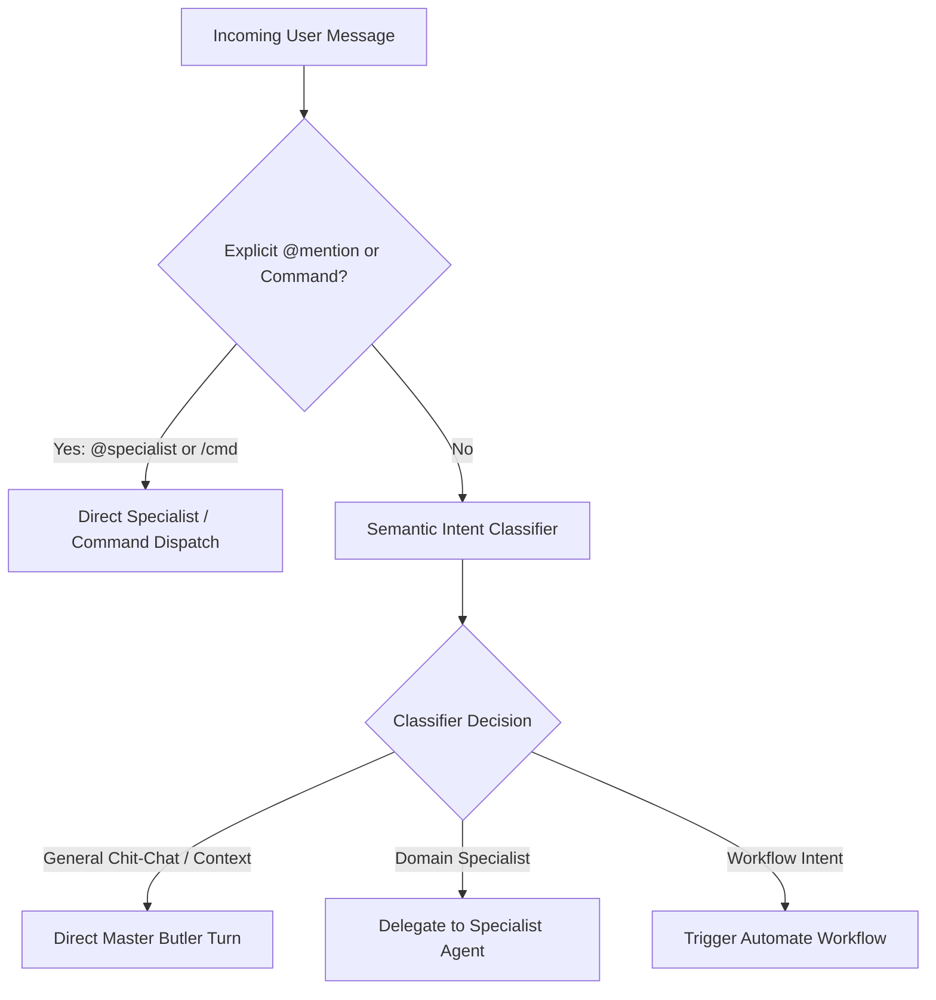

# Intent Router

The **Intent Router** is the traffic director of Alberto's conversational intelligence. Implemented in `backend/alberto/services/assistant.py`, it inspects incoming requests and selects the optimal handling route.

---

## 1. Routing Strategy

Alberto combines deterministic rules with semantic classification to minimize latency and token expenditure:



---

## 2. Classifier Logic & Guardrails

### Fast-Path Rules:
- `@agent_name <prompt>`: Instantly dispatches to the specified agent.
- `/workflow <workflow_id>`: Directly triggers a workflow execution.
- Common conversational greetings ("hello", "good morning"): Handled directly by the Coordinator without routing overhead.

### Semantic Classifier Prompt:
For non-trivial queries, a compact, few-shot prompt is evaluated against the registered specialist descriptions:

```markdown
Given the user query, determine the most suitable destination:
- Destination choices: [COORDINATOR, SPECIALIST:<name>, WORKFLOW:<id>]
- Candidate Specialists:
  * research_analyst: In-depth search, document extraction, empirical citations.
  * code_auditor: Code analysis, git diffs, refactoring.
  * home_assistant: Lights, temperature, device automation.
Query: "Analyze the security vulnerabilities in auth_middleware.py"
Decision: SPECIALIST:code_auditor
```

---

## 3. Fallback & Recovery

If a specialist agent fails or times out:
1. The error is captured by the LangGraph exception boundary.
2. The router falls back to the Master Coordinator with an explanation of the failure.
3. The Coordinator attempts to answer directly using general reasoning or prompts the user for clarification.
