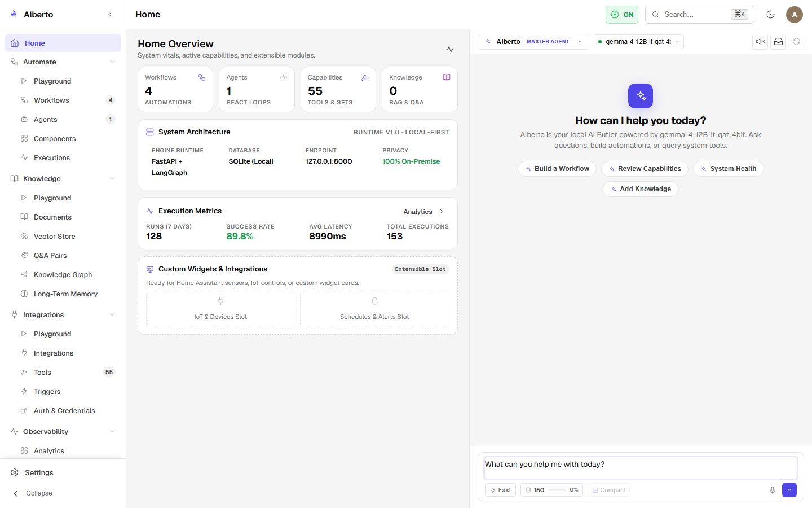

# Master Coordinator (Butler)

The **Master Coordinator** is Alberto's central orchestrator. Implemented in `backend/alberto/services/assistant.py`, it serves as the default voice and intelligence interface of the platform.

{: .doc-screenshot }
<p class="doc-caption">Figure 4.2: Master Coordinator conversational interface with multi-turn history and tool interactions.</p>

---

## 1. Role and Responsibilities

Unlike specialized single-purpose agents, the Master Coordinator:

1. **Understands General Intent:** Evaluates broad, ambiguous user queries.
2. **Maintains Conversational Memory:** Retrieves relevant historical context, user preferences, and knowledge graph entities.
3. **Delegates Tasks:** Dispatches domain-specific sub-tasks to Specialist Agents or triggers Automate Workflows.
4. **Synthesizes Outputs:** Takes outputs from specialist agents or external tools and formats them into a polished conversational response.

---

## 2. Prompt Assembly & Context Construction

Before passing the conversation to the underlying model, the Coordinator dynamically constructs the context window:

```text
┌─────────────────────────────────────────────────────────────┐
│ 1. Core Persona Instructions & Safety Constraints           │
│    "You are Alberto, an intelligent and polite personal     │
│     AI butler. You prioritize user privacy and accuracy."   │
├─────────────────────────────────────────────────────────────┤
│ 2. Assembled Knowledge & Memory                             │
│    - User Facts: [Name: Alex, Preferred Language: Python]   │
│    - Semantic Context: Retrieved document chunks            │
│    - Knowledge Graph Entities: Relevant entity triples      │
├─────────────────────────────────────────────────────────────┤
│ 3. Available Tools & Specialists Schema                     │
│    - Tools: [calculator, search_documents, get_weather]    │
│    - Specialists: [research_analyst, code_reviewer]         │
├─────────────────────────────────────────────────────────────┤
│ 4. Sliding Window Conversation History                      │
│    - User: "Summarize the latest sales numbers"             │
│    - Assistant: "Retrieving quarterly report..."            │
├─────────────────────────────────────────────────────────────┤
│ 5. Active User Input & Interruption State                   │
└─────────────────────────────────────────────────────────────┘
```

---

## 3. Delegation Contract

When the Coordinator determines that a specialized agent should handle a query, it emits a delegation command rather than attempting to solve the domain problem directly:

```json
{
  "action": "delegate",
  "specialist": "research_analyst",
  "payload": {
    "query": "Synthesize the 2026 Q3 revenue figures",
    "required_output": "markdown_table"
  }
}
```

The Master Coordinator handles the delegation asynchronously, captures the subagent's structured output, and responds to the user.
