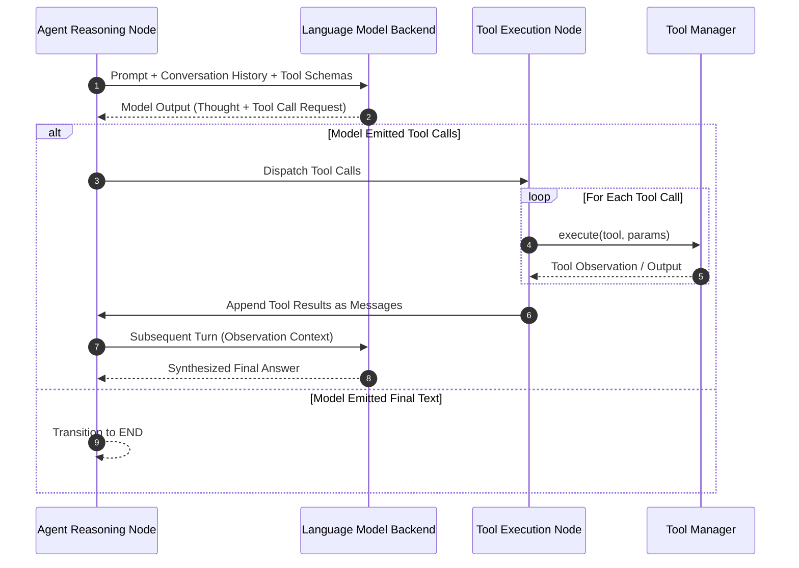

# ReAct Execution Loop

Alberto's conversational and specialist agents utilize the **ReAct (Reason + Act)** pattern implemented on top of LangGraph cyclical graphs.

---

## 1. The Reasoning and Action Cycle

---

## 2. Execution Safeguards & Limits

To prevent infinite loops, runaway recursion, or token exhaustion, Alberto enforces strict execution bounds:

1. **Maximum Recursion Depth (`recursion_limit`):** Defaults to 25 cycles. If an agent loops 25 times without terminating, LangGraph halts execution and returns a timeout error.
2. **Context Window Compression:** If intermediate tool results threaten the model's context window, older tool observations are truncated or summarized.
3. **Repeated Call Detection:** If an agent issues identical tool calls with identical arguments multiple times in sequence without progressing, the loop is terminated with a loop-break warning.
4. **Per-Turn Timeout:** Individual tool calls are constrained by an action timeout (default: 30 seconds), preventing hung subprocesses or network delays from freezing the agent.
