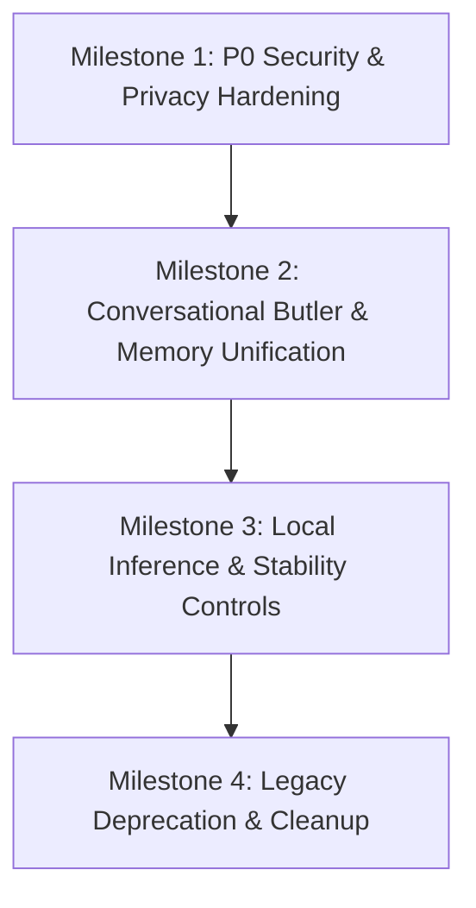
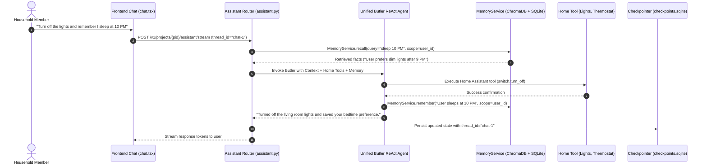

# Alberto — Next Phase Implementation Plan: Butler Hardening & Conversational Unification

**Target Deliverable:** `docs/architecture/ALBERTO_NEXT_PHASE_PLAN.md`  
**Purpose:** Define the minimal, safest implementation sequence to resolve verified P0/P1 audit findings and transition Alberto from an enterprise agent-building platform into a reliable, secure local-first Home Butler.  
**Guiding Principle:** **Reuse first, write only what must exist.** No new database engines, no architectural rewrites, no extra middleware layers. Fix the shared execution path surgically.

---

## 1. Architectural Strategy & Ground Rules

1. **Strictly Single-Household Scope:** Alberto serves one home. Eliminate multi-tenant complexity and self-building meta-agent tooling from the primary conversational path.
2. **Reuse Existing Infrastructure:**  
   - LangGraph `StateGraph` + `AsyncSqliteSaver` checkpointer for durable multi-turn conversations.
   - Existing `MemoryService` (SQLite + ChromaDB) for semantic recall of user preferences and household facts.
   - Unified Model Registry and Provider Adapter layer for local LM Studio / Ollama inference.
   - Existing `materialize_tool` and `entitlement_denial` logic for access control.
3. **Local-First Privacy Guarantee:** Zero silent transmission to cloud providers. All chat and tool execution must fail closed if local models or tools are unavailable.
4. **Surgical, Non-Destructive Changes:** Maintain 100% test pass parity on the existing 578 backend tests and 4 frontend smoke tests.

---

## 2. Sequenced Implementation Milestones



### Milestone 1: P0 Security & Privacy Hardening
**Target:** Eliminate authorization bypasses and unintended cloud leakage.

#### Task 1.1: Wrap Builtin Tools in Entitlement & Reliability Gate
- **Location:** [`backend/alberto/tools/materialize.py:146-149`](file:///c:/Users/oksbw/OneDrive/Desktop/Workspace/Alberto/backend/alberto/tools/materialize.py#L146-L149)
- **Current Defect:** `kind == "builtin"` returns raw `build_builtin_tool(cfg, ctx)` without calling `_wrap_reliability`.
- **Surgical Fix:** Wrap builtin tools in `_wrap_reliability(build_builtin_tool(cfg, ctx), cfg, ctx, idempotent=True)`.
- **Verification:** Unit test asserting that an end user without required entitlements receives an access denial when calling `remember`, `recall`, or `knowledge_search`.

#### Task 1.2: Remove Unintended Cloud Model Fallback
- **Location:** [`backend/alberto/services/assistant.py:836-853`](file:///c:/Users/oksbw/OneDrive/Desktop/Workspace/Alberto/backend/alberto/services/assistant.py#L836-L853) & [`backend/alberto/engine/models.py:27-40`](file:///c:/Users/oksbw/OneDrive/Desktop/Workspace/Alberto/backend/alberto/engine/models.py#L27-L40)
- **Current Defect:** `_assistant_model_ref` defaults to `_STRONG` (`gpt-5.4` / `claude-sonnet-4-6`) if cloud credentials exist in the database.
- **Surgical Fix:** Remove `_STRONG` fallback map. Require explicit configuration; if unconfigured, resolve strictly to the active local model registered in `ModelRegistry` or `fake:offline`. Never fall back to cloud providers implicitly.
- **Verification:** Test verifying that when an OpenAI key is present in secrets but a local LM Studio model is selected, all assistant invocations target the local endpoint.

#### Task 1.3: Enforce Household Role Boundaries in Dev Mode
- **Location:** [`backend/alberto/deps.py:93-100`](file:///c:/Users/oksbw/OneDrive/Desktop/Workspace/Alberto/backend/alberto/deps.py#L93-L100)
- **Current Defect:** When `auth_required=False`, unauthenticated callers are automatically treated as `role="owner"`.
- **Surgical Fix:** Restrict the dev fallback identity to `role="editor"` or prompt for household PIN/session token on mutating operations.
- **Verification:** Verify that destructive operations reject anonymous callers even when `auth_required` is disabled.

---

### Milestone 2: Conversational Butler & Memory Unification
**Target:** Bridge the split-brain chat interface into a single, intelligent Home Butler with long-term memory and home tool capabilities.



#### Task 2.1: Unify Chat Path onto a Single Butler ReAct Agent
- **Location:** [`backend/alberto/services/assistant.py:1085-1175`](file:///c:/Users/oksbw/OneDrive/Desktop/Workspace/Alberto/backend/alberto/services/assistant.py#L1085-L1175)
- **Current Defect:** Branches into hollow stateless `_fast_stream` (no tools, no memory) or `_build_agent` (deep Forge platform self-builder).
- **Surgical Fix:** Replace the split with a single **Butler Coordinator Agent**:
  - Replace the 1,500-token Forge prompt with a concise (~250-token) Home Butler prompt defining Alberto's identity, tone, and device management rules.
  - Automatically bind registered home automation tools and memory tools (`remember`, `recall`).
  - Pass `thread_id` and `checkpointer` into the run configuration so every conversational turn is durably preserved.
- **Verification:** Test verifying that Scenario A ("Hello") and Scenario C ("Turn on the lights") run through the same unified agent with thread state preserved.

#### Task 2.2: Automated Memory Retrieval on Conversational Turns
- **Location:** [`backend/alberto/services/assistant.py`](file:///c:/Users/oksbw/OneDrive/Desktop/Workspace/Alberto/backend/alberto/services/assistant.py)
- **Current Defect:** `MemoryService.recall` is never called by the chat router.
- **Surgical Fix:** Before invoking the model, query `MemoryService.recall(session, tenant_id, project_id, user_msg, scope=user_id)`. If relevant memories meet the cosine threshold (`memory_recall_min_score`), inject them as a system context block:
  ```markdown
  Relevant Household Memory:
  - User prefers living room lights at 40% in evening.
  ```
- **Verification:** Test verifying Scenario B: "What are my preferences?" successfully returns facts stored in SQLite/ChromaDB.

---

### Milestone 3: Local Model Runtime & Stability Controls
**Target:** Optimize inference for local quantized models (Gemma 12B, LM Studio, 8k context window).

#### Task 3.1: Enable Shared HTTP Keep-Alive for Local Engines
- **Location:** [`backend/alberto/engine/providers.py:242-253`](file:///c:/Users/oksbw/OneDrive/Desktop/Workspace/Alberto/backend/alberto/engine/providers.py#L242-L253)
- **Current Defect:** `shared_llm_async_client()` is only wired for `provider_tag == "openai"`. LM Studio and Ollama open unpooled connections.
- **Surgical Fix:** Inject `http_async_client=shared_llm_async_client()` into `ChatOpenAI` initialization for all local providers (`lm_studio`, `ollama`, `vllm`, `openai_compatible`).
- **Verification:** Benchmark local socket reuse; verify zero connection drops or latency spikes across 50 consecutive local turns.

#### Task 3.2: Add Execution Timeout Ceiling
- **Location:** [`backend/alberto/services/assistant.py:1042`](file:///c:/Users/oksbw/OneDrive/Desktop/Workspace/Alberto/backend/alberto/services/assistant.py#L1042) & [`backend/alberto/services/runs.py:621`](file:///c:/Users/oksbw/OneDrive/Desktop/Workspace/Alberto/backend/alberto/services/runs.py#L621)
- **Current Defect:** No wall-clock timeout wraps streaming execution.
- **Surgical Fix:** Wrap the generator iteration in `async with asyncio.timeout(settings.assistant_turn_timeout_seconds or 60.0):`. If timeout expires, yield a clean SSE error frame and gracefully abort.
- **Verification:** Unit test simulating a hung model call; verify SSE stream terminates cleanly after timeout without leaking tasks.

#### Task 3.3: Tame Superstep Recursion Limit
- **Location:** [`backend/alberto/services/assistant.py:1110`](file:///c:/Users/oksbw/OneDrive/Desktop/Workspace/Alberto/backend/alberto/services/assistant.py#L1110) & [`backend/alberto/config.py:383`](file:///c:/Users/oksbw/OneDrive/Desktop/Workspace/Alberto/backend/alberto/config.py#L383)
- **Current Defect:** Hardcoded recursion limit of 100 supersteps allows runaway looping on local models.
- **Surgical Fix:** Lower default recursion limit for Butler chat turns to 15 supersteps (sufficient for multi-step device actions, prevents infinite loops).
- **Verification:** Test verifying that a looping tool failure terminates at 15 steps instead of 100.

---

### Milestone 4: Pruning Enterprise Dead Weight & Shims
**Target:** Eliminate obsolete Forge scaffolding without breaking persisted data.

#### Task 4.1: Deprecate Forge Meta-Agent Tools from Conversational Path
- **Location:** [`backend/alberto/services/assistant.py:760-784`](file:///c:/Users/oksbw/OneDrive/Desktop/Workspace/Alberto/backend/alberto/services/assistant.py#L760-L784)
- **Action:** Remove the 23 visual workflow builder tools (`create_custom_workflow`, `list_node_types`, `evaluate_build`, etc.) from the Butler assistant's tool binding. Retain them only for internal workflow compilation.
- **Token Impact:** Immediately frees ~2,500 tokens of JSON schema overhead from every conversational prompt.

#### Task 4.2: Frontend Chat Target Simplification
- **Location:** [`frontend/components/screens/chat.tsx:53-56`](file:///c:/Users/oksbw/OneDrive/Desktop/Workspace/Alberto/frontend/components/screens/chat.tsx#L53-L56)
- **Action:** Simplify the UI target selector. Alberto is a single Butler; conversational chat should target the Butler by default without exposing internal workflow IDs or prompt starters like *"Create a customer feedback triaging workflow."*

---

## 3. Definition of Done & Acceptance Criteria

| Capability | Verification Metric | Pass Criteria |
|---|---|---|
| **P0 Security** | Builtin tool access control | Non-entitled user denied execution on `remember` / `recall`. |
| **P0 Privacy** | Local model isolation | Zero outbound HTTP calls to cloud APIs when running local models. |
| **P1 Intelligence** | Scenario A: Conversational greeting | Replies within 1 turn; saves turn into `checkpoints.sqlite`. |
| **P1 Intelligence** | Scenario B: Memory recall | "What are my preferences?" recalls facts from ChromaDB. |
| **P1 Intelligence** | Scenario C: Smart home tool action | "Turn on lights" invokes authorized tool; confirms state. |
| **P1 Intelligence** | Scenario E: Sensitive action approval | "Unlock door" triggers HITL approval interrupt before execution. |
| **P2 Efficiency** | 8k Context Window Budget | Prompt + tools + memory consume < 1,500 tokens total (leaving > 6,500 for history). |
| **Test Parity** | Existing regression suite | All 578 backend tests and 4 frontend tests pass cleanly. |
