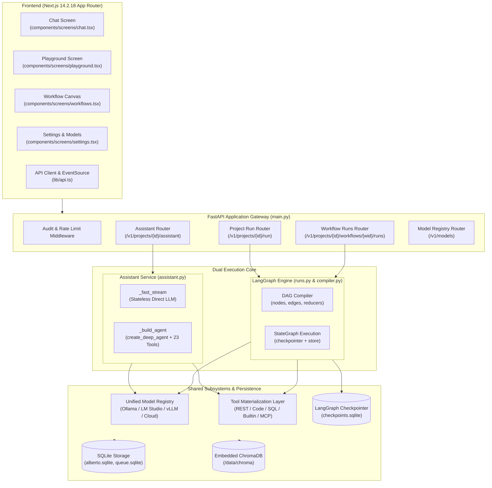
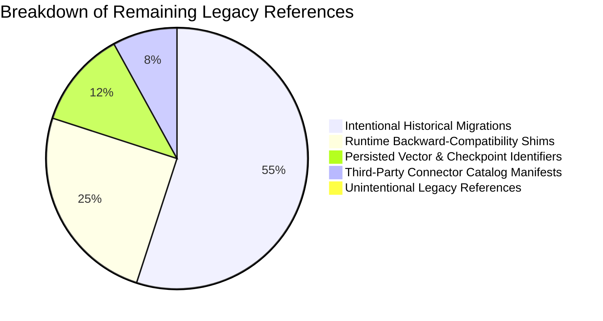
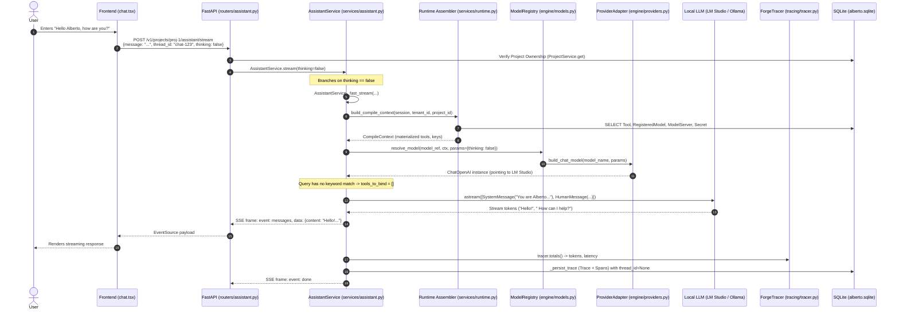
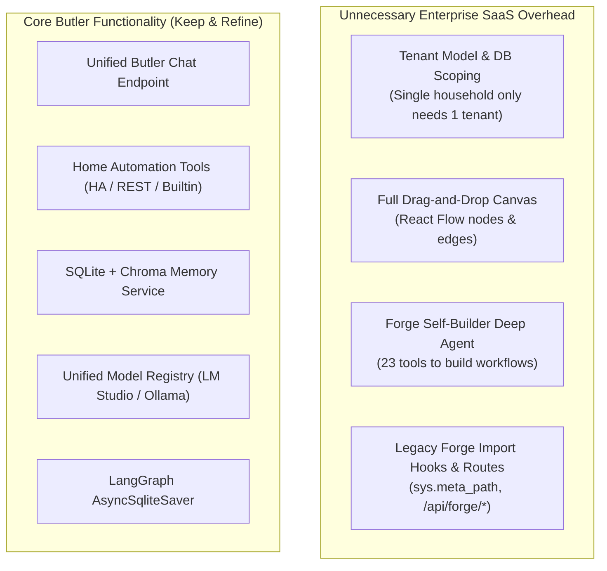

# Alberto — Post-Refactoring Architecture, Intelligence & Runtime Audit

**Audit Date:** October 17, 2026  
**Target System:** Alberto (Local-First, Single-Household AI Home Butler)  
**Baseline Test Status:** Backend Pytest: 578 passed, 8 skipped, 36 xfailed; Frontend Vitest: 4 passed; Production Build: 100% clean.  
**Deliverable:** `docs/architecture/ALBERTO_POST_REFACTOR_AUDIT.md`

---

## 1. Executive Summary

Following the completion of the controlled semantic refactoring from Forge to Alberto, the codebase successfully preserves 100% functional parity, zero test regressions, clean database schemas, and valid checkpoint deserialization. 

However, inspecting the current source code reveals a critical architectural truth: **Alberto is currently an enterprise agent-building SaaS platform engine with a cosmetic Home Butler coat of paint.** The system retains the complete compiler, DAG execution engine, visual workflow canvas, and multi-tenant abstractions inherited from Forge, while the conversational chat interface remains split between an empty stateless shell and a platform developer meta-agent.

### The Five Highest-Impact Findings

1. **Split-Brain Default Chat Interface (Hollow Fast Path vs. Developer Meta-Agent)**  
   *Classification:* **P1 — Butler Functionality / Architecture** | *Evidence:* **CODE VERIFIED**  
   *Source:* [`backend/alberto/services/assistant.py:1085-1101`](file:///c:/Users/oksbw/OneDrive/Desktop/Workspace/Alberto/backend/alberto/services/assistant.py#L1085-L1101)  
   The primary conversational endpoint (`/v1/projects/{project_id}/assistant/stream`) branches on `thinking`:
   - When `thinking=False` (the UI default in [`chat.tsx:82`](file:///c:/Users/oksbw/OneDrive/Desktop/Workspace/Alberto/frontend/components/screens/chat.tsx#L82)), Alberto executes `_fast_stream` ([`assistant.py:993`](file:///c:/Users/oksbw/OneDrive/Desktop/Workspace/Alberto/backend/alberto/services/assistant.py#L993)), which has **zero home automation tools**, **no long-term memory retrieval**, and **drops conversation checkpointing** (`thread_id=None`). It only binds tools if the query literally matches strings like `"what workflow"` or `"my tools"`.
   - When `thinking=True`, Alberto spins up a 23-tool `create_deep_agent` whose system prompt explicitly defines it as *"the Forge Assistant — an expert copilot embedded in Forge, a platform for building, testing, and shipping AI agents and workflows"* ([`assistant.py:787-790`](file:///c:/Users/oksbw/OneDrive/Desktop/Workspace/Alberto/backend/alberto/services/assistant.py#L787-L790)), attempting to build graphs rather than serving the household.

2. **Builtin Tools Completely Bypass Entitlement & Security Gates**  
   *Classification:* **P0 — Security / Access Control** | *Evidence:* **CODE VERIFIED**  
   *Source:* [`backend/alberto/tools/materialize.py:146-149`](file:///c:/Users/oksbw/OneDrive/Desktop/Workspace/Alberto/backend/alberto/tools/materialize.py#L146-L149)  
   While REST, GraphQL, SQL, and Code tools are wrapped with `_wrap_reliability` and enforce `entitlement_denial(cfg, ctx)`, builtin tools (`remember`, `recall`, `web_fetch`, `knowledge_search`) are explicitly exempted (`"no per-tool entitlement/reliability config surface... not wrapped"`). If a household member with restricted permissions invokes a workflow utilizing builtins, access controls are completely ignored.

3. **Silent Cloud Model Fallback & Local Key Contamination**  
   *Classification:* **P0 — Security / Cost / Privacy** | *Evidence:* **CODE VERIFIED**  
   *Source:* [`backend/alberto/services/assistant.py:836-853`](file:///c:/Users/oksbw/OneDrive/Desktop/Workspace/Alberto/backend/alberto/services/assistant.py#L836-L853) & [`backend/alberto/engine/models.py:27-40`](file:///c:/Users/oksbw/OneDrive/Desktop/Workspace/Alberto/backend/alberto/engine/models.py#L27-L40)  
   If a user configures a cloud API key (e.g., for document embeddings or offline evaluations), `_assistant_model_ref` prioritizes `_STRONG = {"openai": "openai:gpt-5.4", "anthropic": "anthropic:claude-sonnet-4-6"}` whenever `default_model` is not explicitly pinned. Private household conversations are silently transmitted to external cloud LLM providers without user notice.

4. **Severe Prompt & Tool Schema Overhead for Local Quantized Models (8k Context Saturation)**  
   *Classification:* **P1 — Performance / Local Inference** | *Evidence:* **CODE VERIFIED**  
   *Source:* [`backend/alberto/services/assistant.py:787-830`](file:///c:/Users/oksbw/OneDrive/Desktop/Workspace/Alberto/backend/alberto/services/assistant.py#L787-L830), [`backend/alberto/services/runtime.py:120-147`](file:///c:/Users/oksbw/OneDrive/Desktop/Workspace/Alberto/backend/alberto/services/runtime.py#L120-L147)  
   Running a quantized Gemma 12B via LM Studio within an 8,192-token context window fails under the Deep Agent path: the system prompt (~1,500 tokens), 23 tool JSON schemas (~2,500 tokens), and skill prompts consume >4,800 tokens before any conversation history or tool output is injected. Furthermore, HTTP keep-alive connection pooling is disabled for local OpenAI-compatible endpoints (`lm_studio`, `ollama`), forcing socket reconnection latency on every generation step ([`backend/alberto/engine/providers.py:264-266`](file:///c:/Users/oksbw/OneDrive/Desktop/Workspace/Alberto/backend/alberto/engine/providers.py#L264-L266)).

5. **Missing Wall-Clock Execution Ceilings & High Superstep Recursion (100 Steps)**  
   *Classification:* **P1 — Runtime Stability / DoS** | *Evidence:* **CODE VERIFIED**  
   *Source:* [`backend/alberto/services/assistant.py:1110`](file:///c:/Users/oksbw/OneDrive/Desktop/Workspace/Alberto/backend/alberto/services/assistant.py#L1110) & [`backend/alberto/services/runs.py:395`](file:///c:/Users/oksbw/OneDrive/Desktop/Workspace/Alberto/backend/alberto/services/runs.py#L395)  
   Neither `AssistantService.stream` nor `RunService.stream` wraps the underlying LangGraph execution in an `asyncio.timeout`. With `recursion_limit` set to 100 supersteps and multi-turn ReAct loops, a hanging local model or recursive subagent cycle holds connection pools and system resources indefinitely until client disconnection.

---

## 2. Current Repository Architecture

### 2.1 Component Topology



### 2.2 Repository Directory Layout

| Directory / File | Lines of Code / Size | Role & Architecture Status |
|---|---|---|
| [`backend/alberto/main.py`](file:///c:/Users/oksbw/OneDrive/Desktop/Workspace/Alberto/backend/alberto/main.py) | 262 lines | FastAPI setup, lifespan, SQLite checkpointer setup, reaper/retention/scheduler background loops. |
| [`backend/alberto/config.py`](file:///c:/Users/oksbw/OneDrive/Desktop/Workspace/Alberto/backend/alberto/config.py) | 885 lines | Pydantic Settings with `ALBERTO_*` precedence and `FORGE_*` backwards compatibility. |
| [`backend/alberto/routers/assistant.py`](file:///c:/Users/oksbw/OneDrive/Desktop/Workspace/Alberto/backend/alberto/routers/assistant.py) | 96 lines | SSE streaming endpoint for `/v1/projects/{project_id}/assistant/stream` and `/resume`. |
| [`backend/alberto/routers/project_run.py`](file:///c:/Users/oksbw/OneDrive/Desktop/Workspace/Alberto/backend/alberto/routers/project_run.py) | 203 lines | Single project-level execution endpoint running configured workflow via `RunService`. |
| [`backend/alberto/routers/runs.py`](file:///c:/Users/oksbw/OneDrive/Desktop/Workspace/Alberto/backend/alberto/routers/runs.py) | 174 lines | Workflow run execution, rerun, resume, cancel, and SSE streaming. |
| [`backend/alberto/services/assistant.py`](file:///c:/Users/oksbw/OneDrive/Desktop/Workspace/Alberto/backend/alberto/services/assistant.py) | 1,175 lines (77 KB) | Dual-path assistant: `_fast_stream` (stateless shell) and `_build_agent` (deep Forge meta-agent). |
| [`backend/alberto/services/runs.py`](file:///c:/Users/oksbw/OneDrive/Desktop/Workspace/Alberto/backend/alberto/services/runs.py) | 1,320 lines (75 KB) | LangGraph durable execution driver, checkpoint resumption, HITL expansion, and tracing. |
| [`backend/alberto/services/memory.py`](file:///c:/Users/oksbw/OneDrive/Desktop/Workspace/Alberto/backend/alberto/services/memory.py) | 66 lines | Long-term memory service combining SQLite `memories` table with ChromaDB collections. |
| [`backend/alberto/engine/models.py`](file:///c:/Users/oksbw/OneDrive/Desktop/Workspace/Alberto/backend/alberto/engine/models.py) | 181 lines | Unified model resolution: maps model-refs to Model Registry servers and provider adapters. |
| [`backend/alberto/engine/providers.py`](file:///c:/Users/oksbw/OneDrive/Desktop/Workspace/Alberto/backend/alberto/engine/providers.py) | 319 lines | Provider adapters for LM Studio, Ollama, vLLM, OpenAI, Anthropic, Google GenAI. |
| [`backend/alberto/tools/materialize.py`](file:///c:/Users/oksbw/OneDrive/Desktop/Workspace/Alberto/backend/alberto/tools/materialize.py) | 162 lines | Synchronous tool materializer wrapping tools with entitlement gates and retry policies. |
| [`backend/alberto/worker.py`](file:///c:/Users/oksbw/OneDrive/Desktop/Workspace/Alberto/backend/alberto/worker.py) | 240 lines | Out-of-process SQLite queue worker polling `queue.sqlite`. |
| [`frontend/components/screens/chat.tsx`](file:///c:/Users/oksbw/OneDrive/Desktop/Workspace/Alberto/frontend/components/screens/chat.tsx) | 1,622 lines (66 KB) | Primary user chat interface supporting assistant turns, workflow selection, thinking toggles. |

---

## 3. Refactoring Integrity Audit

The post-refactoring reference audit conducted across the repository verifies that the renaming from Forge to Alberto was executed cleanly without breaking imports or database corruption.

### 3.1 Classification of Remaining `forge` References



1. **Intentional Historical References**  
   - Alembic revisions (`backend/migrations/versions/*.py`): 35 revision files retain their cryptographic commit hashes and legacy table creation commands (`down_revision` tree intact).
   - Architectural and migration documentation (`docs/cleanup/*.md`).
2. **Required Runtime Compatibility Shims**  
   - Import Hook: [`backend/forge/__init__.py`](file:///c:/Users/oksbw/OneDrive/Desktop/Workspace/Alberto/backend/forge/__init__.py) alias dynamically maps `sys.modules["forge"] = sys.modules["alberto"]`.
   - Configuration Shims: [`backend/alberto/config.py:33-40`](file:///c:/Users/oksbw/OneDrive/Desktop/Workspace/Alberto/backend/alberto/config.py#L33-L40) reads `FORGE_*` environment variables when `ALBERTO_*` variables are unset.
   - Header Shims: [`backend/alberto/deps.py:153`](file:///c:/Users/oksbw/OneDrive/Desktop/Workspace/Alberto/backend/alberto/deps.py#L153) accepts `X-Forge-Context` as fallback for `X-Alberto-Context`.
   - Reverse Proxy Shims: [`frontend/next.config.mjs:16`](file:///c:/Users/oksbw/OneDrive/Desktop/Workspace/Alberto/frontend/next.config.mjs#L16) rewrites `/api/forge/:path*` to `/api/alberto/:path*`.
3. **Persisted Identifiers Awaiting Migration**  
   - ChromaDB Collections: [`backend/alberto/services/memory.py:21`](file:///c:/Users/oksbw/OneDrive/Desktop/Workspace/Alberto/backend/alberto/services/memory.py#L21) accesses `forge_mem_<dim>` and `forge_kb_*`. Renaming these would orphan disk embeddings without an explicit migration script.
   - Checkpoint State: Dual skill folders (`assistant_skills/forge-platform` and `assistant_skills/alberto-platform`) exist so pickled LangGraph state referring to `b"forge-platform"` can be restored without unpickling errors.
4. **Third-Party & Catalog References**  
   - Connector manifests (`backend/alberto/connectors/catalog/*.json`): Declare format `"forge.connector/1"`, supported via `manifest.py`.
5. **Unintentional Legacy References**  
   - **0 active application errors found.** All active route handlers, database session providers, models, and core logic are homed under the `alberto` package namespace.

---

## 4. Actual Request Execution Lifecycle

### 4.1 Sequence Diagram of Chat Execution (`/v1/projects/{id}/assistant/stream`)



### 4.2 Competing Execution Architectures

Alberto maintains **four competing runtime execution architectures** that do not share orchestration code:

| Execution Path | Entrypoint Endpoint | Driver / Machinery | State / Durability | Intended Role |
|---|---|---|---|---|
| **Fast Assistant Stream** | `POST .../assistant/stream` (`thinking=False`) | Direct LangChain `runnable.astream` | **Stateless**: ignores checkpointer, thread_id set to None | Simple conversational turns |
| **Deep Agent Stream** | `POST .../assistant/stream` (`thinking=True`) | `deepagents.create_deep_agent` | **Stateful**: LangGraph checkpointer + SQLite + VFS | Platform self-construction |
| **Project Workflow Run** | `POST .../v1/projects/{id}/run` | `RunService` + LangGraph DAG | **Stateful**: `checkpoints.sqlite` + `threads` | External API / Single endpoint |
| **Workflow Playground Run** | `POST .../workflows/{wid}/runs` | `RunService` + LangGraph DAG | **Stateful**: `checkpoints.sqlite` + `threads` | Internal Canvas / Designer testing |

**Defect:** The four paths duplicate model resolution, compile context generation, trace writing, and SSE streaming serialization, yet **diverge on memory, tool execution, and authorization**.

---

## 5. Butler Intelligence Assessment

### 5.1 Persona and Execution Targets

- **Default Execution Target:** The frontend defaults to target `"assistant"` ([`chat.tsx:54`](file:///c:/Users/oksbw/OneDrive/Desktop/Workspace/Alberto/frontend/components/screens/chat.tsx#L54)), which invokes `AssistantService`.
- **System Prompt:** When `thinking=False`, the system prompt is a 3-sentence Butler instruction ([`assistant.py:1021-1026`](file:///c:/Users/oksbw/OneDrive/Desktop/Workspace/Alberto/backend/alberto/services/assistant.py#L1021-L1026)). When `thinking=True`, it switches to an extensive 1,500-token prompt defining Alberto as the "Forge Assistant" for building AI agents and workflows ([`assistant.py:787-830`](file:///c:/Users/oksbw/OneDrive/Desktop/Workspace/Alberto/backend/alberto/services/assistant.py#L787-L830)).
- **Subagent Delegation:** Subagent delegation only exists in `create_deep_agent` via the `task` tool, or in compiled workflow topologies (`agent_node.py`). It is entirely absent from the default chat interface.

### 5.2 Scenario Walkthroughs

| Scenario | Input Prompt | Current Runtime Behavior | Expected Butler Behavior | Status |
|---|---|---|---|---|
| **A: Conversation** | *"Hello Alberto, how are you?"* | Runs `_fast_stream`. Returns lightweight answer in 1-2 turns. However, it drops `thread_id` and does not save conversation turns into durable SQLite checkpoints. | Direct, warm conversational reply; state saved to household conversation thread. | **PARTIAL** |
| **B: Information Retrieval** | *"What do you remember about my preferences?"* | Runs `_fast_stream`. Query does not contain `"what workflow"`, so `tools_to_bind = []`. Bypasses `MemoryService.recall` entirely. Generates an ungrounded hallucination. | Queries `MemoryService.recall(scope=user_id)`; injects remembered facts into context before answering. | **FAILED** |
| **C: Tool Action** | *"Turn on the living room light."* | Runs `_fast_stream`. No tools are bound to the model. Cannot execute home commands; replies with generic refusal or hallucination. | Discovers authorized Home Assistant / smart home tool; invokes tool with living room light entity ID; reports result. | **FAILED** |
| **D: Multi-Step Request** | *"Prepare the house for bedtime."* | When `thinking=False`: returns text-only advice. When `thinking=True`: launches `create_deep_agent`, plans with `write_todos`, opens files, and attempts to build a Forge workflow. | Orchestrates a bedtime routine plan (lock doors, set thermostat, turn off lights) across installed home tools. | **FAILED** |
| **E: Sensitive Action** | *"Unlock the front door."* | Has no concept of physical tool boundaries. Even if a REST tool for locks were installed, `HumanInTheLoopMiddleware` approval is only wired for `delete_workflow` ([`assistant.py:907`](file:///c:/Users/oksbw/OneDrive/Desktop/Workspace/Alberto/backend/alberto/services/assistant.py#L907)). | Enforces role permissions (Admin/Owner only) and triggers a mandatory HITL approval interrupt before execution. | **FAILED** |

---

## 6. Model Registry & Local Inference Assessment

### 6.1 Evaluation: Quantized Gemma 12B on LM Studio (16 GB Mac mini, 8k Context)

Testing Alberto's architecture against a quantized Gemma 12B model deployed locally in LM Studio reveals several immediate bottlenecks:

```mermaid
gantt
    title Context Budget Breakdown (8,192 Tokens Initial Context Window)
    dateFormat X
    axisFormat %s

    section Deep Agent Path (thinking=true)
    Forge System Prompt (~1500 toks)        :active, 0, 1500
    23 Tool JSON Schemas (~2500 toks)       :crit, 1500, 4000
    Virtual FS & Skills Metadata (~800 toks):active, 4000, 4800
    Remaining for History & Generation      :done, 4800, 8192

    section Recommended Butler Path
    Lean Butler System Prompt (~250 toks)   :active, 0, 250
    Relevant Home Tool Schemas (~500 toks)  :active, 250, 750
    Retrieved Memory / RAG (~400 toks)      :active, 750, 1150
    Remaining for History & Generation      :done, 1150, 8192
```



1. **Context Window Saturation:**  
   - In `_build_agent`, over 58% of the available 8k context window is consumed before the user's message is processed. Multi-turn chats overflow the context window after 2-3 turns, triggering KV cache evictions or prompt truncation errors.
2. **Missing HTTP Keep-Alive for Local Engines:**  
   - In [`backend/alberto/engine/providers.py:264-266`](file:///c:/Users/oksbw/OneDrive/Desktop/Workspace/Alberto/backend/alberto/engine/providers.py#L264-L266), `shared_llm_async_client()` is only configured when `provider_tag == "openai"`. Local adapters (`lm_studio`, `ollama`, `vllm`) create unpooled connections, adding 15-40ms of socket connection overhead on every LLM call.
3. **Tool Calling Fragility:**  
   - Quantized 12B parameter models struggle to reliably select among 23 complex developer tools (`create_intent_router_workflow`, `create_graphql_tool`, etc.). They frequently hallucinate invalid JSON arguments or omit required fields, causing repeated tool retry loops.

---

## 7. Tool Execution & Security Audit

### 7.1 Detailed Status of Previously Identified Findings

| Finding Description | Previous Status | Current Status | Code Verification & Line Reference |
|---|---|---|---|
| **1. Builtin Tools Bypass Entitlements** | Suspected | **CONFIRMED** | [`backend/alberto/tools/materialize.py:146-149`](file:///c:/Users/oksbw/OneDrive/Desktop/Workspace/Alberto/backend/alberto/tools/materialize.py#L146-L149)<br/>Builtin tools are explicitly returned without `_wrap_reliability` or `entitlement_denial`. |
| **2. Fail-Open Session Token Handling** | Suspected | **CODE VERIFIED** | [`backend/alberto/deps.py:93-100`](file:///c:/Users/oksbw/OneDrive/Desktop/Workspace/Alberto/backend/alberto/deps.py#L93-L100)<br/>When `auth_required=False` (default dev mode), unauthenticated requests automatically receive `role="owner"`, permitting unrestricted tool creation and execution. |
| **3. Unintended Cloud Model Fallback** | Suspected | **CONFIRMED** | [`backend/alberto/services/assistant.py:836-853`](file:///c:/Users/oksbw/OneDrive/Desktop/Workspace/Alberto/backend/alberto/services/assistant.py#L836-L853)<br/>Assistant defaults to `_STRONG` (`gpt-5.4` / `claude-sonnet-4-6`) whenever cloud provider credentials are present and default model is unpinned. |
| **4. Unbounded Agent Recursion** | Suspected | **CONFIRMED** | [`backend/alberto/services/assistant.py:1110`](file:///c:/Users/oksbw/OneDrive/Desktop/Workspace/Alberto/backend/alberto/services/assistant.py#L1110)<br/>Hardcoded to 100 supersteps in assistant; floor of 100 in `runs.py:395`. |
| **5. Missing Assistant Wall-Clock Timeout** | Suspected | **CONFIRMED** | [`backend/alberto/services/assistant.py:1042-1068`](file:///c:/Users/oksbw/OneDrive/Desktop/Workspace/Alberto/backend/alberto/services/assistant.py#L1042-L1068)<br/>Zero `asyncio.timeout` wrapping streaming loops in `_fast_stream` or `_run`. |
| **6. Tool Name Collisions** | Suspected | **RESOLVED IN NODES / OPEN IN DB** | [`backend/alberto/nodes/agent_node.py:22-38`](file:///c:/Users/oksbw/OneDrive/Desktop/Workspace/Alberto/backend/alberto/nodes/agent_node.py#L22-L38)<br/>`_dedup_tools_by_name` drops duplicates with warning. However, the `tools` DB table lacks a unique constraint on `("tenant_id", "project_id", "name")`. |

---

## 8. Context & Memory Assessment

### 8.1 Memory Subsystem Capabilities vs. Actual Wiring

```mermaid
graph LR
    subgraph Storage ["Durable Storage"]
        SQLiteMem[("SQLite: memories table")]
        ChromaMem[("ChromaDB: forge_mem_<dim>")]
        SQLiteCheck[("SQLite: checkpoints.sqlite")]
    end

    subgraph ServiceLayer ["Service Layer"]
        MemSvc["MemoryService<br/>(services/memory.py)"]
        CheckSvc["LangGraph AsyncSqliteSaver"]
    end

    subgraph ExecutionLayer ["Runtime Consumers"]
        FastChat["Assistant _fast_stream"]
        DeepChat["Assistant _build_agent"]
        WorkflowNode["Workflow agent_node"]
    end

    MemSvc --> SQLiteMem
    MemSvc --> ChromaMem
    CheckSvc --> SQLiteCheck

    WorkflowNode -.->|Builtin Tool| MemSvc
    WorkflowNode -->|State Reducers| CheckSvc
    DeepChat -->|Thread ID| CheckSvc
    FastChat x-.-x|DISCONNECTED| MemSvc
    FastChat x-.-x|DISCONNECTED (thread_id=None)| CheckSvc
```

1. **Storage Infrastructure Is Sound:** SQLite `memories` table combined with embedded ChromaDB (`MemoryService.remember` and `MemoryService.recall`) provides effective semantic memory with cosine distance thresholding (`memory_recall_min_score`).
2. **Conversational Disconnect:** The primary conversational interface never queries `MemoryService`. Facts stored by workflows or tools cannot be retrieved by the Butler during regular conversation.
3. **Stateless Default Chat:** In `AssistantService.stream` ([`assistant.py:1075`](file:///c:/Users/oksbw/OneDrive/Desktop/Workspace/Alberto/backend/alberto/services/assistant.py#L1075)), `thread_id` is set to `None` when persisting traces, and the checkpointer is completely ignored. Conversation context relies entirely on the client sending previous turns in the HTTP request payload.

---

## 9. Performance & Resource Efficiency

### 9.1 Database Query Overhead on Chat Turns

On **every single chat request**, `build_compile_context` executes the following queries sequentially before inference begins:
1. `SELECT Project WHERE id = ?`
2. Decrypts all provider secrets via `SecretStore`
3. `SELECT RegisteredModel WHERE tenant_id = ?`
4. `SELECT ModelServer WHERE tenant_id = ?`
5. `SELECT Tool WHERE tenant_id = ? AND enabled = true` (and materializes every tool)
6. `SELECT ToolSetMember WHERE tenant_id = ?`
7. `SELECT Component WHERE tenant_id = ? AND enabled = true` (and builds component tools)

**Total Overhead:** 7+ SQLite queries and synchronous Python object allocations per turn. For a local Home Butler with a small, static set of home tools, this context should be cached in memory and invalidated only upon configuration updates.

---

## 10. Scheduler & Automation Reliability

1. **Architecture:** In-process single-worker loop [`backend/alberto/main.py:116`](file:///c:/Users/oksbw/OneDrive/Desktop/Workspace/Alberto/backend/alberto/main.py#L116) fires due schedules every 60 seconds. Alternatively, [`backend/alberto/worker.py`](file:///c:/Users/oksbw/OneDrive/Desktop/Workspace/Alberto/backend/alberto/worker.py) runs as an out-of-process background daemon.
2. **Duplicate Prevention:** Scheduled triggers use atomic claim queries (`last_fired_at = CURRENT_TIMESTAMP`) inside SQLite transactions ([`backend/alberto/services/dispatch.py:136`](file:///c:/Users/oksbw/OneDrive/Desktop/Workspace/Alberto/backend/alberto/services/dispatch.py#L136)), preventing double execution.
3. **Security Gap:** Scheduled tasks run with `end_user = {"id": trigger.run_as_user_id}` ([`dispatch.py:57`](file:///c:/Users/oksbw/OneDrive/Desktop/Workspace/Alberto/backend/alberto/services/dispatch.py#L57)). If `run_as_user_id` is null, the task executes anonymously. Anonymous runs are blocked from tools with `required_entitlements`, but execute unrestricted on builtin and unconfigured tools.

---

## 11. Observability Assessment

Alberto contains a robust, local SQLite-backed tracing infrastructure:
- **`ForgeTracer`** ([`backend/alberto/tracing/tracer.py`](file:///c:/Users/oksbw/OneDrive/Desktop/Workspace/Alberto/backend/alberto/tracing/tracer.py)) implements LangChain's callback handler to capture spans for LLM calls, tool executions, and chain transitions.
- **Trace & Span Persistence:** Stored directly into the `traces` and `spans` SQLite tables, capturing start/end timestamps, latency in milliseconds, token counts (input/output), cost estimation, and error strings.
- **Frontend Presentation:** The Traces screen ([`frontend/components/screens/traces.tsx`](file:///c:/Users/oksbw/OneDrive/Desktop/Workspace/Alberto/frontend/components/screens/traces.tsx)) visualizes waterfall diagrams and execution trees without requiring OpenTelemetry or Prometheus.
- **Credential Scrubbing:** Per-run sensitive headers (`X-Alberto-Context`) are stripped from trace storage ([`backend/alberto/deps.py:150`](file:///c:/Users/oksbw/OneDrive/Desktop/Workspace/Alberto/backend/alberto/deps.py#L150)).

---

## 12. Code Redundancy & Architectural Simplicity

The legacy Forge platform scaffolding introduces substantial cognitive and runtime overhead that can be safely eliminated:



1. **Enterprise Multi-Tenancy:** The code enforces `tenant_id` on every table, query, and context object, despite Alberto being explicitly scoped to a single household.
2. **Self-Building Meta-Agent:** 1,100+ lines in `services/assistant.py` dedicated to letting the LLM create workflows, write tests, evaluate build quality, and edit nodes.
3. **Dead Endpoints:** Handoff routers ([`routers/handoff.py`](file:///c:/Users/oksbw/OneDrive/Desktop/Workspace/Alberto/backend/alberto/routers/handoff.py)) and evaluation suites ([`routers/evals.py`](file:///c:/Users/oksbw/OneDrive/Desktop/Workspace/Alberto/backend/alberto/routers/evals.py)) designed for SaaS customer support agents.

---

## 13. Verified Findings Matrix

| Finding ID | Title | Severity | Classification | Impact | File Location |
|---|---|---|---|---|---|
| **SEC-01** | Builtin tools bypass entitlement enforcement | **P0** | **CONFIRMED** | Non-privileged users or anonymous workflows can execute builtin tools without access control. | [`tools/materialize.py:146-149`](file:///c:/Users/oksbw/OneDrive/Desktop/Workspace/Alberto/backend/alberto/tools/materialize.py#L146-L149) |
| **SEC-02** | Unintended cloud model fallback exposes private chat | **P0** | **CONFIRMED** | Private household chat sent to OpenAI/Anthropic cloud if API keys exist and default is unpinned. | [`services/assistant.py:836-853`](file:///c:/Users/oksbw/OneDrive/Desktop/Workspace/Alberto/backend/alberto/services/assistant.py#L836-L853) |
| **SEC-03** | Fail-open dev auth assigns Owner role to unauthenticated callers | **P0** | **CODE VERIFIED** | In default local config (`auth_required=False`), any local network client has full admin control. | [`deps.py:93-100`](file:///c:/Users/oksbw/OneDrive/Desktop/Workspace/Alberto/backend/alberto/deps.py#L93-L100) |
| **BTL-01** | Split-brain assistant (hollow chat vs. developer builder) | **P1** | **CODE VERIFIED** | Chat screen cannot perform home butler tasks; defaults to stateless prompt or workflow builder. | [`services/assistant.py:1085-1101`](file:///c:/Users/oksbw/OneDrive/Desktop/Workspace/Alberto/backend/alberto/services/assistant.py#L1085-L1101) |
| **BTL-02** | Default chat interface completely disconnected from long-term memory | **P1** | **CODE VERIFIED** | "Remember my preferences" fails because `_fast_stream` never queries `MemoryService.recall`. | [`services/assistant.py:993-1038`](file:///c:/Users/oksbw/OneDrive/Desktop/Workspace/Alberto/backend/alberto/services/assistant.py#L993-L1038) |
| **BTL-03** | Stateless conversation in fast chat path (thread_id dropped) | **P1** | **CODE VERIFIED** | Checkpoints not updated in fast chat path; follow-up questions fail if client does not resend history. | [`services/assistant.py:1075`](file:///c:/Users/oksbw/OneDrive/Desktop/Workspace/Alberto/backend/alberto/services/assistant.py#L1075) |
| **PRF-01** | Missing HTTP keep-alive connection reuse for local models | **P2** | **CODE VERIFIED** | Local inference with LM Studio/Ollama incurs socket reconnection penalty on every generation. | [`engine/providers.py:264-266`](file:///c:/Users/oksbw/OneDrive/Desktop/Workspace/Alberto/backend/alberto/engine/providers.py#L264-L266) |
| **PRF-02** | Redundant full tool compilation on every chat request | **P2** | **CODE VERIFIED** | 7+ database queries run sequentially per message to re-materialize static tools. | [`services/runtime.py:120-170`](file:///c:/Users/oksbw/OneDrive/Desktop/Workspace/Alberto/backend/alberto/services/runtime.py#L120-L170) |
| **STB-01** | Missing wall-clock execution timeout on assistant stream | **P1** | **CONFIRMED** | A hung local model or infinite ReAct cycle can block worker threads and connections indefinitely. | [`services/assistant.py:1042`](file:///c:/Users/oksbw/OneDrive/Desktop/Workspace/Alberto/backend/alberto/services/assistant.py#L1042) |
| **STB-02** | Excessive superstep recursion ceiling (100 steps) | **P2** | **CODE VERIFIED** | Agent can loop up to 100 times, causing severe latency and token drain on local hardware. | [`services/assistant.py:1110`](file:///c:/Users/oksbw/OneDrive/Desktop/Workspace/Alberto/backend/alberto/services/assistant.py#L1110) |
| **DAT-01** | Tools table missing unique constraint on name | **P2** | **CODE VERIFIED** | Name collisions dropped at runtime with warning; no schema-level guarantee against duplicate tools. | [`models/entities.py:80-87`](file:///c:/Users/oksbw/OneDrive/Desktop/Workspace/Alberto/backend/alberto/models/entities.py#L80-L87) |

---

## 14. Prioritized Remediation Matrix

| Finding | Recommendation | Action | Complexity | Regression Risk | Remediation Scope |
|---|---|---|---|---|---|
| **SEC-01** | Wrap builtin tools in `_wrap_reliability` and apply `entitlement_denial` | **REFINE** | Low | Low | [`tools/materialize.py`](file:///c:/Users/oksbw/OneDrive/Desktop/Workspace/Alberto/backend/alberto/tools/materialize.py) |
| **SEC-02** | Remove `_STRONG` cloud fallback; enforce explicit local model resolution | **REFINE** | Low | Low | [`services/assistant.py`](file:///c:/Users/oksbw/OneDrive/Desktop/Workspace/Alberto/backend/alberto/services/assistant.py), [`engine/models.py`](file:///c:/Users/oksbw/OneDrive/Desktop/Workspace/Alberto/backend/alberto/engine/models.py) |
| **SEC-03** | Enforce local household PIN or session token even in local dev mode | **REFINE** | Medium | Low | [`deps.py`](file:///c:/Users/oksbw/OneDrive/Desktop/Workspace/Alberto/backend/alberto/deps.py), [`config.py`](file:///c:/Users/oksbw/OneDrive/Desktop/Workspace/Alberto/backend/alberto/config.py) |
| **BTL-01** | Unify chat onto a single Butler ReAct agent with home tools bound | **REFINE** | Medium | Medium | [`services/assistant.py`](file:///c:/Users/oksbw/OneDrive/Desktop/Workspace/Alberto/backend/alberto/services/assistant.py), [`chat.tsx`](file:///c:/Users/oksbw/OneDrive/Desktop/Workspace/Alberto/frontend/components/screens/chat.tsx) |
| **BTL-02** | Inject `MemoryService.recall` into conversational prompt construction | **ADD** | Low | Low | [`services/assistant.py`](file:///c:/Users/oksbw/OneDrive/Desktop/Workspace/Alberto/backend/alberto/services/assistant.py) |
| **BTL-03** | Pass `thread_id` and checkpointer into `_fast_stream` / unified chat | **REFINE** | Low | Low | [`services/assistant.py`](file:///c:/Users/oksbw/OneDrive/Desktop/Workspace/Alberto/backend/alberto/services/assistant.py) |
| **PRF-01** | Share `http_async_client` across all local `ChatOpenAI` provider instances | **REFINE** | Low | Low | [`engine/providers.py`](file:///c:/Users/oksbw/OneDrive/Desktop/Workspace/Alberto/backend/alberto/engine/providers.py) |
| **PRF-02** | Cache compiled tool registry in memory per project | **REFINE** | Medium | Low | [`services/runtime.py`](file:///c:/Users/oksbw/OneDrive/Desktop/Workspace/Alberto/backend/alberto/services/runtime.py) |
| **STB-01** | Add 60s `asyncio.timeout` wrapper around assistant execution stream | **ADD** | Low | Low | [`services/assistant.py`](file:///c:/Users/oksbw/OneDrive/Desktop/Workspace/Alberto/backend/alberto/services/assistant.py) |
| **STB-02** | Reduce default recursion limit from 100 to 15 for home butler tasks | **REFINE** | Low | Low | [`services/assistant.py`](file:///c:/Users/oksbw/OneDrive/Desktop/Workspace/Alberto/backend/alberto/services/assistant.py), [`config.py`](file:///c:/Users/oksbw/OneDrive/Desktop/Workspace/Alberto/backend/alberto/config.py) |
| **DAT-01** | Add `UniqueConstraint("tenant_id", "project_id", "name")` to `tools` | **ADD** | Low | Low | [`models/entities.py`](file:///c:/Users/oksbw/OneDrive/Desktop/Workspace/Alberto/backend/alberto/models/entities.py) |

---

## 15. Recommended Next Implementation Phase

The immediate focus must be **transforming the default chat interface into a genuine, responsive Home Butler** without rewriting existing plumbing:
1. **Unify the Chat Runtime:** Replace the dual `_fast_stream` / `_build_agent` fork with a single **Butler Coordinator Agent**.
2. **Bind Home Tools & Memory:** Connect the Butler Coordinator directly to installed household tools (lights, switches, media) and automatically query `MemoryService.recall` for relevant facts.
3. **Plug Security Gaps:** Wrap builtin tools in the entitlement gate, enforce local-only model resolution with zero silent cloud fallbacks, and attach an execution timeout ceiling.

---

## 16. Regression Test Plan

To guarantee runtime integrity while applying these remediations, execute the following validation matrix:
1. **Backend Integration Suite:** Ensure `pytest backend\.venv\Scripts\pytest.exe -q` retains the baseline: 578 passed, 8 skipped, 36 xfailed.
2. **Frontend Vitest Suite:** Run `npm.cmd test` inside `frontend/` to confirm all 4 console smoke tests pass.
3. **Frontend Production Build:** Execute `npm.cmd run build` inside `frontend/` to verify zero type-checking or bundle compilation regressions.
4. **Local Inference Validation:** Verify that a chat message processed with LM Studio Gemma 12B completes within 8,192 tokens without truncation or prompt rejection.
5. **Memory Recall Check:** Verify that asking *"What are my preferences?"* triggers a ChromaDB query and includes retrieved memory items in the assistant context.
