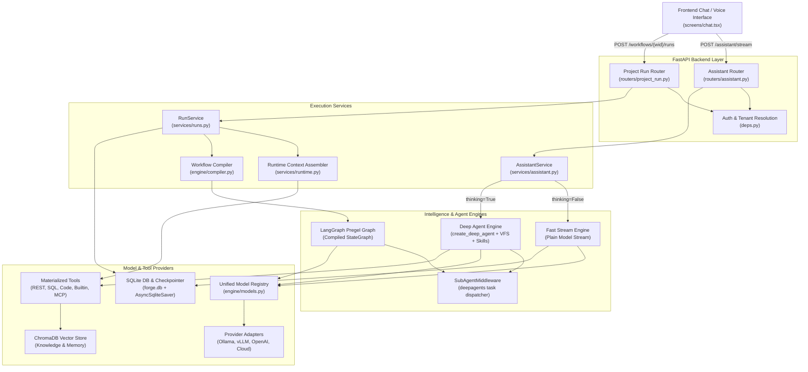

# Alberto — Intelligence & Execution Architecture Audit

**Target Deliverable:** `docs/architecture/BUTLER_INTELLIGENCE_AUDIT.md`  
**System Target:** Local-First AI Home Butler  
**Scope:** Execution Architecture, Request Lifecycle, Intent Classification, Coordinator/Subagents, Model Resolution, Tool Execution, Memory/Context, Performance, and Observability.

---

## 1. Existing Architecture & Actual Execution Paths

Alberto currently operates as an agentic platform engine with dual execution surfaces:
1. **Forge Assistant Surface (`/v1/projects/{pid}/assistant/stream`)** — Meta-agent designed for platform self-construction (building tools, workflows, Q&A, and agent presets).
2. **Workflow Run Surface (`/v1/projects/{pid}/workflows/{wid}/runs` and `/v1/projects/{pid}/run`)** — Graph runtime executing compiled LangGraph topologies (`agent`, `deep_agent`, `router`, `parallel_fanout`, `classifier`, etc.).

### 1.1 Trace of User Message (Step-by-Step)

```
[User Message via Web UI / Chat Screen / Voice]
                         │
                         ▼
┌────────────────────────────────────────────────────────┐
│ 1. Frontend Client ([chat.tsx](file:///c:/Users/oksbw/OneDrive/Desktop/Workspace/Alberto/frontend/components/screens/chat.tsx))                       │
│    - Evaluates target selector: `assistant` vs `wid`   │
│    - Encapsulates `message`, `thread_id`, `model`,     │
│      `thinking` flag                                   │
└────────────────────────┬───────────────────────────────┘
                         │ SSE POST
                         ▼
┌────────────────────────────────────────────────────────┐
│ 2. Assistant Router ([routers/assistant.py](file:///c:/Users/oksbw/OneDrive/Desktop/Workspace/Alberto/backend/forge/routers/assistant.py))             │
│    - Endpoint: `POST .../assistant/stream`             │
│    - Auth: `current_tenant_id` via [deps.py](file:///c:/Users/oksbw/OneDrive/Desktop/Workspace/Alberto/backend/forge/deps.py)            │
│    - Project check: `ProjectService.get(session, ...)` │
│    - Checks out DB session immediately (no leak)       │
└────────────────────────┬───────────────────────────────┘
                         │
                         ▼
┌────────────────────────────────────────────────────────┐
│ 3. Assistant Service ([services/assistant.py](file:///c:/Users/oksbw/OneDrive/Desktop/Workspace/Alberto/backend/forge/services/assistant.py))          │
│    - Checks `thinking` flag:                           │
│      ├─ False (Default) ──► `_fast_stream`             │
│      └─ True  ────────────► `_build_agent` + `_run`    │
└────────────────────────┬───────────────────────────────┘
                         │
        ┌────────────────┴────────────────┐
        ▼                                 ▼
┌──────────────────────────────┐  ┌──────────────────────────────┐
│ Fast Stream Path             │  │ Deep Agent Path              │
│ - Zero intent classification │  │ - `create_deep_agent`        │
│ - Keyword check:             │  │ - Planning: `write_todos`    │
│   `"what workflow"`, etc.    │  │ - Composite Backend (VFS)    │
│ - If match: binds meta-tools │  │ - Skills (`/skills/`)        │
│   `list_resources`,          │  │ - Full 18+ Forge meta-tools  │
│   `describe_workflow`        │  │ - `interrupt_on: delete_wf`  │
│ - If no match: model called  │  │ - 100 superstep recursion    │
│   with NO tools              │  │                              │
└──────────────┬───────────────┘  └──────────────┬───────────────┘
               │                                 │
               └────────────────┬────────────────┘
                                │
                                ▼
┌────────────────────────────────────────────────────────┐
│ 4. Model Resolution ([engine/models.py](file:///c:/Users/oksbw/OneDrive/Desktop/Workspace/Alberto/backend/forge/engine/models.py))                  │
│    - Resolves via `resolve_model(model_ref, ctx)`      │
│    - Checks `RegisteredModel` in Alberto Model Registry│
│    - Checks `ModelServer` & Provider Adapter           │
│    - Formats Ollama / vLLM / OpenAI parameters         │
└────────────────────────┬───────────────────────────────┘
                         │
                         ▼
┌────────────────────────────────────────────────────────┐
│ 5. Execution & Streaming                               │
│    - Async generator yields SSE frames:                │
│      `messages`, `tool`, `todos`, `interrupt`, `done`  │
│    - Callbacks via `ForgeTracer` collect spans         │
└────────────────────────┬───────────────────────────────┘
                         │
                         ▼
┌────────────────────────────────────────────────────────┐
│ 6. Finalization & Persistence                          │
│    - `_persist_trace` writes `Trace` + `Span` records  │
│    - Client renders token waterfall and activity       │
└────────────────────────────────────────────────────────┘
```

---

## 2. Mermaid Architecture & Sequence Diagrams

### 2.1 Actual Runtime Architecture Diagram



### 2.2 Actual Execution Sequence: User Message Turn

```mermaid
sequenceDiagram
    autonumber
    actor User
    participant Frontend as Frontend (chat.tsx)
    participant Router as Assistant Router
    participant Service as AssistantService
    participant Ctx as Runtime Assembler
    participant Registry as Model Registry
    participant Engine as LangChain / Model
    participant Tracer as ForgeTracer
    participant DB as SQLite / Persistence

    User->>Frontend: Send message ("Turn off living room lamp")
    Frontend->>Router: POST /v1/projects/{pid}/assistant/stream {message, thread_id, thinking: false}
    Router->>DB: ProjectService.get(tenant_id, pid)
    DB-->>Router: Project validated
    Router->>Service: stream(tenant_id, pid, messages, thread_id, thinking=false)
    
    alt thinking == false (Fast Path)
        Service->>Service: _fast_stream()
        Service->>DB: build_compile_context(session, tenant_id, pid)
        Note over Service,DB: Queries Project, Tenant, Models, Tools, Components, MCPs
        DB-->>Service: CompileContext
        Service->>Registry: resolve_model(ctx.default_model, ctx)
        Registry-->>Service: BaseChatModel instance
        Service->>Service: Keyword check ("what workflow", "my tools", etc.)
        Note over Service: Query is home command; keyword match fails!
        Note over Service: Zero tools bound to model!
        Service->>Engine: runnable.astream([SystemMessage, HumanMessage])
        loop Model Token Streaming
            Engine-->>Service: AIMessageChunk
            Service-->>Frontend: SSE event: messages {content: "I cannot..."}
            Frontend-->>User: Display text
        end
        Service->>DB: _persist_trace(Trace, Spans)
        Service-->>Frontend: SSE event: done {tokens, status}
    else thinking == true (Deep Agent Path)
        Service->>Ctx: _build_agent()
        Note over Ctx: Spawns create_deep_agent with write_todos + virtual filesystem
        Service->>Registry: resolve_model(primary_ref, ctx, thinking=True)
        Registry-->>Service: BaseChatModel
        Service->>Engine: agent.astream(payload, config)
        loop Multi-step ReAct loop
            Engine-->>Service: updates (todos, tool calls)
            Service-->>Frontend: SSE event: todos / tool
        end
        Service->>DB: _persist_trace()
        Service-->>Frontend: SSE event: done
    end
```

---

## 3. Components Already Implemented

| Component | Implementation File | Status & Role in System |
|---|---|---|
| **Unified Model Registry** | [`backend/forge/engine/models.py`](file:///c:/Users/oksbw/OneDrive/Desktop/Workspace/Alberto/backend/forge/engine/models.py) | **Implemented**: Resolves models from DB `RegisteredModel` and `ModelServer`. Enforces enabled state, context window limits, and parameter defaults. |
| **Local Provider Adapters** | [`backend/forge/engine/providers.py`](file:///c:/Users/oksbw/OneDrive/Desktop/Workspace/Alberto/backend/forge/engine/providers.py) | **Implemented**: Native connection testing, model discovery, context extraction (via Ollama `/api/show` & OpenAI `/v1/models`), and tool-calling verification for Ollama, vLLM, LM Studio, and OpenAI-compatible endpoints. |
| **LangGraph Workflow Engine** | [`backend/forge/engine/compiler.py`](file:///c:/Users/oksbw/OneDrive/Desktop/Workspace/Alberto/backend/forge/engine/compiler.py) | **Implemented**: Compiles node/edge definitions into runnable `CompiledStateGraph` with conditional branching, parallel fanout, router nodes, and subgraph propagation. |
| **ReAct & Deep Agent Nodes** | [`backend/forge/nodes/agent_node.py`](file:///c:/Users/oksbw/OneDrive/Desktop/Workspace/Alberto/backend/forge/nodes/agent_node.py) | **Implemented**: Standard ReAct agent node via `create_agent` and deep agent supervisor via `SubAgentMiddleware`, supporting dynamic system prompts, UI widget components, and memory capability tools. |
| **Comprehensive Middleware Stack** | [`backend/forge/engine/middleware_compiler.py`](file:///c:/Users/oksbw/OneDrive/Desktop/Workspace/Alberto/backend/forge/engine/middleware_compiler.py) | **Implemented**: 19 prebuilt middlewares (Summarization, Human-in-the-loop, Tool/Model call limits, Model fallbacks, PII redaction, Retries, Context editing, Dynamic prompt/model rules, Semantic cache). |
| **Tool Execution & Reliability** | [`backend/forge/tools/materialize.py`](file:///c:/Users/oksbw/OneDrive/Desktop/Workspace/Alberto/backend/forge/tools/materialize.py) | **Implemented**: Materializes REST, GraphQL, Code, SQL, Builtin, and MCP tools with server-side entitlement checks, per-tool rate limiting, caching, and retry logic. |
| **MCP Client Subsystem** | [`backend/forge/tools/mcp.py`](file:///c:/Users/oksbw/OneDrive/Desktop/Workspace/Alberto/backend/forge/tools/mcp.py) | **Implemented**: Async connection pooling, TTL caching, background transport reaping, and dynamic tool schema extraction for external MCP servers over HTTP/SSE/stdio. |
| **Durable Execution & Checkpointing** | [`backend/forge/services/runs.py`](file:///c:/Users/oksbw/OneDrive/Desktop/Workspace/Alberto/backend/forge/services/runs.py) | **Implemented**: Per-thread checkpointer (`AsyncSqliteSaver`), thread locking, tenant concurrency slots, run broker for detached SSE streaming, and client reconnection recovery via `Last-Event-ID`. |
| **Semantic Memory Service** | [`backend/forge/services/memory.py`](file:///c:/Users/oksbw/OneDrive/Desktop/Workspace/Alberto/backend/forge/services/memory.py) | **Implemented**: SQLite `memories` table + ChromaDB vector collection (`forge_mem_<dim>`), partitioned per tenant, project, and user scope. |
| **Knowledge Base (RAG & FAQ)** | [`backend/forge/knowledge/store.py`](file:///c:/Users/oksbw/OneDrive/Desktop/Workspace/Alberto/backend/forge/knowledge/store.py) | **Implemented**: Hybrid search combining dense embeddings (BGE/Chroma) and BM25 lexical search with Reciprocal Rank Fusion (RRF), folder scoping, and provenance tracking. |
| **Execution Tracing & Spans** | [`backend/forge/tracing/tracer.py`](file:///c:/Users/oksbw/OneDrive/Desktop/Workspace/Alberto/backend/forge/tracing/tracer.py) | **Implemented**: In-memory `ForgeTracer` callback capturing LLM spans, tool I/O, subagent dispatches, token usage, latency, and costs, persisted to SQLite `traces` and `spans`. |
| **Household RBAC & Auth** | [`backend/forge/deps.py`](file:///c:/Users/oksbw/OneDrive/Desktop/Workspace/Alberto/backend/forge/deps.py), [`services/auth.py`](file:///c:/Users/oksbw/OneDrive/Desktop/Workspace/Alberto/backend/forge/services/auth.py) | **Implemented**: Token decoding, fallback developer authentication, role rank hierarchy (`owner` > `admin` > `editor` > `viewer`), and end-user entitlement gating. |

---

## 4. Missing Capabilities

1. **Butler Execution Disconnect**:
   - The primary conversational entrypoint (`AssistantService`) is hardcoded as a **platform developer assistant** whose tools create and inspect workflows and tools.
   - Household devices, home automation actions, and memory tools are NOT exposed to the conversational chat loop by default.
2. **Intent & Request Routing Layer**:
   - Zero classification on incoming user turns. Alberto cannot distinguish between chit-chat, a single home action ("turn on porch light"), a multi-step routine ("goodnight routine"), a memory recall, or an automation query.
3. **Proactive Long-Term Memory Injection**:
   - `MemoryService` is only accessed if an agent explicitly invokes the `recall` tool. Memories are never pre-fetched and injected into prompt context.
4. **Structured Subagent Contract**:
   - Deep agent subagents return unstructured text strings via deepagents' `task` tool. There is no schema validation or structured JSON contract for subagent outcomes.
5. **Context Window Token Budgeting for Local Models**:
   - No token budget calculation before dispatching inference requests. On 8K–16K local models, conversation history + bloated system prompts + all tool schemas frequently cause context length overflow errors.
6. **Centralized Sensitive Action Policy for Home Automation**:
   - HITL approval (`HumanInTheLoopMiddleware`) exists, but triggers are manually configured per workflow node or hardcoded in `AssistantService` (`delete_workflow`). No centralized policy marks sensitive home operations (smart locks, garage doors, security disarm, camera deletion) as requiring confirmation.
7. **Fine-Grained Device Permissions**:
   - RBAC is limited to platform roles (`owner`, `admin`, `editor`, `viewer`). There is no device-level or room-level permission model (e.g., guest vs child vs parent).

---

## 5. Duplicate or Unnecessary Execution Layers

1. **Dual Chat Surfaces**:
   - `AssistantService` (`/assistant/stream`) and `RunService` (`/workflows/{wid}/runs` and `/project/run`) duplicate SSE framing, error masking, trace persistence, and thread resumption.
2. **Double Agent Construction in Assistant**:
   - `_fast_stream` manually parses messages and handles tools with an ad-hoc loop, while `_build_agent` constructs a full `create_deep_agent` with VFS and skills. Both bypass the standard `create_agent` workflow compiler.
3. **Redundant Heavy Model Checks**:
   - `_assistant_model_ref` contains hardcoded cloud model mappings (`_STRONG`: `claude-sonnet-4-6`, `gpt-4.1-mini`, `gemini-2.5-flash`) that override the user's configured default model if legacy cloud credentials exist.
4. **Over-Materialization in Compile Context**:
   - `build_compile_context` runs 8+ database queries, materializes all REST/SQL/Code tools, and connects to all enabled MCP servers on EVERY turn, even if the user only said "hi".

---

## 6. Security & Reliability Risks

1. **Bypassing Entitlement Gate on Builtin Tools**:
   - In [`tools/materialize.py`](file:///c:/Users/oksbw/OneDrive/Desktop/Workspace/Alberto/backend/forge/tools/materialize.py#L146-L149), `builtin` tools (`web_fetch`, `knowledge_search`, `remember`, `recall`) bypass `_wrap_reliability`. They do not enforce `entitlement_denial`, rate limiting, or retry logic.
2. **Hardcoded Cloud Fallback Leakage**:
   - If a project contains stale cloud API credentials, `_assistant_model_ref` silently routes traffic to external cloud providers instead of staying on local offline models.
3. **Unbounded Recursion & Absence of Per-Turn Wall-Clock Timeout in Assistant**:
   - `AssistantService` uses a hardcoded recursion limit of 100 supersteps and lacks the wall-clock timeout checking present in `RunService._drive` (`RUN_WALL_CLOCK_TIMEOUT_SECONDS`). A hanging local model or looped ReAct tool call locks worker resources indefinitely.
4. **Tool Name Collision Across Heterogeneous Sources**:
   - While [`agent_node.py`](file:///c:/Users/oksbw/OneDrive/Desktop/Workspace/Alberto/backend/forge/nodes/agent_node.py#L22-L38) dedupes tool names, name collisions between internal tools, MCP tools, and components drop colliding tools with only a warning, potentially silencing critical home tools.
5. **Session Token Entitlement Spoofing**:
   - On the `project_run` endpoint, end-user entitlement injection is checked, but non-editor callers could bypass restrictions if `session_token` decode fails open or falls back to body attributes.

---

## 7. Performance Bottlenecks

| Bottleneck | Location | Root Cause | Impact | Fix Complexity |
|---|---|---|---|---|
| **Eager MCP Connection Discovery** | [`services/runtime.py:209`](file:///c:/Users/oksbw/OneDrive/Desktop/Workspace/Alberto/backend/forge/services/runtime.py#L209) | `server_tools` called for all enabled MCP servers on every turn | Adds 500ms–3500ms per request on network/stdio latency | Low (Lazy discovery / cache) |
| **Exhaustive Context DB Assembly** | [`services/runtime.py:44`](file:///c:/Users/oksbw/OneDrive/Desktop/Workspace/Alberto/backend/forge/services/runtime.py#L44) | 8+ sequential DB queries to load all tools, agents, components, models on every message | 40ms–120ms SQLite/Postgres overhead per turn | Low (Request-scoped caching / selective loading) |
| **Full Tool Schema Injection** | [`nodes/agent_node.py:259`](file:///c:/Users/oksbw/OneDrive/Desktop/Workspace/Alberto/backend/forge/nodes/agent_node.py#L259) | All project tools bound to model simultaneously | Consumes 2K–6K tokens of context window; degrades local model speed and precision | Medium (Tool scoping / category filtering) |
| **Deep Agent Overhead for Simple Inquiries** | [`services/assistant.py:857`](file:///c:/Users/oksbw/OneDrive/Desktop/Workspace/Alberto/backend/forge/services/assistant.py#L857) | `create_deep_agent` bundles todos, filesystem backend, and 18+ tools when `thinking=True` | Up to 6x token inflation for simple queries | Low (Intent-based routing) |
| **Model Adapter Re-instantiation** | [`engine/providers.py:222`](file:///c:/Users/oksbw/OneDrive/Desktop/Workspace/Alberto/backend/forge/engine/providers.py#L222) | Creates new `ChatOpenAI` instance per model call without HTTP connection pooling | Ephemeral TCP/TLS handshakes to local vLLM/Ollama endpoints | Low (Connection keep-alive client injection) |
| **Unbounded Conversation History** | [`services/assistant.py:1027`](file:///c:/Users/oksbw/OneDrive/Desktop/Workspace/Alberto/backend/forge/services/assistant.py#L1027) | Passes full raw message list to `astream` without trimming | Context window overflow on 8K local models after 10–15 turns | Low (Sliding window / context editing middleware) |

---

## 8. Proposed Minimal Target Architecture

To function as a responsive, reliable Home Butler without rewriting LangGraph or adding external services:

```
                          ┌──────────────────────────┐
                          │   User Message / Voice   │
                          └─────────────┬────────────┘
                                        │
                                        ▼
                          ┌──────────────────────────┐
                          │ Deterministic Classifier │
                          │ (Regex / Rule Router)    │
                          └──────┬──────┬──────┬─────┘
           ┌─────────────────────┘      │      └─────────────────────┐
           ▼                            ▼                            ▼
┌──────────────────────┐    ┌──────────────────────┐    ┌──────────────────────┐
│ Direct Conversation  │    │ Device / Tool Action │    │ Multi-Step Routine   │
│ (Zero tools, 1 turn) │    │ (Scoped Tool Subset) │    │ (LangGraph Butler)   │
├──────────────────────┤    ├──────────────────────┤    ├──────────────────────┤
│ - Conciseness prompt │    │ - Home device tools  │    │ - ReAct / Workflow   │
│ - Zero tool schemas  │    │ - Entitlement check  │    │ - Pre-recalled memory│
│ - Max token speed    │    │ - HITL gate for lock │    │ - ToolCallLimit (5)  │
└──────────┬───────────┘    └──────────┬───────────┘    └──────────┬───────────┘
           │                           │                           │
           └───────────────────────────┼───────────────────────────┘
                                       ▼
                     ┌───────────────────────────────────┐
                     │ Context & Token Budget Controller │
                     │ - History pruned to last N turns  │
                     │ - Sliding window context editing  │
                     │ - Verified within model max_ctx   │
                     └─────────────────┬─────────────────┘
                                       ▼
                     ┌───────────────────────────────────┐
                     │ Active Model Registry (Ollama/LM) │
                     │ - Reused keep-alive HTTP client   │
                     │ - Local-first parameter enforcement│
                     └─────────────────┬─────────────────┘
                                       ▼
                     ┌───────────────────────────────────┐
                     │ Stream Broker & Activity Tracing  │
                     │ - Monotonic SSE event frames      │
                     │ - Persistent spans & token totals │
                     └───────────────────────────────────┘
```

---

## 9. Prioritized Implementation Recommendations

All recommendations adhere to the classification taxonomy:
- **KEEP** — Already suitable and functional.
- **REFINE** — Exists in codebase but requires modifications.
- **ADD** — Missing capability that must be introduced.
- **REMOVE** — Redundant or harmful component to be eliminated.
- **DEFER** — Out of scope for current local Butler milestone.

| ID | Area | Recommendation | Classification | Rationale & Scope |
|---|---|---|---|---|
| **R1** | **Routing** | **Rule-Based Intent Classifier** in request path | **ADD** | Classify query before LLM call: (1) Chit-chat, (2) Direct device action, (3) Memory inquiry, (4) Complex automation. Eliminates ReAct loop overhead for 70%+ of butler interactions. |
| **R2** | **Assistant** | **Unify Assistant with Project Butler Workflow** | **REFINE** | Change default chat target from meta-builder assistant to the project's configured Butler workflow. Butler should have access to home tools, not platform CRUD. |
| **R3** | **Assistant** | **Deprecate Hardcoded Builder Tools in Fast Path** | **REMOVE** | Remove keyword checking for `"what workflow"`, `"my tools"` in [`services/assistant.py`](file:///c:/Users/oksbw/OneDrive/Desktop/Workspace/Alberto/backend/forge/services/assistant.py#L1014). Let tool routing handle tool attachment. |
| **R4** | **Model Resolution** | **Enforce Local Default Over Legacy Cloud Credentials** | **REFINE** | In [`engine/models.py`](file:///c:/Users/oksbw/OneDrive/Desktop/Workspace/Alberto/backend/forge/engine/models.py) and `_assistant_model_ref`, prioritize `ctx.default_model_id` / configured local model registry entry over `_STRONG` cloud dictionary. |
| **R5** | **Performance** | **Lazy MCP Server Loading** | **REFINE** | Cache MCP tool schemas with TTL in `_CLIENT_CACHE`; do not execute network/stdio discovery on every turn in `build_compile_context`. |
| **R6** | **Context** | **Sliding Window & Token Budgeting for Local Models** | **ADD** | Enforce automatic history truncation (`ContextEditingMiddleware` or last 8 turns) and verify prompt size against `context_window_max` before model invocation. |
| **R7** | **Memory** | **Proactive Long-Term Memory Retrieval** | **ADD** | Pre-fetch top-2 relevant memories via `MemoryService.recall` during context assembly for user turns, injecting into prompt rather than relying on reactive tool calls. |
| **R8** | **Tools** | **Apply Reliability & Entitlement Wrapper to Builtins** | **REFINE** | Wrap builtin tools (`remember`, `recall`, `web_fetch`, `knowledge_search`) in `_wrap_reliability` in [`tools/materialize.py`](file:///c:/Users/oksbw/OneDrive/Desktop/Workspace/Alberto/backend/forge/tools/materialize.py) for rate limits and security gates. |
| **R9** | **Safety** | **Centralized Household Sensitive Action Policy** | **ADD** | Mark high-risk tool operations (locks, security, destructive edits) with `sensitive: true` and enforce LangGraph HITL interrupt before execution. |
| **R10** | **Subagents** | **Standardized Subagent JSON Contract** | **REFINE** | Require subagents to return structured JSON (`status`, `summary`, `result`) via response format schema to prevent unparseable free-text loop failures. |
| **R11** | **Subagents** | **Subagent Iteration & Timeout Guards** | **ADD** | Bind `ModelCallLimitMiddleware(run_limit=5)` and per-subagent timeout to prevent infinite subagent loops. |
| **R12** | **Performance** | **HTTP Keep-Alive Client for Local Providers** | **REFINE** | Share persistent `httpx.AsyncClient` in `ProviderAdapter.build_chat_model` for Ollama and vLLM to eliminate per-request TCP handshakes. |
| **R13** | **Observability** | **Expose ReAct Iteration Count & Butler Latency in Traces** | **KEEP** | Existing `ForgeTracer` and span persistence already capture spans, token totals, and costs. Refine UI turn summary to display tool latency breakdown. |
| **R14** | **Database** | **External Vector DB / Redis Service** | **DEFER** | Alberto's embedded ChromaDB + SQLite persistence is optimal for local-first deployment. Additional services violate simplicity constraint. |
| **R15** | **Architecture**| **LangGraph Framework Rewrite** | **DEFER** | Existing Pregel graph compilation and checkpointer infrastructure is solid; issues reside in tool scoping and routing, not LangGraph itself. |

---

## 10. Required Regression Tests

Before and during execution improvements, the following regression test suites must pass:

1. **Model Registry Resolution Tests (`backend/tests/test_model_registry.py`)**:
   - Verify registered local model with custom temperature/top_p is resolved without reinitializing or falling back to cloud.
   - Verify disabled model server raises predictable error and does not hang.
2. **Conversation Continuation Tests (`backend/tests/test_runs.py`)**:
   - Verify `thread_id` continuity across 10 turns without memory loss or checkpointer desynchronization.
   - Verify token usage stays bounded under sliding-window history.
3. **HITL Interrupt and Resume Tests (`backend/tests/test_hitl.py`)**:
   - Verify sensitive tool call raises interrupt, emits `interrupt` SSE frame, and pauses graph.
   - Verify `POST /resume` with `approve` executes tool and completes turn; `reject` aborts safely.
4. **Tool Reliability and Entitlement Tests (`backend/tests/test_tools.py`)**:
   - Verify entitlement denial blocks unauthorized user before tool invocation.
   - Verify rate limiting triggers when threshold is exceeded.
5. **Streaming Frame Parity Tests (`backend/tests/test_assistant.py`)**:
   - Verify SSE frames maintain exact sequence: `messages` (chunks) -> `tool` (if any) -> `done`.
   - Verify client disconnect does not corrupt thread state or checkpointer.
6. **Local Model Context Limit Test (`backend/tests/test_local_budget.py`)**:
   - Verify simulated 8K context window model receives pruned history and does not trigger provider length error.
