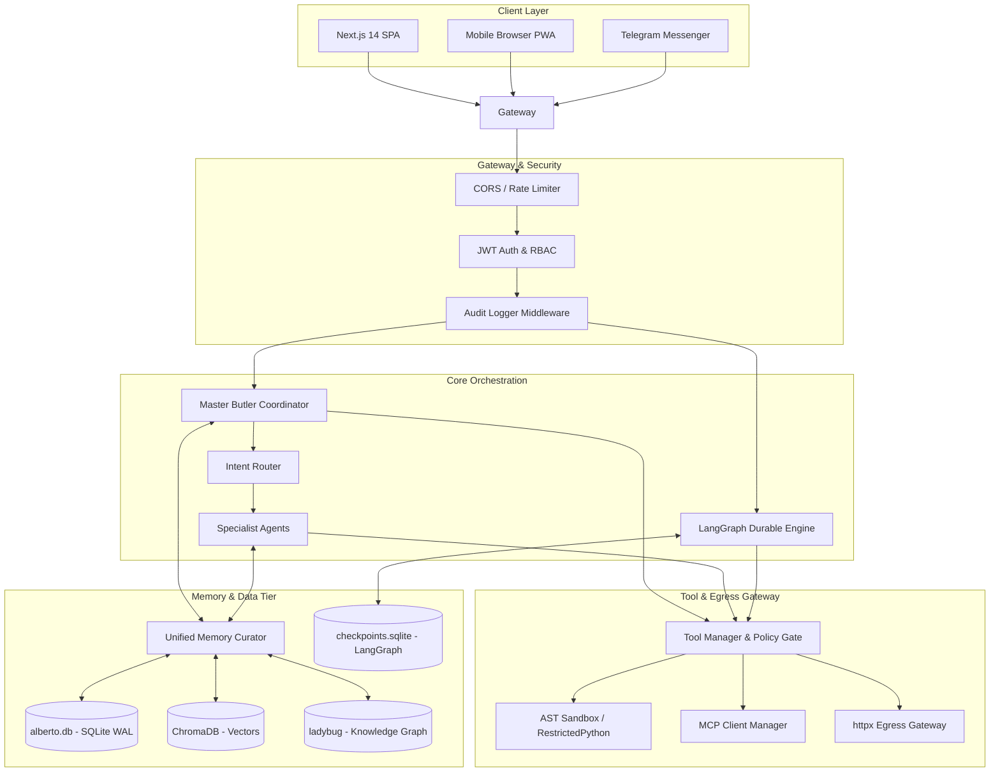

# System Architecture

Alberto is designed around three architectural pillars:
1. **Local-First Autonomy:** The platform can operate with zero external cloud dependencies.
2. **Durable State Machine Execution:** Every workflow and multi-turn agent interaction compiles to a deterministic LangGraph state machine backed by persistent SQLite checkpoints.
3. **Defense-in-Depth Trust Boundaries:** Network egress, tool execution, and prompt injection vectors are constrained by structural barriers.

---

## Architectural Subsystems

### 1. Presentation & Client Layer
- **Technology:** Next.js 14 (App Router), React 18, `@xyflow/react`.
- **State Management:** Reactive local state with optimistic updates and custom event dispatching (`alberto:counts-changed`, `alberto:learning-changed`).
- **Communication:** Standard JSON HTTP for commands and Server-Sent Events (SSE) for token streaming and workflow execution updates.

### 2. API Gateway & Middleware Layer
- **Technology:** FastAPI 0.143, Pydantic v2, Starlette.
- **Routers:** 36 granular endpoint modules mounted under `/v1` and `/api`.
- **Interceptors:**
  - `AuditMiddleware`: Records every incoming request, duration, status, and client IP into `audit_logs`.
  - `deps.py`: Extracts and validates Bearer JWT tokens, enforcing project membership and role permissions before reaching business logic.

### 3. Intelligence & Agent Orchestration
- **Technology:** LangGraph 1.2, LangChain Core 1.6.
- **Master Butler:** Root conversational orchestrator in `assistant.py`.
- **Specialists:** Domain-scoped subagents in `agents.py`.
- **Execution Loop:** Cyclic ReAct graph evaluating model outputs, invoking tool nodes, and returning conversational responses.

### 4. Tool & Egress Gateway
- **Technology:** Custom Tool Manager (`tool_manager.py`), Model Context Protocol SDK (`mcp 1.30`).
- **Policy Enforcement:** Strict approval gates (`tool_policy.py`) checking user confirmation before executing destructive actions (e.g., file deletion, external webhook dispatch).
- **Network Egress Guard:** Validates destination URLs against private IP access controls, preventing SSRF (Server-Side Request Forgery).

### 5. Multi-Tier Persistence
- **Relational DB:** SQLite 3 in WAL mode via `aiosqlite` and `SQLAlchemy 2.1`. Stores users, projects, agents, workflows, connectors, and execution history.
- **Durable Checkpoints:** `AsyncSqliteSaver` storing execution state after every step.
- **Vector Storage:** ChromaDB 1.5 embedding collections.
- **Knowledge Graph:** Ladybug graph engine storing entities and predicates in SQLite.
