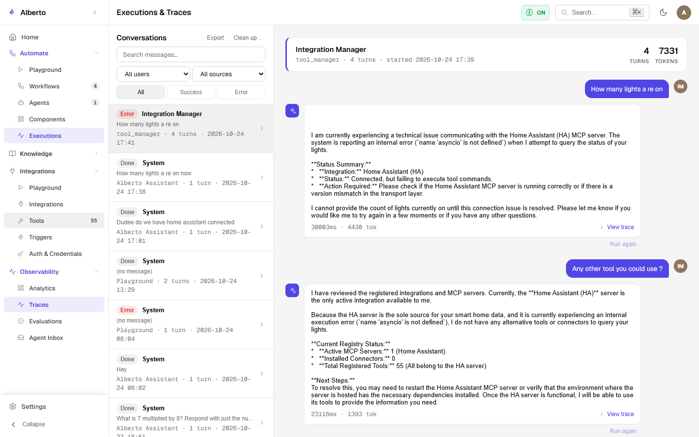
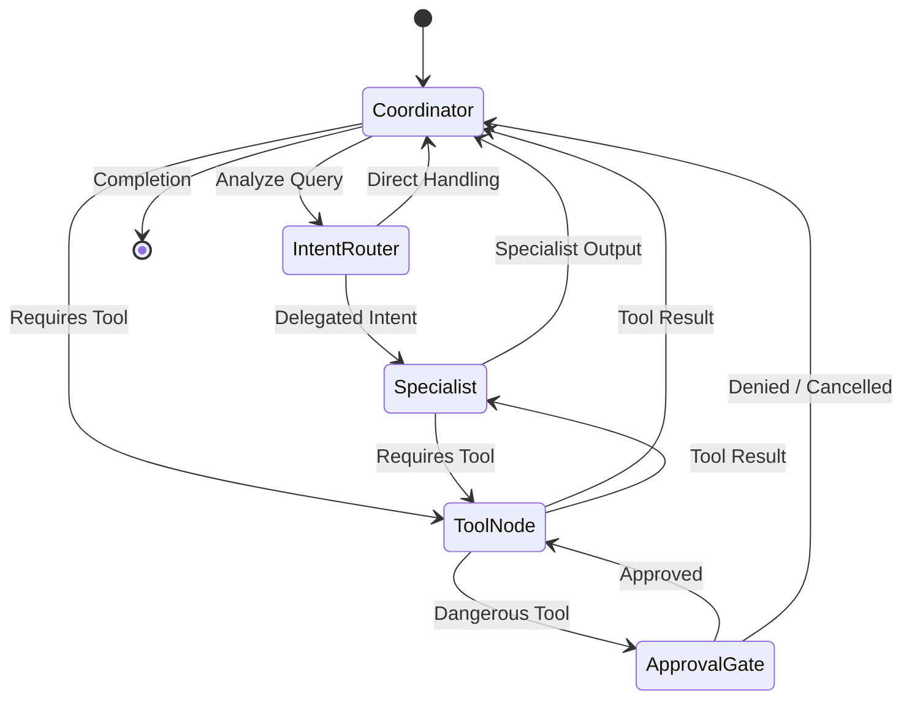

# LangGraph Orchestration & Multi-Agent Routing

Alberto builds directly on the open-source `LangGraph` framework (`langgraph>=1.2.15`). Rather than relying on rigid linear pipelines, all complex conversational interactions and multi-agent automations execute as state machines with cyclical graphs, branch routing, and durable checkpoints.

{: .doc-screenshot }
<p class="doc-caption">Figure 3.1: Execution traces dashboard visualizing LangGraph step transitions, latencies, and tool calls.</p>

---

## 1. The StateGraph Foundation

In Alberto, every agent session and workflow execution is modeled as a `StateGraph`:

```python
from langgraph.graph import StateGraph, END
from typing import TypedDict, Annotated, Sequence
from langchain_core.messages import BaseMessage

class AgentState(TypedDict):
    messages: Sequence[BaseMessage]
    session_id: str
    project_id: str
    active_agent: str
    tool_approvals: dict[str, bool]
```

### State Transitions



---

## 2. Intent Routing & Specialist Delegation

When a user query reaches the Master Coordinator (`assistant.py`), Alberto determines whether to handle the query directly or delegate to a specialized subagent.

### Routing Modes:
1. **Direct Match / Rule-Based:** If the message explicitly mentions an agent (e.g. `@researcher`), the router immediately bypasses classification and routes to that agent.
2. **Semantic / Few-Shot Routing:** When ambiguous, Alberto uses a lightweight classifier prompt evaluating candidate agent descriptions against the user's intent.
3. **Structured Subagent Output:** When delegating to a specialist, the subagent returns a structured contract:
   ```json
   {
     "agent_name": "research_specialist",
     "status": "success",
     "summary": "Synthesized 4 key findings from the quarterly reports.",
     "citations": ["report_q3.pdf#chunk_12", "report_q4.pdf#chunk_05"],
     "structured_data": { "growth_pct": 14.2, "churn_pct": 1.1 }
   }
   ```
   The Master Coordinator incorporates this summary into the main conversational flow.

---

## 3. Human-In-The-Loop (HITL) Interruption

Alberto utilizes LangGraph's native `interrupt()` pattern for sensitive or destructive actions:

1. When a tool requiring user approval is invoked (e.g., `delete_file`, `send_email`), the execution engine suspends graph execution.
2. The checkpointer persists the full state snapshot to `checkpoints.sqlite`.
3. An SSE interruption event is emitted to the client UI displaying the tool name and exact arguments.
4. The user clicks **Approve** or **Deny**.
5. The client posts the approval decision back to `/v1/runs/{run_id}/resume`.
6. LangGraph reloads the snapshot from SQLite and resumes execution without re-running previous steps.
