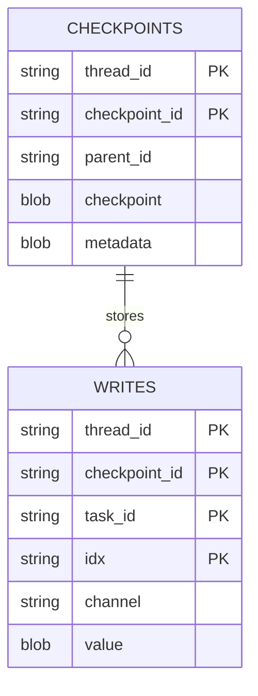

# Persistence Architecture

Alberto's persistence tier is designed around local-first durability, isolation, and simplified zero-maintenance operations.

---

## 1. Storage Boundaries & Directory Layout

All application state is confined to a single directory hierarchy controlled by `ALBERTO_DATA_DIR` (default: `./data`):

```text
/data
├── db/
│   ├── alberto.db          # Relational entities (users, projects, agents, workflows, secrets)
│   ├── checkpoints.sqlite  # LangGraph checkpointer state snapshots
│   ├── queue.sqlite        # Background job queue and lease manager
│   └── ladybug/            # Entity-relationship knowledge graph tables
├── chroma/                 # Embedded ChromaDB vector index and metadata
├── models/
│   └── fastembed/          # ONNX embedding model weights cache
└── config/
    └── master.key          # AES-GCM-256 secret vault key
```

---

## 2. Relational Database (`alberto.db`)

Managed via `SQLAlchemy 2.1` and `aiosqlite`.

### SQLite Configuration Pragmas
Upon establishing each database connection pool, Alberto configures high-concurrency pragmas:

```sql
PRAGMA journal_mode = WAL;
PRAGMA synchronous = NORMAL;
PRAGMA busy_timeout = 10000;
PRAGMA foreign_keys = ON;
PRAGMA cache_size = -64000; -- 64MB memory page cache
```

- **WAL (Write-Ahead Logging):** Allows concurrent readers without blocking writers, and writers without blocking readers.
- **Synchronous = NORMAL:** Ensures durability across application crashes while optimizing I/O throughput.
- **Busy Timeout = 10s:** Prevents immediate `database is locked` exceptions during bursty writes by pausing and retrying.

---

## 3. Durable Checkpointing (`checkpoints.sqlite`)

Workflow and agent graph states are persisted using `langgraph.checkpoint.sqlite.aio.AsyncSqliteSaver`:



- **Step Isolation:** After every node transition, LangGraph serializes the full execution state (variables, messages, tool calls) into the checkpoint database.
- **Resumability:** Workflows interrupted for user approval or server restarts resume from the exact last checkpoint without re-running prior nodes.

---

## 4. Vector Storage (`chroma/`)

Vector storage is managed by embedded **ChromaDB**:
- Storage is partitioned by collections per project.
- Embeddings are generated using local FastEmbed (`bge-small-en-v1.5`, 384 dimensions) or external providers.
- Similarity search uses cosine distance indexing with persistent HNSW graph structures.
