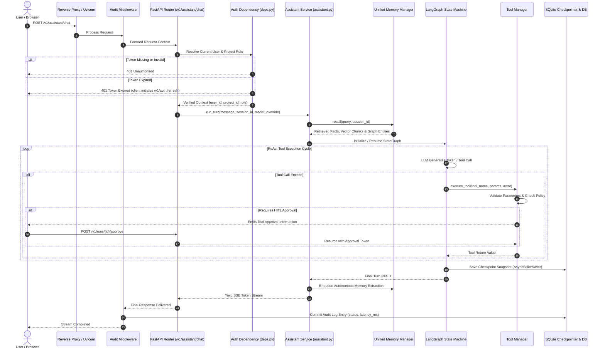

# Request Lifecycle

This document traces the complete lifecycle of a request through the Alberto platform, examining middleware interception, authentication verification, agent dispatch, tool execution, and response streaming.

---

## High-Level Execution Sequence

---

## Detailed Phase Analysis

### 1. Ingestion & Audit Interception
When an HTTP request enters FastAPI:
- `AuditMiddleware` intercepts the request before it reaches router logic.
- It records `start_time = time.perf_counter()`, extracts the client IP address (`request.client.host`), and reads headers.
- If the endpoint matches an audited route (e.g., `/v1/assistant/*`, `/v1/workflows/*`), an audit entry is queued.

### 2. Dependency Resolution & Authentication
In `backend/alberto/deps.py`:
- `get_current_user` extracts the `Authorization: Bearer <token>` header.
- Decodes the JWT using `ALBERTO_SECRET_KEY` and validates the expiration timestamp (`exp`).
- Queries `users` table to ensure the account is active and has not been revoked.
- `get_project_with_role` verifies that the user is an active member of the specified `project_id` and has appropriate permissions (e.g. `editor` or `owner`).

### 3. Context & Memory Assembly
Inside `backend/alberto/services/assistant.py`:
- Retrieves previous turns for the active `session_id`.
- Performs semantic retrieval across ChromaDB for relevant document chunks.
- Queries the Ladybug knowledge graph for entity triples associated with terms in the prompt.
- Injects assembled facts into the prompt's `<system_context>` block.

### 4. LangGraph Cyclic Execution
The Master Coordinator initiates a `StateGraph`:
- Dispatches prompt to the designated LLM (e.g. `llama3.2` via Ollama or `gpt-4o` via OpenAI).
- If the model emits a tool call, execution pauses and transitions to the `tools` node.
- Tool arguments are validated against Pydantic schemas.
- If the tool is designated `destructive`, execution pauses, an SSE approval event is sent to the client, and execution state is saved to `checkpoints.sqlite`.

### 5. Memory Learning & Streaming Delivery
- Tokens are streamed back via Server-Sent Events (`text/event-stream`).
- After the final chunk is sent, a background task (`MemoryCurator`) reviews the conversation turn. If novel facts or preferences are detected, they are committed to the memory database.
