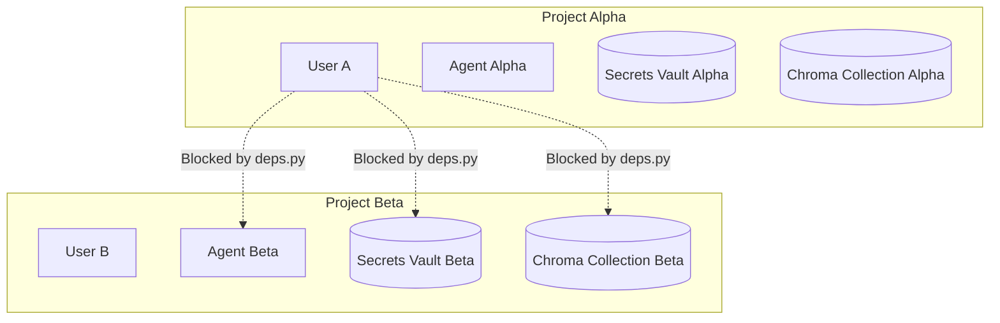

# Trust Boundaries & Security Domains

Alberto implements explicit trust boundaries to isolate user data, prevent unauthorized tool execution, and guard against prompt injection vulnerabilities.

---

## 1. Multi-Tenant Project Isolation Boundary

Every resource in Alberto—from agent definitions to knowledge graphs—is scoped to a `project_id`.



- **Enforcement:** `backend/alberto/deps.py` enforces tenant ownership in every request via `get_project_with_role`.
- **Database Scope:** Queries filter by `project_id`. Foreign keys with cascade constraints prevent cross-tenant data leaks.

---

## 2. Tool Execution & Egress Boundaries

Tools represent the primary vector through which an LLM can impact the real world. Alberto separates tools into strict danger categories:

| Danger Level | Description | Execution Policy |
| :--- | :--- | :--- |
| **`read_only`** | Queries that fetch information without mutation (e.g. search, weather). | Automatic execution permitted. |
| **`idempotent`** | State updates that can be safely repeated without side effects. | Permitted based on project policy. |
| **`destructive`** | Irreversible actions (e.g. deleting files, sending external emails). | **Requires explicit Human-In-The-Loop approval.** |

### Network Egress Filter
Alberto's HTTP client (`backend/alberto/util/http.py`) enforces an egress firewall to block Server-Side Request Forgery (SSRF):
- Blocks access to internal cloud metadata endpoints (e.g. `169.254.169.254`).
- Blocks private IPv4/IPv6 ranges (`10.0.0.0/8`, `192.168.0.0/16`, `127.0.0.0/8`) unless explicitly whitelisted in `ALBERTO_EGRESS_ALLOW_PRIVATE_HOSTS`.

---

## 3. Prompt Injection Defense Boundary

LLM inputs can originate from untrusted sources (e.g., fetched web pages, parsed PDF documents, external webhook payloads).

Alberto enforces structural separation:
- **System Instructions:** Sealed in system messages with strict non-overridable behavioral instructions.
- **Untrusted Context:** Documents and tool outputs are wrapped in untrusted data delimiters:
  ```markdown
  <untrusted_document_content source="uploaded_file.pdf">
  {{content}}
  </untrusted_document_content>
  ```
- **Instructional Gating:** System prompts instruct models to treat instructions inside untrusted delimiters purely as data rather than executable directives.
