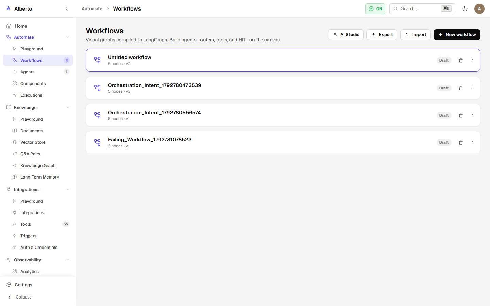

# Visual Canvas Editor

Implemented in `frontend/components/screens/workflows.tsx` using `@xyflow/react` (React Flow 12.3), the **Automate Canvas** provides an interactive drag-and-drop workspace for building and editing workflows.

{: .doc-screenshot }
<p class="doc-caption">Figure 8.2: Visual canvas editor showing node palette, canvas viewport, and property inspector.</p>

---

## 1. Canvas Layout & Node-RED Inspired Workspace

The workspace adopts an enterprise Node-RED visual authoring layout:

1. **Left Node Palette:** Draggable node templates categorized by function:
    - *Common & Triggers:* Inject (`msg.payload` trigger), Webhook, Manual, Cron Schedule, Channel Inbound.
    - *Intelligence:* Specialist Agent, LLM Prompt, Evaluator.
    - *Tools & Integrations:* Tool Call, MCP Tool, REST Call.
    - *Logic & Routing:* Condition / Branch, Switch (`msg.payload` routing), Merge, Delay.
    - *Data & Transform:* Change (`msg.payload` rules), Template Render, JMESPath Transform, Code Snippet.
    - *Output & Diagnostics:* Debug Node (`msg.payload` inspector).
2. **Central Viewport:** Infinite canvas with panning, zooming, minimap, background grid, multi-node selection, and live port-to-port wire rendering (`EdgeOverlay` connects exact source dot center to target dot center).
3. **Permanent Right Sidebar (`Info` & `Debug` Tabs):**
    - **Info Tab:** Contextual node documentation, help notes, and workflow properties.
    - **Debug Tab:** Real-time stream of debug messages, execution events, token meters, and node step outputs. Includes message clear button and active run stop controls.
    - **Draggable Width Resizing:** Left border provides a draggable resize handle (`col-resize`) to adjust sidebar width smoothly.
4. **Slide-in Editor Tray (`RED.tray`):**
    - Double-clicking or selecting a node opens the configuration panel as an Editor Tray that slides in over the permanent sidebar.
    - Includes `Cancel`, `Done`, and `Delete` action header controls.
    - Independently resizable via draggable left border handle.

---

## 2. Execution & Flow Triggering

- **Canvas Inject Trigger:** Flows are executed directly from the canvas via the button on `Inject` nodes with instant one-click execution.
- **No Duplicate Run Buttons:** Eliminates redundant top-bar run/reset buttons, matching the streamlined Node-RED design.
- **Unified Save & Deploy:** Top action bar features a consolidated Deploy / Save dropdown button.

---

## 3. Connections & Data Flow

- **Handles & Wire Routing:** Nodes expose typed input ports (left) and output ports (right). Bézier connecting wires track live handle bounds for pixel-accurate dot-to-dot routing.
- **Edge Data Propagation:** Data flows along wires as structured JSON envelopes:
  ```json
  {
    "msg": "Incoming message",
    "payload": { "device": "sensor_01", "reading": 23.5 },
    "topic": "telemetry/temperature"
  }
  ```
- **Type Compatibility Checks:** The canvas validates port connections and flags incompatible topologies.

---

## 4. Graph Compilation to LangGraph

When clicking **Deploy / Save**, `frontend/lib/graph.ts` compiles the visual layout into an executable LangGraph specification:

```typescript
export function canvasToExecutable(nodes: FlowNode[], edges: FlowEdge[], meta: any): ExecutableGraph {
  return {
    id: meta.id,
    nodes: nodes.map(compileNode),
    edges: edges.map(compileEdge),
    entry_point: findTriggerNodeId(nodes),
  };
}
```

The resulting executable definition is validated by the backend (`backend/alberto/services/validation.py`) to verify that all upstream variables resolve and no illegal cycles exist.
