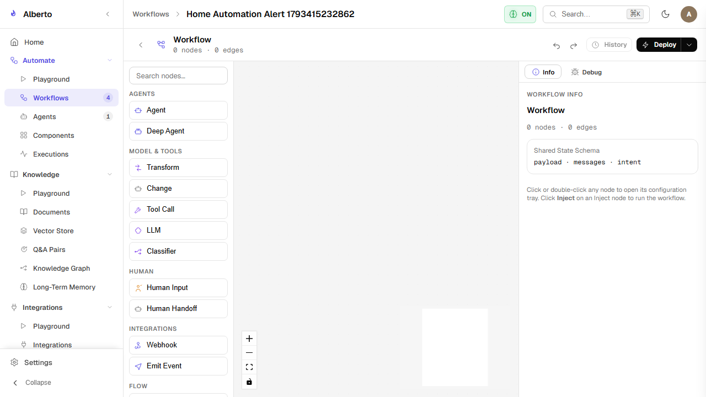
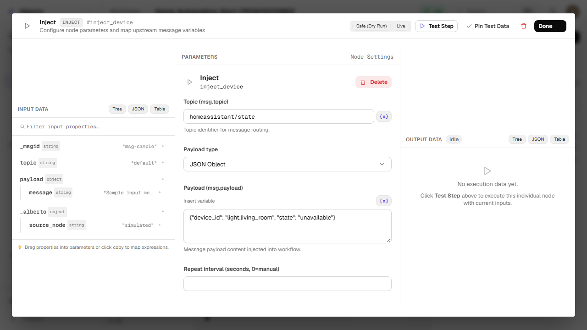

# Visual Canvas Editor

Implemented in `frontend/components/screens/workflows.tsx` using `@xyflow/react` (React Flow 12.3), the **Automate Canvas** provides an interactive drag-and-drop workspace for building and editing workflows.

{: .doc-screenshot }
<p class="doc-caption">Figure 8.2: Visual canvas editor showing compact Node-RED cards, explicit input/output ports, and real-time debug sidebar.</p>

---

## 1. Canvas Layout & Node-RED Inspired Workspace

The workspace adopts an enterprise Node-RED visual authoring layout:

1. **Left Node Palette:** Draggable node templates categorized by function:
    - *Common & Triggers:* Inject (`msg.payload` trigger), Webhook, Manual, Cron Schedule, Channel Inbound.
    - *Intelligence:* Specialist Agent, LLM Prompt, Evaluator.
    - *Tools & Integrations:* Tool Call, MCP Tool, REST Call.
    - *Logic & Routing:* Condition / Branch, Switch (`msg.payload` routing), Merge, Delay.
    - *Data & Transform:* Change (`msg.payload` rules), Template Render, JMESPath Transform, Code Snippet.
    - *Output & Diagnostics:* Debug Node (`msg.payload` inspector).
2. **Central Viewport:** Infinite canvas with panning, zooming, minimap, background grid, multi-node selection, and live port-to-port wire rendering (`EdgeOverlay` connects exact source dot center to target dot center using custom SVG bezier paths inside React Flow's `ViewportPortal`).
3. **Permanent Right Sidebar (`Info` & `Debug` Tabs):**
    - **Info Tab:** Workflow metadata, active revision, description, and export/import options.
    - **Debug Tab:** Real-time debug stream capturing all emitted `msg` frames with secret redaction and hierarchical JSON property trees.
4. **Deploy & Save Controls:** Split deployment button supporting full activation or draft persistence with validation checks.

---

## 2. n8n-Inspired 3-Panel Node Configuration Modal

Clicking any canvas node opens the comprehensive 3-panel configuration dialog (`NodeConfigModal.tsx`):

{: .doc-screenshot }
<p class="doc-caption">Figure 8.3: 3-panel modal showing Input Data tree, Parameters form, and Output Data testing panel with Safe (Dry Run) controls.</p>

```
+-------------------+--------------------------+---------------------+
|    INPUT DATA     |        PARAMETERS        |     OUTPUT DATA     |
|                   |                          |                     |
| Upstream outputs  | Node-specific form       | Single-step test    |
| JSON tree & drag  | Dynamic variable pickers | Safe (Dry-Run)/Live |
| Pinned test data  | Expression editor        | Execution metrics   |
| Combined branches | Save / Done controls     | Output verification |
+-------------------+--------------------------+---------------------+
```

### Key Capabilities:
- **Input Data Panel:** Inspects upstream incoming `msg` properties. Allows pinning test payloads across sessions.
- **Combined Branches View:** When multiple incoming edges converge, displays an aggregated view across all upstream parent branches.
- **Parameters Panel:** Parameter form with upstream variable drag-and-drop and syntax highlighting.
- **Output Data & Step Testing:** Test individual nodes interactively via `POST /v1/projects/{pid}/workflows/{wid}/step`.
- **Keyboard Dismissal & Accessibility:** Standard `Escape` key handler and `Done` confirmation button cleanly close dialogs without obscuring canvas interactions.

---

## 3. Step Execution Security & Anti-Tampering

Interactive step testing is strictly mediated by the backend server (`backend/alberto/routers/workflows.py`):

1. **Server-Authoritative Definition:** The server validates node identity against the saved workflow definition in `wf.executable` and `wf.canvas`.
2. **Node Type Anti-Spoofing:** Attempts to test a node using a spoofed `node_type` (e.g. executing an `inject` node as `tool_call`) are rejected with `HTTP 422`.
3. **Tool & Parameter Anti-Tampering:**
    - For `tool_call` nodes, `tool_id` and `auth_provider_id` cannot be substituted or swapped.
    - For `agent` nodes, `agent_id` cannot be replaced, and tools/toolsets/MCP servers cannot be injected beyond saved grants.
    - For `subworkflow` nodes, `subworkflow_id` cannot be modified.
    - For `webhook_out` nodes, destination URLs are pre-validated against Server-Side Request Forgery (SSRF) rules.
4. **Permission Stripping:** Caller-supplied `approved`, `human_approved`, or `admin` flags are stripped from input payloads.
5. **Stale Revision Conflict Detection:** Requests carrying an outdated `active_version` return `HTTP 409 Conflict`.
