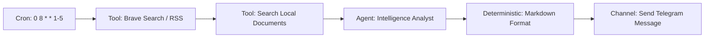
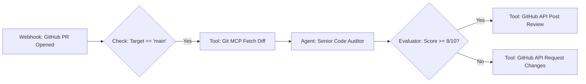
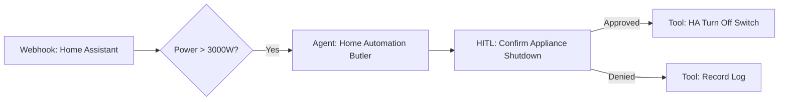

# Real-World Workflow Examples

This section walks through three verified production workflow examples built with Alberto Automate.

---

## Example 1: Daily Intelligence Briefing

Automatically scans ingested news, queries local vector knowledge, summarizes key developments, and sends a formatted briefing to Telegram every weekday at 08:00 AM.

### Node Configuration:
1. **Cron Trigger:** `0 8 * * 1-5` (Runs Monday through Friday at 08:00 AM).
2. **Tool Node (`knowledge_search`):** Query: `"Project updates AND pending reviews"`, limit: `5`.
3. **Agent Node (`intelligence_analyst`):**
   - System Prompt: *"Synthesize the retrieved project notes and news into a 3-bullet morning briefing."*
4. **Channel Delivery Node:** Target: Telegram Bot (`telegram:send_message`), Chat ID: `{{user.telegram_chat_id}}`.

---

## Example 2: Autonomous Pull Request Code Auditor

Triggered via GitHub webhook on new pull requests, analyzes changed files, runs security checks, and posts a review comment.

### Key Safety Gates:
- The `GitHub API Post Review` tool is rated `destructive`—requiring human approval before Alberto submits public comments on external repositories.

---

## Example 3: Smart Home Anomaly Detection & Alert

Monitors Home Assistant sensor webhooks, evaluates energy consumption anomalies, and asks for confirmation before toggling devices.

