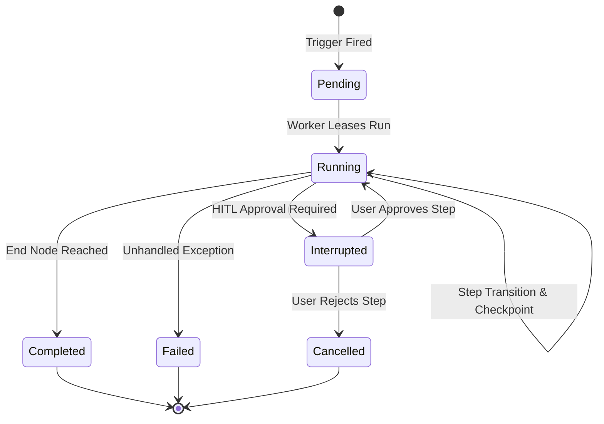
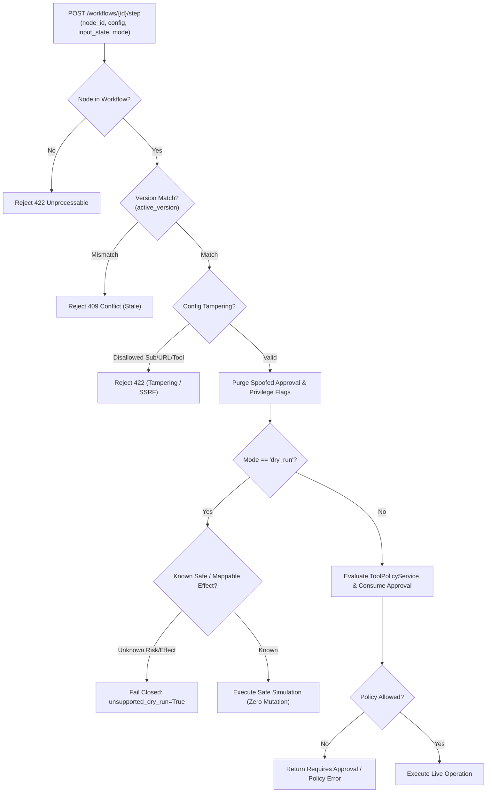

# Execution Lifecycle & Dry Runs

Workflow execution in Alberto is managed by `backend/alberto/services/runs.py`. Runs execute as durable, asynchronously checkpointed LangGraph threads.

{: .doc-screenshot }
<p class="doc-caption">Figure 8.3: Automate Playground executing a dry-run test with live event streaming and variable inspection.</p>

---

## 1. Execution Lifecycle



### Lifecycle States:
1. **`pending`**: Run registered in database; waiting for worker thread lease.
2. **`running`**: Actively executing nodes in the LangGraph runtime.
3. **`interrupted`**: Suspended at a human-in-the-loop approval gate. Checkpoint saved.
4. **`completed`**: All branches successfully reached terminal nodes.
5. **`failed`**: Halted due to an unrecoverable node exception.
6. **`cancelled`**: Terminated by user or timeout.

---

## 2. Canonical Node-RED Messaging Model & Runtime State

All workflow nodes interact through a standard message envelope (`msg`) layered onto Alberto's persistent LangGraph state machine:

```json
{
  "_msgid": "msg-9f4a1b82c3e410f2",
  "topic": "telemetry.temperature",
  "payload": {
    "sensor_id": "temp_04",
    "reading": 42.8,
    "unit": "celsius"
  },
  "_alberto": {
    "source_node": "inject_1",
    "step": 1,
    "timestamp": 1730302800000
  }
}
```

### Standard Message Fields:
- **`msg._msgid`**: Collision-resistant UUID-based message identifier preserved across downstream transformations to track end-to-end lineage.
- **`msg.payload`**: Primary business data payload (JSON object, array, primitive). Downstream agent, tool, and logic nodes operate on and transform this payload.
- **`msg.topic`**: Optional routing classification string.
- **`msg._alberto`**: Protected system metadata namespace containing runtime step counts, parent node IDs, and source node provenance. Never exposed to arbitrary user modification.

### Sequential Replacement vs Concurrent Merge Semantics:
Automate 2.0 strictly distinguishes sequential execution from parallel branches:
- **Sequential Execution (`b_step > a_step`):** Successor nodes overwrite or delete payload keys intentionally. Previous keys are not resurrected by deep merges.
- **Concurrent Branches (`b_step == a_step`):** Parallel sibling branches preserve non-conflicting keys, and branch-specific outputs are recorded into `_branches` for deterministic aggregation by `Join` nodes.

### Context Scopes:
Automate 2.0 provides three isolated context scopes:
1. **Node Context**: Local instance state (e.g. counters, local checkpoints).
2. **Flow Context (`flow`)**: Shared workflow-level context accessible across all nodes within the graph run (e.g. accumulated batch values, run-wide settings).
3. **Global Context**: Approved application-level read-only configurations and global constants.

### Expression Evaluation:
Expressions are safely evaluated using `RestrictedPython` with `safer_getattr` guards and access to `msg`, `payload`, `flow`, and `context`:
- `{{msg.payload.sensor_id}}` or `{{payload.sensor_id}}`
- `{{flow.batch_total}}`
- Python arithmetic and comparisons in condition nodes: `payload['reading'] > 40` or `urgency >= 3`

---

## 3. Step Execution & Test Modes

The `/v1/projects/{pid}/workflows/{wid}/step` endpoint enables isolated single-node execution for iterative development:

- **Safe (Dry Run) Mode:** The default mode for testing. Side-effecting tools (e.g., delete, write, external API mutations) are safely simulated without modifying external systems.
- **Live Test Mode:** Explicitly opted into by the user. Enforces strict `ToolPolicyService` authorization checks and requires genuine, unconsumed HITL approval tokens (`approval_id`) for destructive or critical-risk actions. Self-declared approval flags in input state are rejected.



---

## 4. Anti-Tampering Architecture for Step Execution

Step testing (`POST /v1/projects/{pid}/workflows/{wid}/step`) allows unsaved parameter adjustments in the three-panel editor while guaranteeing zero privilege escalation:

1. **Authoritative Workflow Definition:**
   - Server resolves the stored workflow graph using project and user isolation.
   - Nodes must legitimately exist in the graph (`node_id` check); node type spoofing is rejected.
   - Version concurrency: Optional `active_version` guard rejects stale client executions with `HTTP 409 Conflict`.
2. **Strict Override Constraints:**
   - **`tool_call`**: Client cannot substitute `tool_id` or `auth_provider_id` to access ungranted tools. Only non-security input parameters may be modified.
   - **`agent` / `deep_agent`**: Target `agent_id` cannot be changed. Client cannot inject ungranted `tools`, `toolsets`, or `mcp_servers` beyond what the server-saved agent definition grants.
   - **`subworkflow`**: Client cannot substitute `subworkflow_id`.
   - **`webhook_out`**: Outgoing URLs undergo SSRF validation (`validate_url`) ensuring internal networks (RFC 1918 / loopback / cloud metadata) are blocked unless explicitly authorized. Credential / `auth_provider_id` substitutions are rejected.
3. **Privilege & Approval Flag Sanitization:**
   - The server strips self-declared approval and administrative escalation fields (`approved`, `human_approved`, `requires_approval`, `entitlements`, `roles`, `is_admin`, `super_user`) from both `config` and `input_state`.

---

## 5. Complete Dry-Run Isolation & Fail-Closed Classification

Alberto Automate guarantees zero mutating side effects during dry-run testing across all execution paths:

| Execution Path | Dry-Run Enforcement |
| :--- | :--- |
| **Direct Tool Nodes (`tool_call`)** | Evaluates tool metadata. Known mutating tools return synthetic payloads with `dry_run: True`. Unknown effect/risk fails closed with `unsupported_dry_run: True`. |
| **Agent Tool Execution (ReAct)** | LangChain tools wrapped with `_wrap_tool_for_agent`. Read-only tools execute normally; mutating tools simulate success; unclassified tools fail closed (`unsupported_dry_run: True`). |
| **Tool Manager Delegation** | Master Agent delegations intercepted by `execute_delegated_tool`. Mutating actions simulated; unclassified tools reject execution. |
| **HTTP Egress (`webhook_out`)** | `GET` requests read live endpoints; `POST`, `PUT`, `DELETE`, `PATCH` simulate responses without sending network packets. Unknown HTTP methods fail closed (`unsupported_dry_run: True`). |

> [!IMPORTANT]
> **Fail-Closed Security Guarantee:** If a tool's effect or risk classification is `unknown`, Automate refuses to guess. Dry-run halts immediately with `unsupported_dry_run: True` and zero side effects.

---

## 6. Human-In-The-Loop Approvals & Idempotency

High-risk or policy-guarded operations require explicit out-of-band approvals.

1. **Atomic Single-Use Consumption:**
   - Approvals are stored in SQLite and transitioned from `approved` to `consumed` via an atomic `UPDATE ... WHERE status = 'approved'` statement.
   - Concurrent race attempts result in exactly one execution winner (`rowcount == 1`). Competing requests receive an `ApprovalAlreadyConsumedError`.
2. **Dry-Run Non-Consumption:**
   - Dry-run step executions and simulations never consume active approvals, preserving them for final live execution.
3. **Failure Recovery & Idempotency:**
   - Checkpoints persist execution state before and after tool calls.
   - If a downstream node fails after a tool call completes, re-running the checkpoint does not cause blind duplicate executions of non-idempotent tools.

