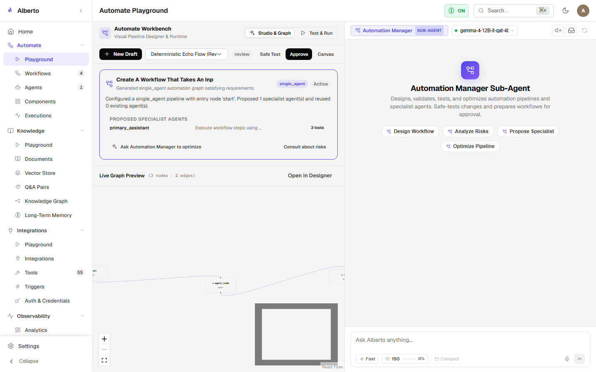
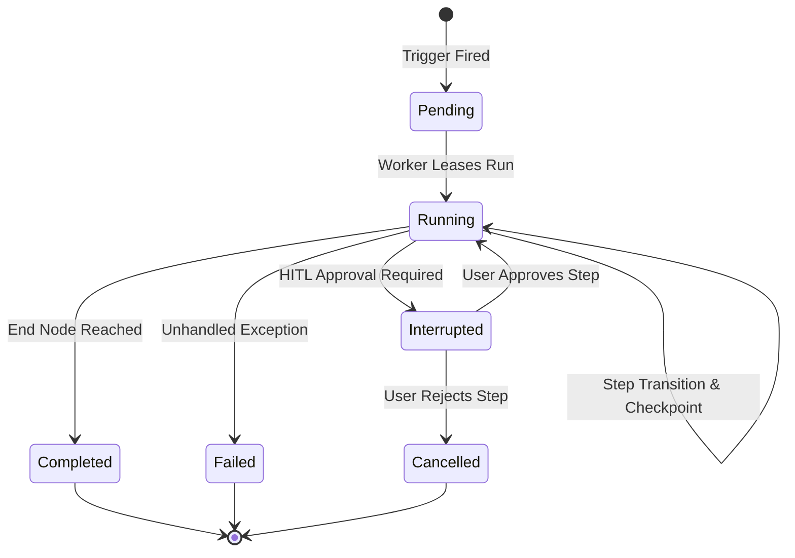

# Execution Lifecycle & Dry Runs

Workflow execution in Alberto is managed by `backend/alberto/services/runs.py`. Runs execute as durable, asynchronously checkpointed LangGraph threads.

{: .doc-screenshot }

Figure 8.3: Automate Playground executing a dry-run test with live event streaming and variable inspection.

---

## 1. Execution Lifecycle

### Lifecycle States:
1. **`pending`**: Run registered in database; waiting for worker thread lease.
2. **`running`**: Actively executing nodes in the LangGraph runtime.
3. **`interrupted`**: Suspended at a human-in-the-loop approval gate. Checkpoint saved.
4. **`completed`**: All branches successfully reached terminal nodes.
5. **`failed`**: Halted due to an unrecoverable node exception.
6. **`cancelled`**: Terminated by user or timeout.

---

## 2. Runtime State Envelope & Variable Flow

All workflow nodes interact through a shared LangGraph state dictionary. Alberto standardizes the keys across both low-code and code-native nodes:

- **`state.payload`**: The primary data payload for the current step. When an Agent node executes, its JSON output is unpacked here.
- **`state.output`**: Mirrors `payload` to provide a uniform inspection target across node types in the execution panel.
- **`state.msg`**: Node-RED compatible message envelope (`msg.payload`, `msg.topic`).
- **`state.messages`**: Multi-turn message history channel with `add_messages` reducer.

### Expression & Condition Resolution:
Downstream nodes (such as `router`, `switch`, `transform`, and template strings) automatically resolve variables from both top-level state and the `payload` dictionary. For example:
- `details.priority >= 4` evaluates against `state.payload.details.priority` or `state.details.priority`.
- Template substitutions support `{{state.payload.category}}` as well as direct key references `{{state.category}}`.

---

## 3. Interactive Execution & Node-RED Debug Logging

Workflows can be run interactively right within the visual canvas:

- **Inject Node Trigger:** Click the trigger button on any `Inject` node to inject a message payload (`msg.payload`, custom JSON, string, or boolean) into the pipeline instantly.
- **Node-RED Style Debug Tab:** Telemetry streams into the permanent right sidebar's **Debug** tab via Server-Sent Events (SSE):
  - **Live Node Step Tracking:** Active nodes illuminate on the canvas with status spinners, moving to success (green) or error (red) states.
  - **Debug Messages:** Node-level debug events and variable mutations display chronologically with expandable JSON viewers, payload filters, and copy shortcuts.
  - **Diagnostics:** Execution durations, token usage meters, and cost summaries are reported live.
  - **Human-in-the-Loop Interrupts:** Interactive pause requests present approval/rejection buttons directly within the execution viewer, resuming downstream nodes immediately upon decision.
- **Step Inspection:** Click on any completed node in the execution waterfall to inspect exact inputs, resolved parameters, and emitted outputs.
- **Replayability:** Re-run failed workflows from the exact checkpoint that encountered an error, modifying inputs or tool configurations on the fly.
