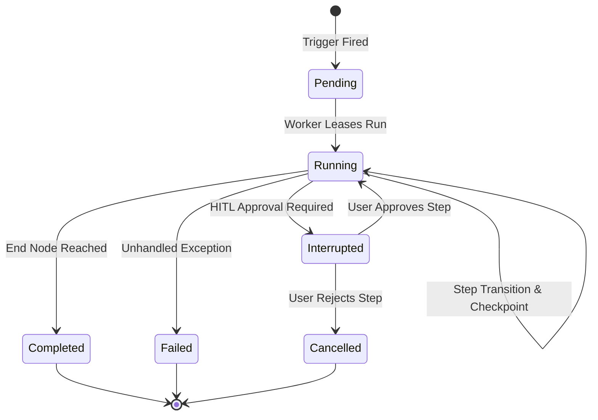

# Execution Lifecycle & Dry Runs

Workflow execution in Alberto is managed by `backend/alberto/services/runs.py`. Runs execute as durable, asynchronously checkpointed LangGraph threads.

{: .doc-screenshot }

Figure 8.3: Automate Playground executing a dry-run test with live event streaming and variable inspection.

---

## 1. Execution Lifecycle

### Lifecycle States:
1. **`pending`**: Run registered in database; waiting for worker thread lease.
2. **`running`**: Actively executing nodes in the LangGraph runtime.
3. **`interrupted`**: Suspended at a human-in-the-loop approval gate. Checkpoint saved.
4. **`completed`**: All branches successfully reached terminal nodes.
5. **`failed`**: Halted due to an unrecoverable node exception.
6. **`cancelled`**: Terminated by user or timeout.

---

## 2. Interactive Dry Runs & Playground

The **Automate Playground** allows developers to test workflows with sample payloads before publishing to production:

- **Mock Triggers:** Inject custom JSON payloads without waiting for real webhooks or cron schedules.
- **Step Inspection:** Click on any completed node in the execution waterfall to inspect exact inputs, resolved parameters, and emitted outputs.
- **Replayability:** Re-run failed workflows from the exact checkpoint that encountered an error, modifying inputs or tool configurations on the fly.
