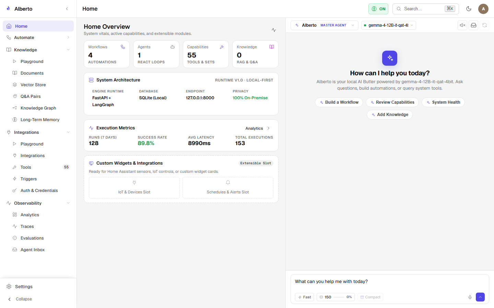
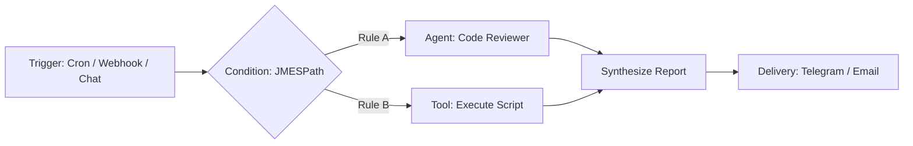

# Automate: Visual Workflow Designer

**Automate** is Alberto's visual multi-agent workflow designer. It bridges intuitive visual graph design with industrial-grade deterministic execution, compiling interactive React Flow DAGs directly into LangGraph state machines.

{: .doc-screenshot }

Figure 8.1: Workflows dashboard displaying created workflow graphs, node counts, and run histories.

---

## Architectural Philosophy

Traditional workflow engines (such as n8n or Zapier) are built for deterministic webhook ETL, but struggle with autonomous multi-agent branching and tool loops. Conversely, purely autonomous multi-agent frameworks often lack deterministic controls, predictable branching, and visual observability.

Automate combines both worlds:
1. **Deterministic Nodes:** Triggers, filters, code snippets, and template renderers execute with absolute predictability.
2. **Agentic Nodes:** Specialist agent nodes possess bounded autonomy, utilizing tool calling and semantic reasoning where appropriate.
3. **Durable Checkpoints:** Every node transition saves state to SQLite, allowing long-running tasks to survive crashes and wait indefinitely for human approval.

---

## In This Section

- [Visual Canvas](canvas.md) — The React Flow canvas editor, node palette, handles, and inspector panel.
- [Node Types & Flow Control](node-types.md) — Exhaustive guide to Triggers, Conditions, Agents, Tools, and Formatting steps.
- [Execution & Dry Runs](execution.md) — Running workflows, inspecting step outputs, and pausing for human approval.
- [Real-World Workflow Examples](examples.md) — Complete walkthroughs of production workflow graphs.
