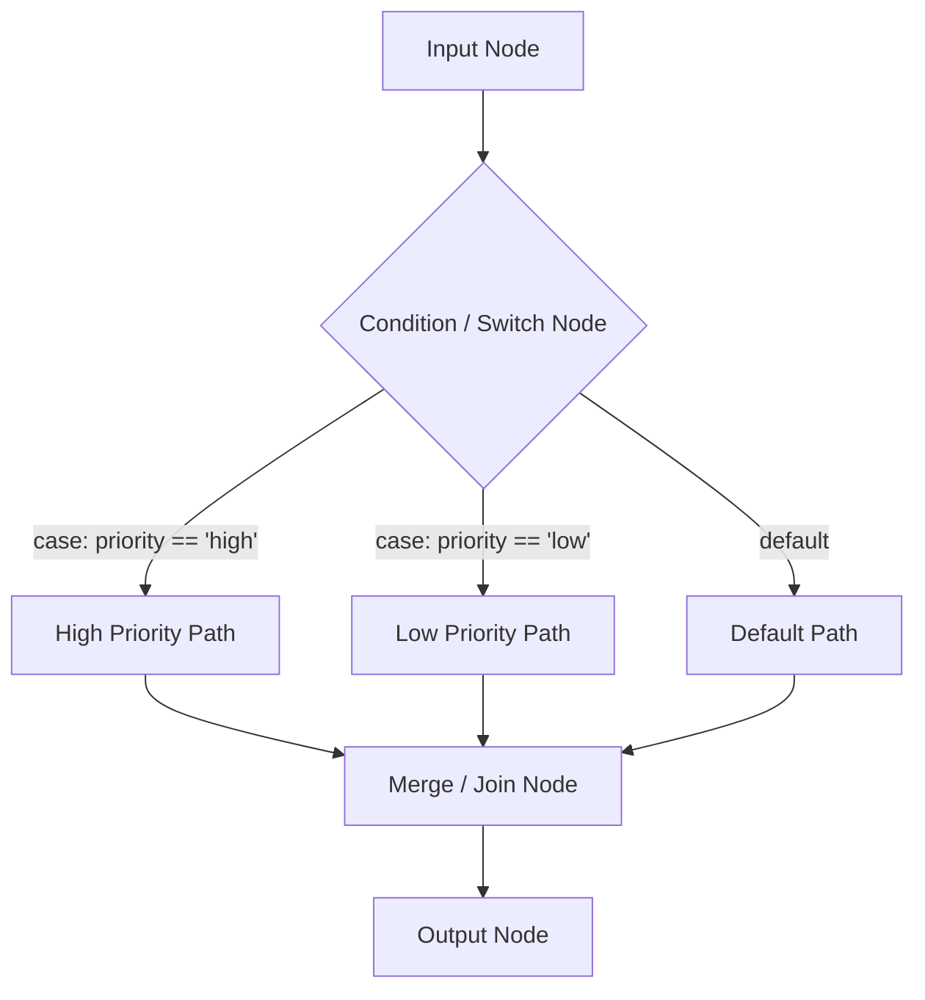

# Workflow Node Types & Flow Control

Every step in an Automate workflow is represented by a typed node with explicit input parameters, execution behavior, and output contracts.

---

## 1. Triggers

Triggers serve as the root entry point for a workflow execution graph.

| Trigger Node | Mode | Configuration | Behavior |
| :--- | :--- | :--- | :--- |
| **`manual_trigger`** | Interactive | Parameter schema (strings, numbers, booleans) | Initiated via UI or API call with custom inputs. |
| **`webhook_trigger`** | Inbound HTTP | Secret webhook token | Triggers when an external HTTP `POST` arrives. |
| **`cron_trigger`** | Scheduled | Standard 5-field cron expression (e.g. `0 9 * * 1-5`) | Evaluated by Alberto's background scheduler. |
| **`channel_trigger`**| Messaging | Channel type (e.g. `telegram`), optional filter | Triggers on matching incoming chat messages. |

---

## 2. Intelligence & Agent Nodes

| Node Type | Capabilities |
| :--- | :--- |
| **`agent_node`** | Embeds a Specialist Agent preset. Has access to assigned tools and operates with an autonomous ReAct loop. |
| **`prompt_node`** | Lightweight, direct single-turn LLM generation without tool calling. Ideal for zero-shot text formatting. |
| **`evaluator_node`**| Binary or scored evaluation step. Compares outputs against a rubrics prompt and routes conditionally. |

---

## 3. Tool & Integration Nodes

| Node Type | Capabilities |
| :--- | :--- |
| **`tool_node`** | Directly executes a registered Alberto tool (e.g., `knowledge_search`, `calculator`). |
| **`mcp_tool_node`**| Invokes a tool exposed by an active Model Context Protocol (MCP) server. |
| **`rest_call_node`**| Performs an arbitrary HTTP request (GET, POST, PUT, DELETE) with variable interpolation. |

---

## 4. Logic & Control Flow

- **`condition` (Branch):** Evaluates a boolean JavaScript expression or JMESPath query (e.g., `payload.score > 0.85`), directing execution to the `true` or `false` output handle.
- **`switch`:** Multi-way branch evaluating expressions against multiple discrete case values.
- **`merge`:** Joins multiple incoming branches, continuing execution when either the first (race) or all (barrier) branches arrive.
- **`delay`:** Pauses execution for a specified duration using durable timers without consuming CPU resources.
