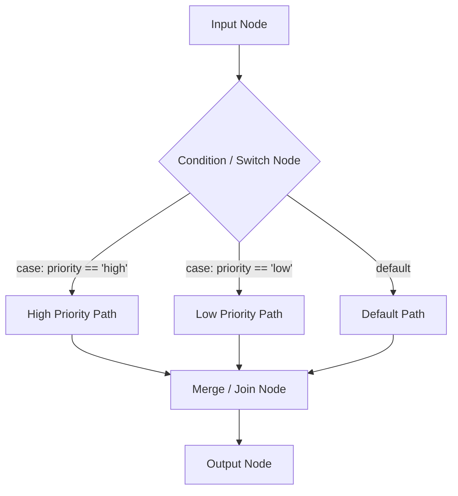

# Workflow Node Types & Flow Control

Every step in an Automate workflow is represented by a typed node with explicit input parameters, execution behavior, and output contracts.

---

## 1. Triggers

Triggers serve as the root entry point for a workflow execution graph.

| Trigger Node | Mode | Configuration | Behavior |
| :--- | :--- | :--- | :--- |
| **`manual_trigger`** | Interactive | Parameter schema (strings, numbers, booleans) | Initiated via UI or API call with custom inputs. |
| **`webhook_trigger`** | Inbound HTTP | Secret webhook token | Triggers when an external HTTP `POST` arrives. |
| **`cron_trigger`** | Scheduled | Standard 5-field cron expression (e.g. `0 9 * * 1-5`) | Evaluated by Alberto's background scheduler. |
| **`channel_trigger`**| Messaging | Channel type (e.g. `telegram`), optional filter | Triggers on matching incoming chat messages. |

---

## 2. Intelligence & Agent Nodes

| Node Type | Capabilities | Output Contract |
| :--- | :--- | :--- |
| **`agent`** | Embeds a Specialist Agent preset or inline model. Runs autonomous tool loops or dynamic single-task pipeline execution. | Standardized JSON envelope (`payload`, `msg.payload`, `output`). Supports user-defined JSON schema, bounded validation retries, and optional custom `output_key`. |
| **`deep_agent`** | Deep multi-agent orchestrator with subagent delegation, file system skills, and extended reasoning loops. | Standardized JSON envelope matching `agent` nodes, unpacking structured outputs into workflow state. |
| **`llm` / `prompt_node`** | Lightweight, direct single-turn LLM generation without tool calling. Ideal for zero-shot text formatting. | Writes response string or object to `output_key` (default `result`) and appends to `messages`. |
| **`classifier`** | Zero-shot or few-shot classification. Matches user intent against configured labels. | Writes classified intent string or structured category to `intent` or `output_key`. |

### Agent Node Standardized JSON Output & Pipeline Execution

Every Agent node in Alberto Automate follows a standardized output envelope to guarantee seamless downstream routing and data mapping:

1. **Default JSON Envelope:**
   - Agent nodes always emit JSON-compatible dictionaries into workflow state:
     - `state.payload`: normalized JSON object containing `{ "response": text, "content": text }` (or structured fields if schema is specified).
     - `state.output`: mirrors `state.payload` for consistent node output inspection.
     - `state.msg.payload`: Node-RED-compatible message envelope.
   - Raw markdown blocks and unparsed JSON strings are normalized automatically.

2. **Structured Output Schemas & Validation:**
   - Configure an optional JSON Schema in `config.response_format.schema` or `config.output_schema`.
   - The engine automatically instructs the LLM and constrains output generation.
   - When output is received, Alberto validates it against the schema via `jsonschema`.
   - **Bounded Retries:** If the response violates the schema or is malformed, Alberto performs up to 2 self-correction retries with explicit error feedback before raising a terminal error.

3. **Downstream Unpacking & State Keys:**
   - When `output_key` is configured (e.g. `triage`), the structured data is written directly to `state[output_key]` in addition to `payload`.
   - Top-level schema properties are unpacked directly into `payload` (e.g. `payload.category`, `payload.urgency`), allowing downstream routers and conditions to access them directly as `urgency >= 4` or `payload.urgency >= 4`.

4. **Backward Compatibility:**
   - The `messages` channel is preserved across all agent executions for conversational or multi-turn workflows.

---

## 3. Tool & Integration Nodes

| Node Type | Capabilities |
| :--- | :--- |
| **`tool_node`** | Directly executes a registered Alberto tool (e.g., `knowledge_search`, `calculator`). |
| **`mcp_tool_node`**| Invokes a tool exposed by an active Model Context Protocol (MCP) server. |
| **`rest_call_node`**| Performs an arbitrary HTTP request (GET, POST, PUT, DELETE) with variable interpolation. |

---

## 4. Logic & Control Flow

- **`condition` (Branch):** Evaluates a boolean JavaScript expression or JMESPath query (e.g., `payload.score > 0.85`), directing execution to the `true` or `false` output handle.
- **`switch`:** Multi-way branch evaluating expressions against multiple discrete case values.
- **`merge`:** Joins multiple incoming branches, continuing execution when either the first (race) or all (barrier) branches arrive.
- **`delay`:** Pauses execution for a specified duration using durable timers without consuming CPU resources.
