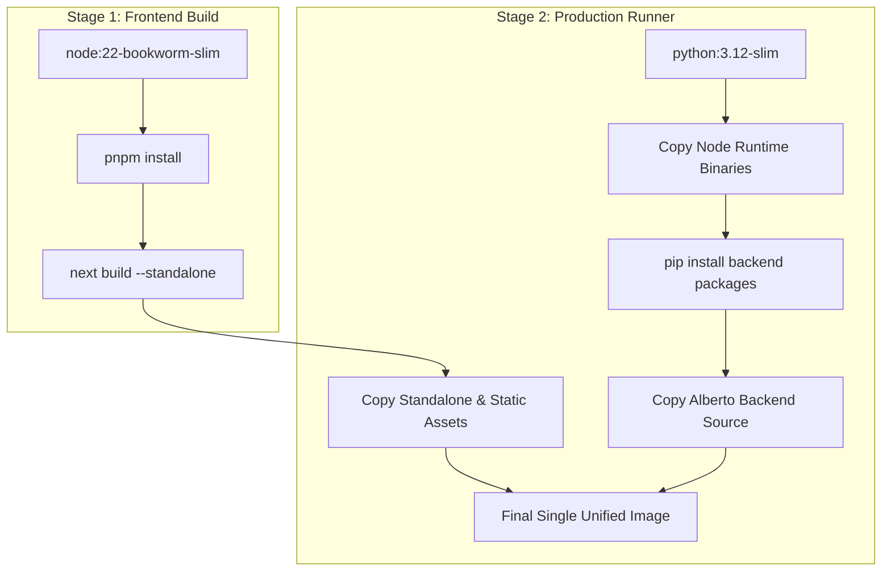

# Docker Production Build

Alberto packages the entire application into a single, high-performance container image.

---

## 1. Multi-Stage Dockerfile Architecture

The build process (`docker/Dockerfile`) uses a multi-stage workflow:



### Stage 1: Frontend Builder
- Base: `node:22-bookworm-slim`
- Installs dependencies via `pnpm`.
- Compiles the Next.js single-page application into standalone output bundles (`standalone/` and `static/`).

### Stage 2: Unified Production Runner
- Base: `python:3.12-slim`
- Installs Node.js runtime binaries directly into the Debian runner.
- Installs Python dependencies (`uvicorn`, `fastapi`, `langgraph`, `chromadb`, `pydantic`).
- Sets up `supervisord` or entrypoint script to launch:
  1. Uvicorn FastAPI server on `127.0.0.1:8000`.
  2. Next.js standalone server on `0.0.0.0:3000`.

---

## 2. Building the Image

Build from the repository root:

```bash
docker build -f docker/Dockerfile -t ghcr.io/oksbwn/alberto:latest .
```

To run the standalone container without Docker Compose:

```bash
docker run -d \
  --name alberto \
  -p 3000:3000 \
  -p 8000:8000 \
  -v alberto_data:/data \
  --add-host host.docker.internal:host-gateway \
  -e ALBERTO_DATA_DIR=/data \
  -e ALBERTO_BOOTSTRAP_ADMIN_PASSWORD=change_me_in_prod \
  ghcr.io/oksbwn/alberto:latest
```

---

## 3. Container Health Checks & Liveness

The container defines health probes against the FastAPI health endpoint:

```dockerfile
HEALTHCHECK --interval=15s --timeout=5s --start-period=10s --retries=3 \
  CMD curl -f http://127.0.0.1:8000/health || exit 1
```

If the backend fails to respond within 5 seconds for 3 consecutive intervals, Docker marks the container unhealthy, triggering container restart policies.
