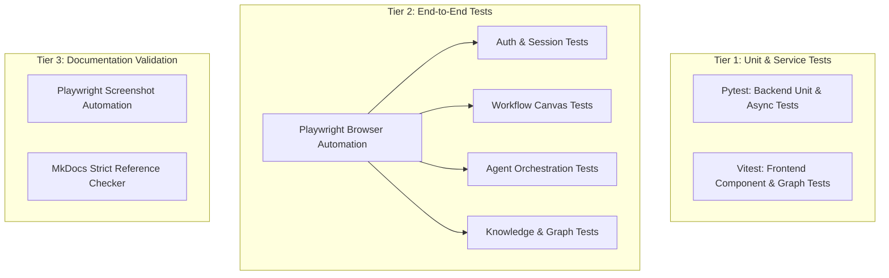

# Testing Infrastructure

Alberto uses a comprehensive three-tier testing strategy ensuring backend correctness, frontend component stability, and end-to-end integration reliability.



---

## 1. Backend Testing with Pytest

Backend tests reside in `backend/tests/` and `tests/backend/`:

```bash
cd backend
pytest
```

### Running Specific Test Groups:
```bash
# Test Agent Orchestration
pytest tests/backend/test_agents.py

# Test Tool Manager & Policy Gates
pytest tests/backend/test_tool_manager.py

# Test Memory Extraction
pytest tests/backend/test_unified_memory.py
```

### Test Isolation:
Backend tests use an in-memory SQLite database (`sqlite+aiosqlite:///:memory:`) and temporary mock vector stores, ensuring test executions never mutate your development or production data.

---

## 2. Frontend Testing with Vitest

Frontend unit and component tests reside in `frontend/`:

```bash
cd frontend
npm run test
```

This verifies React Flow graph compilation (`graph.ts`), token calculations, and UI primitive formatting.

---

## 3. End-to-End Testing with Playwright

Playwright tests reside in `tests/e2e/`:

```bash
cd frontend
npm run test:e2e
```

### Test Isolation Guard
The E2E test fixture (`tests/e2e/fixtures/data.fixture.ts`) contains an automated guard:
```typescript
if (storagePath && !storagePath.includes("test_e2e") && storagePath.includes("data\\db")) {
  throw new Error("TEST ISOLATION VIOLATION: Connected backend is using dev storage!");
}
```
Playwright spawns isolated instances at backend port `8005` and frontend port `3005` backed by `data/test_e2e` to prevent tests from modifying your local development database.

---

## 4. Documentation E2E & Screenshot Capture

Playwright is also used to validate this documentation site and capture UI screenshots:

```bash
# Capture fresh documentation screenshots
npx playwright test tests/docs/capture-screenshots.spec.ts

# Validate documentation site navigation and search
npx playwright test tests/docs/docs-e2e.spec.ts
```
