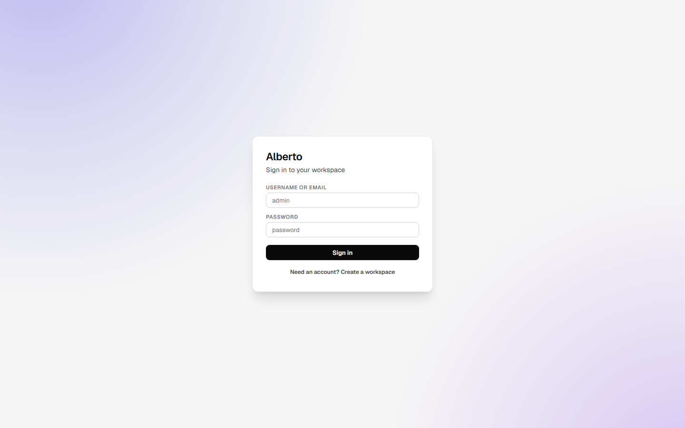
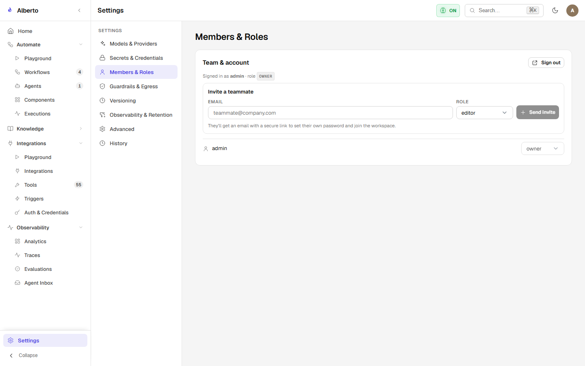

# First Administrator Setup & Login

Alberto incorporates multi-tenant project isolation and role-based access control (RBAC). Upon initial database initialization, a bootstrap administrator account is automatically generated.

{: .doc-screenshot }
<p class="doc-caption">Figure 2.1: Initial login screen with email, password, and workspace creation toggle.</p>

---

## 1. Default Bootstrap Credentials

When first running Alberto against a clean database, the backend reads the following bootstrap configuration:

```ini
ALBERTO_BOOTSTRAP_ADMIN_EMAIL=admin
ALBERTO_BOOTSTRAP_ADMIN_PASSWORD=password
```

> [!WARNING]
> In production environments, immediately change these values via environment variables before the initial startup or reset the password inside **Settings &rarr; Members & Roles**.

---

## 2. Signing In

1. Open your browser and navigate to `http://localhost:3000`.
2. Enter the bootstrap credentials:
   - **Username / Email:** `admin` (or the configured email)
   - **Password:** `password`
3. Click **Sign in**.

The application will exchange credentials with the `/v1/auth/login` endpoint:

```http
POST /v1/auth/login HTTP/1.1
Host: localhost:8000
Content-Type: application/json

{
  "email": "admin",
  "password": "password"
}
```

The response provides an HMAC-SHA256 Bearer JWT:

```json
{
  "access_token": "eyJhbGciOiJIUzI1NiIsInR5cCI6IkpXVCJ9...",
  "refresh_token": "eyJhbGciOiJIUzI1NiIsInR5cCI6IkpXVCJ9...",
  "token_type": "bearer",
  "user": {
    "id": "usr_01j7xyz...",
    "email": "admin",
    "role": "owner"
  }
}
```

The token is stored in the browser's `localStorage` (`alberto_access_token`) and attached as a `Bearer` header to subsequent API requests.

---

## 3. Workspaces & Projects

Alberto organizes all assistant states, memory graphs, documents, and workflows inside **Projects** (often called Workspaces):

- Each project owns isolated SQLite records, ChromaDB collections, and secret vaults.
- A single user account can create or join multiple projects.
- The default project is automatically provisioned during startup (`default-project`).

### Team Roles & Permissions

{: .doc-screenshot }
<p class="doc-caption">Figure 2.2: Workspace members and role assignments.</p>

Alberto enforces 5 granular RBAC roles:

| Role | Permissions |
| :--- | :--- |
| **`owner`** | Complete administrative control, workspace deletion, billing, member invites. |
| **`admin`** | Manage model providers, secret credentials, guardrails, and members. |
| **`editor`** | Create and edit workflows, specialist agents, and tools. |
| **`viewer`** | Read-only access to chat, analytics, and workflow execution traces. |
| **`connector`** | Machine-to-machine service token with scoped execution privileges. |
