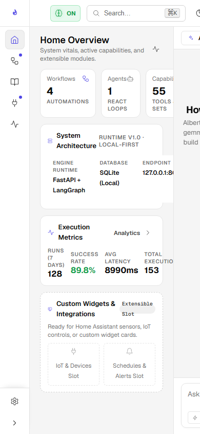

# Your First Butler Conversation

Alberto's conversational interface is powered by the **Master Coordinator** (`assistant.py`), an autonomous agent operating on LangGraph. It retains conversational context, consults semantic memory, and selectively calls tools.

{: .doc-screenshot }
<p class="doc-caption">Figure 2.5: Interactive Butler chat interface with real-time streaming and tool calls.</p>

---

## 1. Initiating a Conversation

1. Click on **Home** or **Assistant** in the sidebar.
2. In the bottom input bar, type:
   ```text
   Hi Alberto, my name is Alex. Remember that my preferred programming language is Python and I am working on an AI Butler platform.
   ```
3. Press **Enter** or click the send button.

### What Happens Behind the Scenes:

1. **API Dispatch:** The client issues a `POST /v1/assistant/chat` request with the user message and session ID.
2. **Memory Retrieval:** Alberto queries ChromaDB and the SQLite Knowledge Graph for entities matching "Alex" or "Python".
3. **Intent Classification:** The Coordinator evaluates if any specialized agent or tool is required.
4. **Execution & Streaming:** Alberto formats the prompt with memory context and streams tokens back to the browser via Server-Sent Events (SSE).
5. **Memory Extraction:** A background curator task extracts episodic facts ("user_name: Alex", "favorite_language: Python") and commits them to the memory store.

---

## 2. Testing Memory Recall

In the same session (or after refreshing your browser), verify that Alberto recalls your context:

```text
What is my name and which language do I prefer?
```

Alberto will retrieve the stored memory fact and respond accurately:

> *"Your name is Alex, and your preferred programming language is Python."*

You can view stored memory facts at any time by navigating to **Knowledge &rarr; Long-Term Memory** in the sidebar.

{: .doc-screenshot style="max-width: 400px;" }
<p class="doc-caption">Figure 2.6: Conversational interface on mobile viewports.</p>

---

## 3. Autonomous Memory Learning Toggle

In the top right of the application topbar, locate the **Memory Learning indicator** button:

```text
[Brain Icon] ON
```

- When **ON**: Alberto automatically extracts durable facts, user preferences, and entity relationships from chat sessions.
- When **OFF**: Alberto operates in ephemeral mode, using only the active conversation window without committing new long-term memories.
