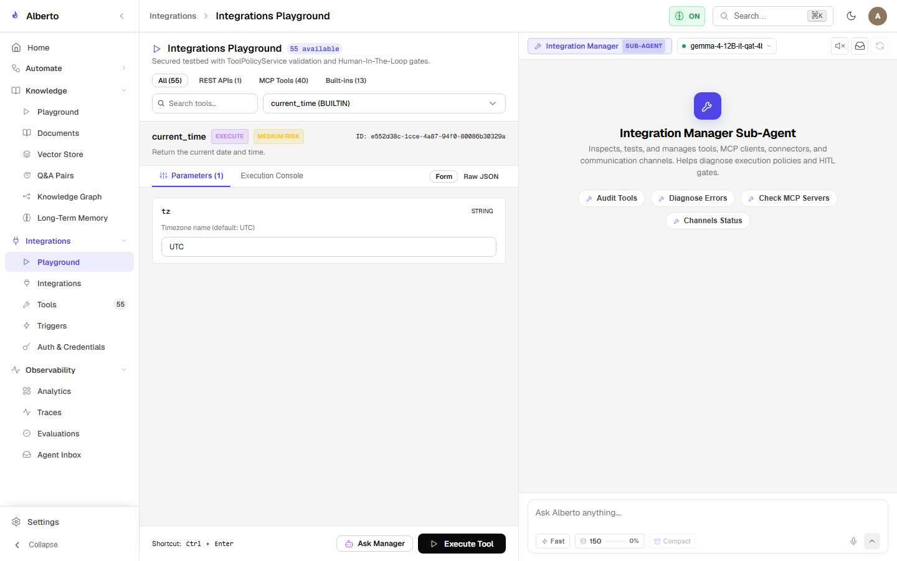

# Connecting Your First Integration

Alberto connects to external systems through two distinct mechanisms:

1. **REST Connectors:** HTTP integrations with custom headers, authentication, and endpoint mappings.
2. **Model Context Protocol (MCP):** Dynamic stdio or SSE servers exposing standardized tools and resources.

{: .doc-screenshot }

Figure 2.7: Integrations overview with active connectors and channel bindings.

---

## 1. Registering an MCP Server

The **Model Context Protocol (MCP)** enables running local tools as isolated subprocesses.

### Step 1: Open Integrations Screen

1. In the sidebar, expand **Integrations** and click **Integrations**.
2. Click the **MCP** tab or **Add MCP Server** button.

### Step 2: Configure Stdio Transport

Provide the server configuration:
- **Server Name:** `local_filesystem`
- **Transport:** `stdio`
- **Command:** `npx`
- **Arguments:** `-y @modelcontextprotocol/server-filesystem /path/to/allowed/directory`
- **Environment Variables:** Optional key-value pairs needed by the subprocess.

Click **Connect**.

### Step 3: Discovery & Schema Inspection

Alberto starts the subprocess, sends an MCP `initialize` request, and discovers available tools. Once connected:
1. Navigate to **Integrations &rarr; Tools**.
2. You will see the new tools (e.g., `read_file`, `list_directory`) registered with parameter schemas and danger ratings.

{: .doc-screenshot }

Figure 2.8: Tool Manager listing discovered MCP tools with permission scopes.

---

## 2. Registering a REST Connector

For web services (e.g. weather APIs, webhooks, smart-home controllers):

1. In **Integrations**, click **New Connector**.
2. Specify:
   - **Name:** `open_meteo_weather`
   - **Base URL:** `https://api.open-meteo.com/v1`
   - **Authentication:** `None` (or Bearer Token / API Key)
3. Add an endpoint method:
   - **Operation ID:** `get_forecast`
   - **Method:** `GET`
   - **Path:** `/forecast?latitude={lat}&longitude={lon}&current_weather=true`
4. Click **Save Connector**. Alberto exposes `open_meteo_weather:get_forecast` to your agents.

---

## 3. Assigning Tools to Agents

By default, newly registered tools are **not** automatically exposed to all agents. To grant access:

1. Navigate to **Automate &rarr; Agents**.
2. Select an agent (or the Master Butler).
3. Under **Tools**, check your new connector or MCP tool.
4. Save the agent. The agent can now invoke the tool during conversation or workflow execution.
