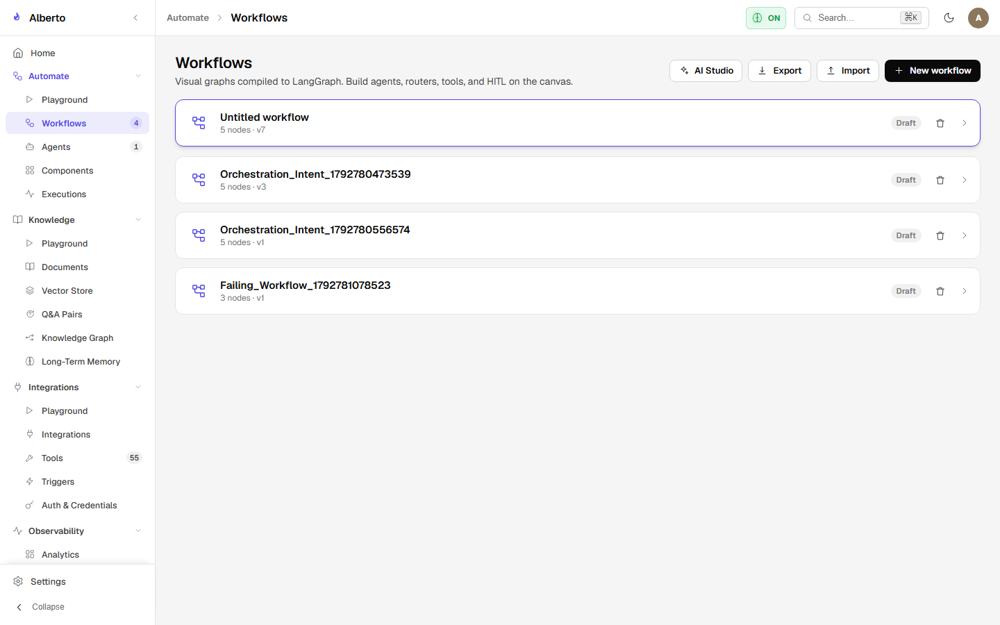
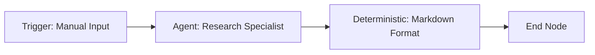
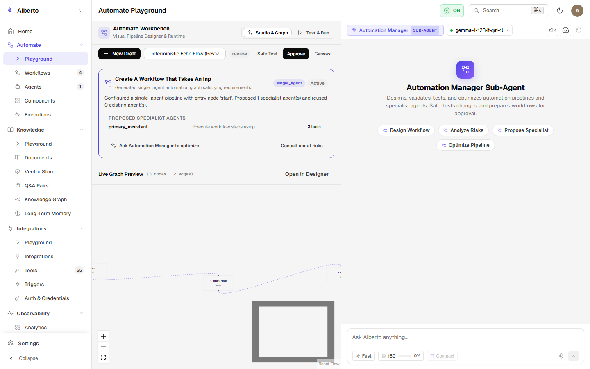

# Building Your First Visual Workflow

Alberto's **Automate** module provides a node-based visual designer powered by React Flow. Workflows are compiled directly into LangGraph state machines, providing durable SQLite checkpoints and step-level human approval gates.

{: .doc-screenshot }
<p class="doc-caption">Figure 2.9: Workflow manager displaying created workflow graphs, node counts, and run statistics.</p>

---

## 1. Creating a New Workflow

1. In the sidebar, expand **Automate** and click **Workflows**.
2. Click **New workflow** in the top right.
3. You are redirected to the visual canvas editor.

{: .doc-screenshot }
<p class="doc-caption">Figure 2.10: React Flow visual canvas editor with drag-and-drop node palette and properties inspector.</p>

---

## 2. Step-by-Step: Multi-Agent Research & Summarize Workflow

Let's build a workflow that accepts a topic, researches it using an agent node, summarizes the findings, and outputs the result.



### Step 1: Add a Trigger Node
1. Drag a **Trigger** node from the left palette onto the canvas.
2. In the right inspector panel:
   - **Type:** `manual`
   - **Schema:** Define input parameter `topic` (string).

### Step 2: Add an Agent Node
1. Drag an **Agent** node onto the canvas.
2. Connect the output handle of the **Trigger** node to the input handle of the **Agent** node.
3. In the inspector:
   - **Agent Preset:** Select `research_analyst` (or use Master Coordinator).
   - **Prompt Template:**
     ```mustache
     Conduct research on the following user topic: {{topic}}.
     Extract key takeaways and empirical facts.
     ```

### Step 3: Add a Formatting Step
1. Drag a **Deterministic / Code** node onto the canvas.
2. Connect the Agent output to this node.
3. Configure a markdown template to format the output with headers and timestamps.

### Step 4: Publish & Run

1. In the topbar, click **Publish**. This validates the graph topology (detects disconnected inputs or cycles) and compiles it into an executable LangGraph specification.
2. Click **AI Studio / Playground** to execute the workflow interactively.

{: .doc-screenshot }
<p class="doc-caption">Figure 2.11: Automate Playground executing a workflow run with real-time step streaming and inspection.</p>
