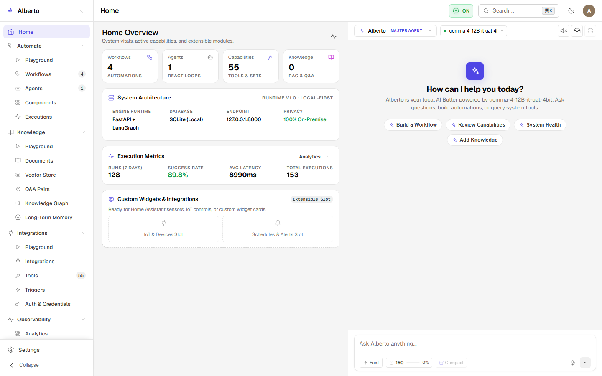
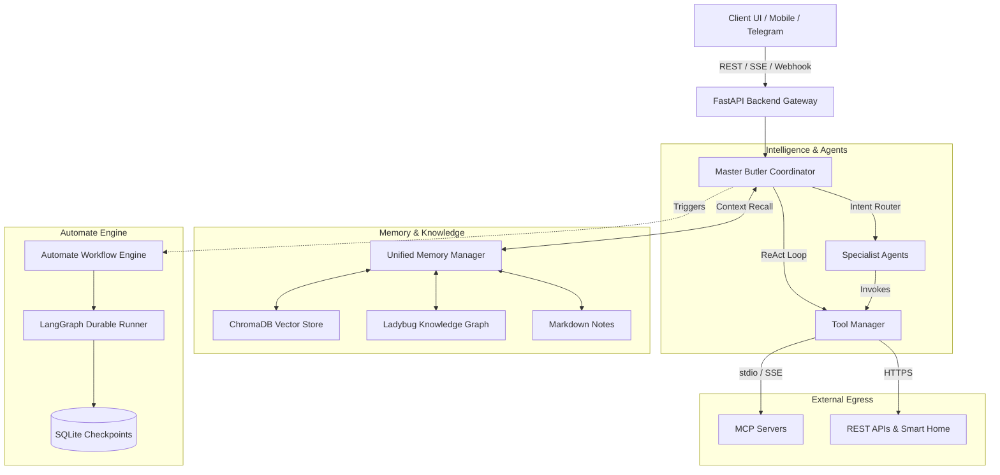
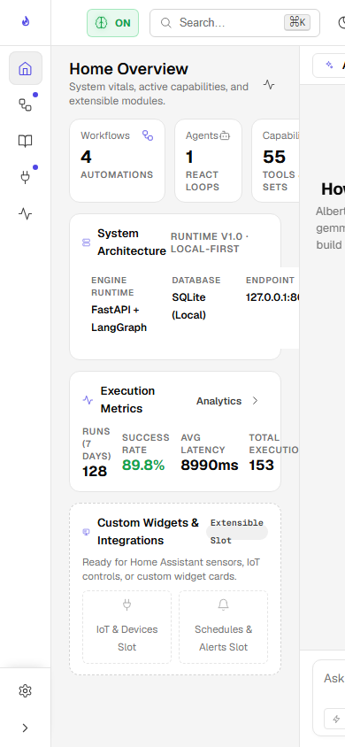

# Alberto: The Local-First AI Butler & Multi-Agent Automation Platform

Welcome to the technical documentation for **Alberto**, an extensible, privacy-preserving, local-first personal AI Butler and multi-agent workflow platform.

Alberto unifies autonomous personal assistant interactions, unified memory, external tool calling, and visual workflow automation into a self-hosted single-container deployment.

{: .doc-screenshot }

Figure 1.1: Alberto Butler Dashboard with real-time memory learning and assistant controls.

---

## What Alberto Solves

Modern cloud-based AI assistants often introduce privacy liabilities, vendor lock-in, and unpredictable latency. Moreover, most personal assistants cannot reliably execute workflows, interact with private APIs, or preserve long-term context across disparate sessions.

Alberto addresses these challenges by providing:

1. **Local-First Privacy:** Operates entirely within your private network. Can run 100% locally with local LLM engines ([Ollama](providers/local-models.md), [vLLM](providers/local-models.md)) and embedded vector databases ([ChromaDB](memory/vector-store.md)), keeping conversations, documents, and credentials on your hardware.
2. **True Multi-Agent Orchestration:** Deploys a **Master Coordinator** that can intelligently delegate complex requests to purpose-built **Specialist Agents** using [LangGraph](architecture/orchestration.md).
3. **Unified Memory Tier:** Synchronizes three complementary memory paradigms:
    - **Episodic & Working Memory:** Sliding-window context buffers and conversation turn recall.
    - **Semantic Vector Storage:** Local FastEmbed document chunking and ChromaDB similarity search.
    - **Dynamic Knowledge Graph:** Extracted entities and relationships persisted in SQLite with human-in-the-loop ontology governance.
4. **Visual Workflow Automation (Automate):** A node-based canvas powered by React Flow that compiles visual DAGs into deterministic or agentic LangGraph state machines with durable checkpoints.
5. **Universal Integration Gateway:** Native support for the **Model Context Protocol (MCP)**, REST connectors, and communication channels (Telegram, Slack, and webhooks).

---

## Key Platform Capabilities

| Capability | Description | Documentation Guide |
| :--- | :--- | :--- |
| **Conversational Butler** | Master coordinator that parses intent, synthesizes context, and manages tool invocation. | [Master Coordinator](agents/master-coordinator.md) |
| **Specialist Agents** | Configurable AI agents with designated system prompts, tools, and model backends. | [Specialist Agents](agents/specialist-agents.md) |
| **Visual Workflow Designer** | Interactive canvas to design triggers, conditions, and agent interactions without code. | [Automate Canvas](automate/canvas.md) |
| **Model Context Protocol (MCP)** | Client-side integration for Anthropic's open MCP protocol over stdio and SSE transports. | [MCP Architecture](tools-and-integrations/mcp.md) |
| **Knowledge Graph & Dynamic Ontology** | Entity-relationship graph extracting facts from conversations with human review gates. | [Knowledge Graph](memory/knowledge-graph.md) |
| **Multi-Channel Gateways** | Independent identity resolution and conversational interaction over Telegram and webhooks. | [Channels](tools-and-integrations/channels.md) |
| **Durable Execution Engine** | Persistent workflow execution with SQLite checkpoints, step replay, and approval gates. | [Persistence Architecture](architecture/persistence.md) |

---

## Deployment Architectures

Alberto is engineered to operate in diverse deployment targets:

- **Local Development:** Python 3.12+ virtualenv (`backend/`) and Next.js 14 (`frontend/`) communicating over localhost.
- **Single Docker Container:** All-in-one production container packaging FastAPI, Next.js, and background workers under Supervisord.
- **Docker Compose:** Multi-service orchestration including optional remote Ollama hosts and Chroma instances.

{: .doc-screenshot style="max-width: 400px;" }

Figure 1.2: Alberto mobile-responsive interface accessible from any mobile browser.

---

## Platform Limitations & Bounds

- **Single-Node Focus:** Alberto is optimized for single-host and home-server environments. Clustered multi-node high availability is not currently an architecture goal.
- **Local Embedding Scope:** Embedded semantic search defaults to `bge-small-en-v1.5` (384 dimensions) via ONNX runtime for maximum CPU performance; dense multilingual datasets may require higher-dimension cloud embeddings.
- **SQLite Concurrency:** Main database tables utilize SQLite in WAL (Write-Ahead Logging) mode. It easily sustains concurrent reads and serialized background worker writes, but is not designed for distributed enterprise multi-writer topologies.

---

## Platform Glossary

- **Butler / Master Coordinator:** The primary root agent conversational persona (`assistant.py`) responsible for high-level user coordination.
- **Specialist Agent:** A localized subagent defined with explicit toolsets, custom prompts, and assigned model backends.
- **LangGraph:** The underlying DAG and cyclic graph state engine used for workflow execution and conversational agent loops.
- **MCP (Model Context Protocol):** Open protocol standard for connecting LLMs to local data repositories and external tools.
- **Automate:** Alberto's visual workflow creation environment and durable graph execution runtime.
- **Checkpointer:** The SQLite-backed persistence mechanism storing execution snapshots between workflow steps.
- **Ladybug:** The SQLite-backed graph database engine utilized by Alberto for dynamic knowledge graph storage.
