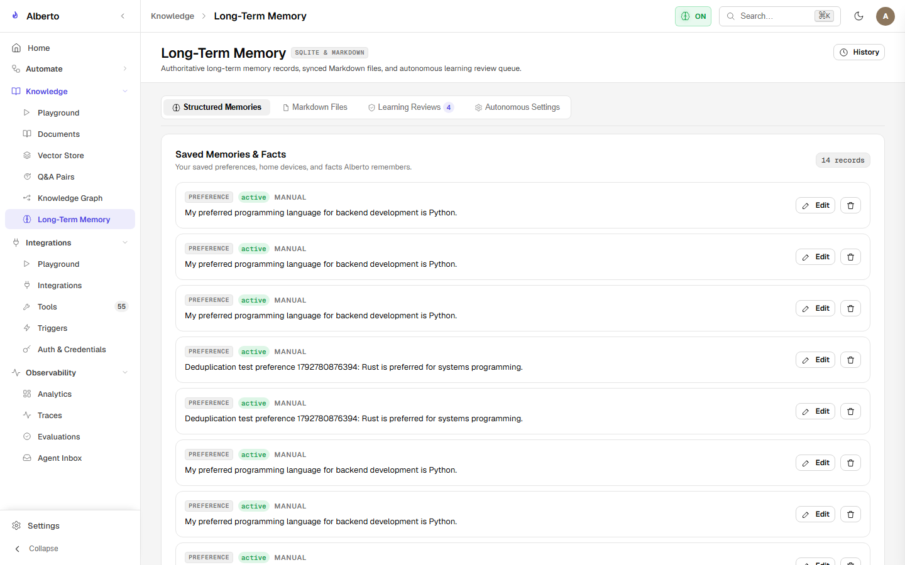
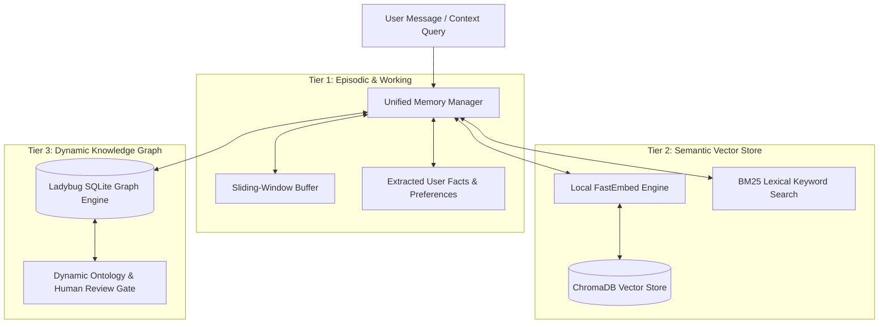

# Memory & Knowledge Management

Alberto integrates three complementary memory models into a single unified architecture, providing immediate conversation awareness, semantic document recall, and entity-relationship reasoning.

{: .doc-screenshot }

Figure 7.1: Long-term episodic memory manager displaying extracted user facts and preferences.

---

## The Three Tiers of Alberto Memory

---

## Memory Tiers Overview

| Memory Tier | Storage Technology | Primary Role |
| :--- | :--- | :--- |
| **Working & Episodic Memory** | SQLite + In-Memory Cache | Immediate conversation turns, user preferences, explicit instructions. |
| **Semantic Vector Store (RAG)** | ChromaDB + FastEmbed (`bge-small-en-v1.5`) | Unstructured document retrieval, PDF parsing, hybrid dense + sparse search. |
| **Knowledge Graph** | Ladybug SQLite Engine | Typed entities, relational predicates, multi-hop fact traversal. |
| **Markdown Notes** | Direct Flat Files (`data/memory/*.md`) | Human-readable notes and structured logs editable directly in markdown. |

---

## In This Section

- [Unified Memory Manager](unified-memory.md) — How Alberto unifies episodic recall with autonomous memory learning.
- [Vector Store & RAG](vector-store.md) — Document ingestion, recursive chunking, embeddings, and hybrid search.
- [Knowledge Graph & Dynamic Ontology](knowledge-graph.md) — Extracting entity-relationship graphs with human review gates.
- [Markdown Memory](markdown-memory.md) — Plaintext markdown memory curation and local file persistence.
