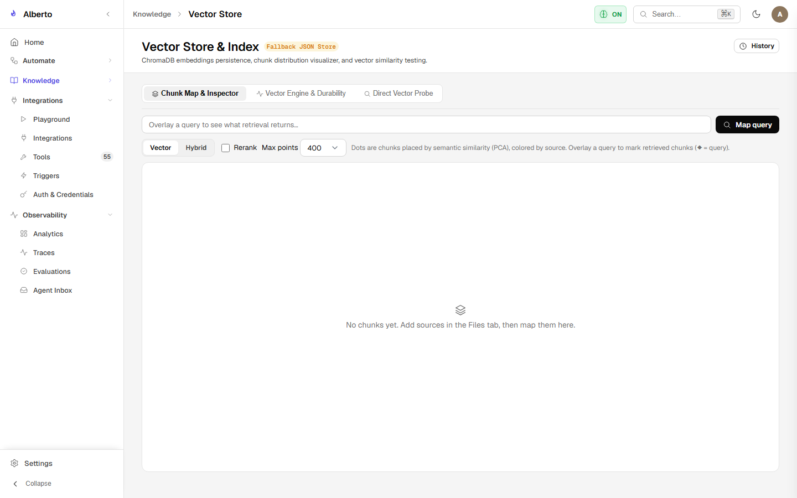
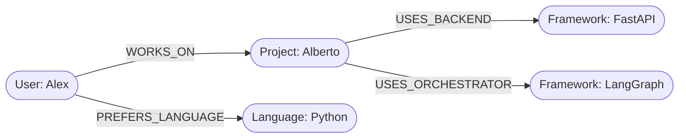

# Knowledge Graph & Dynamic Ontology

Alberto incorporates an entity-relationship graph subsystem (`backend/alberto/services/graph_manager.py`) built on the **Ladybug** SQLite graph engine.

{: .doc-screenshot }

Figure 7.5: Interactive Knowledge Graph Explorer visualizing connected entities, types, and relational predicates.

---

## 1. Data Model

The graph represents knowledge as subject-predicate-object triples with typed entities:

### Entity Schema:
- **`entity_id`**: Canonical slug (e.g. `user_alex`).
- **`name`**: Display label (`Alex`).
- **`type`**: Semantic category (`Person`, `Device`, `Project`, `Software`, `Location`).
- **`properties`**: JSON dictionary of metadata attributes.

### Relationship Schema:
- **`source_id`**: Originating entity.
- **`target_id`**: Destination entity.
- **`predicate`**: Relational verb (`OWNED_BY`, `CONNECTED_TO`, `AUTHORED`, `DEPENDS_ON`).
- **`weight` / `confidence`**: Numerical probability score (0.0 to 1.0).

---

## 2. Dynamic Ontology & Human-In-The-Loop Review

Unlike brittle static graph schemas, Alberto supports **Dynamic Ontologies** (`ontology_registry.py`):
1. When novel concepts appear in conversation (e.g., a new smart-home sensor type), the extractor proposes a new entity type or predicate candidate.
2. If the confidence exceeds the automated threshold, it is committed immediately.
3. If ambiguous, the candidate is routed to the **Ontology Review Queue**, where an operator can approve, reclassify, or reject the proposed relationship.

---

## 3. Graph Traversal in Context Assembly

During query answering, Alberto performs multi-hop breadth-first graph traversal (up to 2 degrees of separation) starting from entities recognized in the prompt. This allows the Butler to answer complex relational questions (e.g., *"Which projects authored by Alex depend on FastAPI?"*) that pure vector similarity cannot solve.
