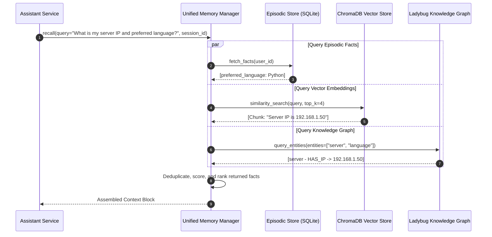

# Unified Memory Manager

Implemented in `backend/alberto/services/unified_memory.py`, the **Unified Memory Manager** coordinates knowledge retrieval across episodic memories, vector embeddings, and knowledge graph relationships.

---

## 1. Context Synthesis & Recall Pipeline

When a user submits a query, Alberto triggers a multi-stage recall sequence:

---

## 2. Autonomous Memory Learning & Curation

When the **Memory Learning** toggle is enabled, Alberto automatically learns from conversation turns:

1. **Extraction Pipeline (`memory_curator.py`):** After a conversation turn finishes, an asynchronous worker evaluates the exchange.
2. **Fact Filtering:** Ephemeral greetings and trivial chit-chat are discarded. Only persistent facts, preferences, credentials, and relationship updates are extracted.
3. **Contradiction Resolution:** If a new fact contradicts an older fact (e.g., "I moved to Seattle" vs older "I live in Boston"), the older fact is superseded with a timestamped deprecation flag rather than abruptly deleted.
4. **User Governance:** Users can view, edit, or delete stored facts at any time from the **Knowledge &rarr; Long-Term Memory** screen.
