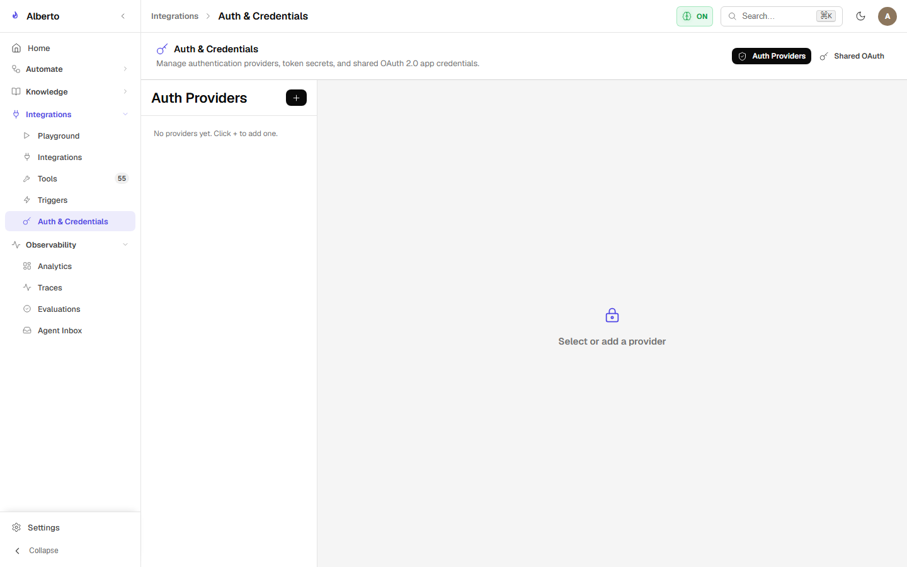
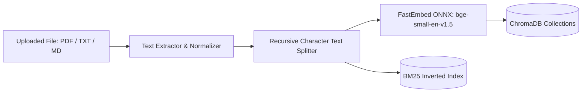
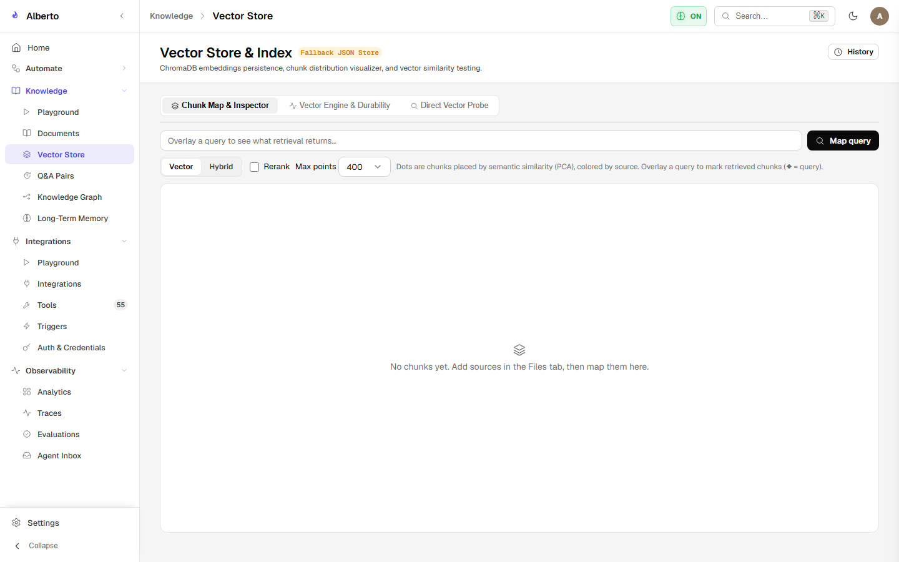
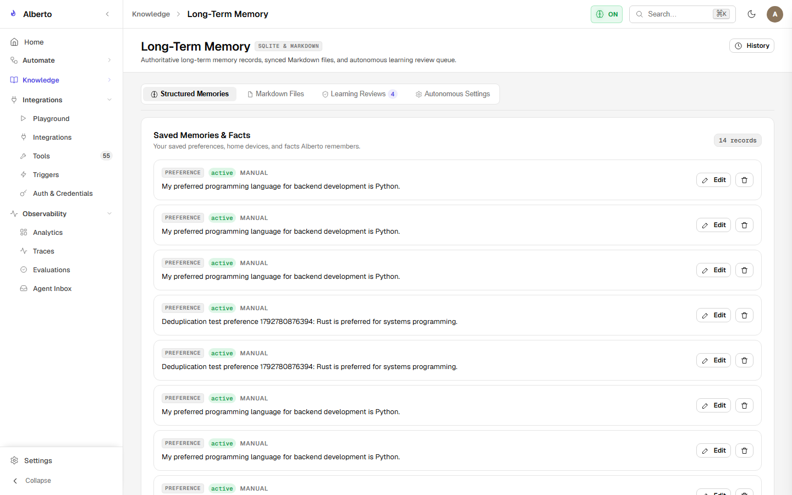

# Vector Store & Semantic RAG

Alberto includes an embedded Retrieval-Augmented Generation (RAG) subsystem (`backend/alberto/services/knowledge.py`) powered by **ChromaDB** and **FastEmbed**.

{: .doc-screenshot }
<p class="doc-caption">Figure 7.2: Ingested document repository showing file types, parsing status, and chunk counts.</p>

---

## 1. Document Ingestion Pipeline

Alberto supports uploading PDF, Markdown, Plaintext, and JSON documents.



### Ingestion Stages:
1. **Extraction:** PyPDF or native text decoders extract plaintext from raw files.
2. **Recursive Chunking:** Text is broken into chunks of 300 tokens with a 50-token overlap, ensuring semantic coherence across boundaries.
3. **Local Embedding Generation:** Alberto utilizes FastEmbed with `BAAI/bge-small-en-v1.5` (384 dimensions) running via ONNX Runtime on CPU/GPU. No external API keys are required.
4. **Vector Persistence:** Vectors and metadata (filename, page number, chunk index) are committed to ChromaDB under `data/chroma`.

---

## 2. Hybrid Retrieval with Reciprocal Rank Fusion (RRF)

Dense vector search can struggle with exact keyword matches (e.g. error codes or part numbers), while keyword search misses semantic synonyms. Alberto combines both via **Reciprocal Rank Fusion**:

{: .doc-screenshot }
<p class="doc-caption">Figure 7.3: Vector similarity search inspection with distance scoring.</p>

```python
def reciprocal_rank_fusion(dense_ranks: list[str], sparse_ranks: list[str], k: int = 60) -> list[str]:
    scores = {}
    for rank, doc_id in enumerate(dense_ranks):
        scores[doc_id] = scores.get(doc_id, 0.0) + 1.0 / (k + rank)
    for rank, doc_id in enumerate(sparse_ranks):
        scores[doc_id] = scores.get(doc_id, 0.0) + 1.0 / (k + rank)
    return sorted(scores.keys(), key=lambda x: scores[x], reverse=True)
```

---

## 3. Q&A Pair Synthesis

To enhance recall accuracy, Alberto includes an optional Q&A generator that analyzes document chunks and synthesizes expected user questions:

{: .doc-screenshot }
<p class="doc-caption">Figure 7.4: Generated Q&A pairs associated with source document chunks.</p>

When a user asks a question, matching against synthesized questions yields significantly higher cosine similarity than matching directly against raw technical paragraphs.
