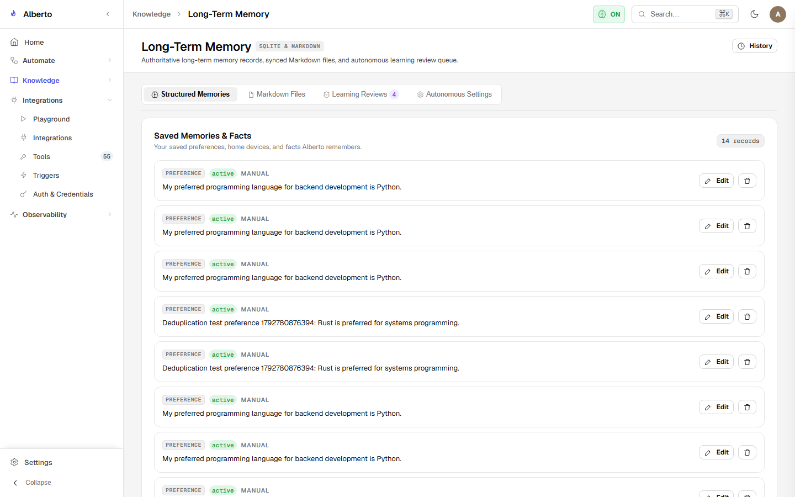

# Model Catalog & Token Metrics

Alberto monitors model usage, response times, token throughput, and financial costs across all agent and workflow interactions.

{: .doc-screenshot }
<p class="doc-caption">Figure 5.2: Observability analytics dashboard visualizing token consumption, latencies, and estimated spend.</p>

---

## 1. Metrics Tracked Per Turn

Every conversational turn and workflow step records telemetry in the database:

| Metric | Description | Units |
| :--- | :--- | :--- |
| **`prompt_tokens`** | Input tokens consumed by context, memory, and conversation history. | Integer |
| **`completion_tokens`** | Output tokens generated by the model. | Integer |
| **`total_tokens`** | Combined input and output tokens. | Integer |
| **`latency_ms`** | Total elapsed wall-clock execution time. | Milliseconds |
| **`tokens_per_second` (TPS)** | Generation speed (`completion_tokens / (latency_ms / 1000)`). | Tokens / sec |
| **`estimated_cost_usd`** | Calculated financial cost based on catalog pricing rates. | USD ($) |

---

## 2. Dynamic Pricing Engine

In `backend/alberto/model_catalog.py`, pricing rates are dynamically mapped to model identifiers:

```python
MODEL_PRICING = {
    "openai:gpt-4o": {"input": 2.50 / 1e6, "output": 10.00 / 1e6},
    "openai:gpt-4o-mini": {"input": 0.15 / 1e6, "output": 0.60 / 1e6},
    "anthropic:claude-3-5-sonnet": {"input": 3.00 / 1e6, "output": 15.00 / 1e6},
    "ollama:*": {"input": 0.0, "output": 0.0}, # Local models are zero-cost
    "vllm:*": {"input": 0.0, "output": 0.0},
}
```

---

## 3. Budgeting and Quota Enforcement

Under **Settings &rarr; Advanced &rarr; Budgets**, administrators can define monthly expenditure limits per project:

- **Soft Limit:** Generates a warning notification in the dashboard when consumption reaches 80% of budget.
- **Hard Limit:** Blocks subsequent non-local model calls when 100% of budget is reached, automatically falling back to registered local models (Ollama/vLLM) to prevent unexpected cloud bills.
