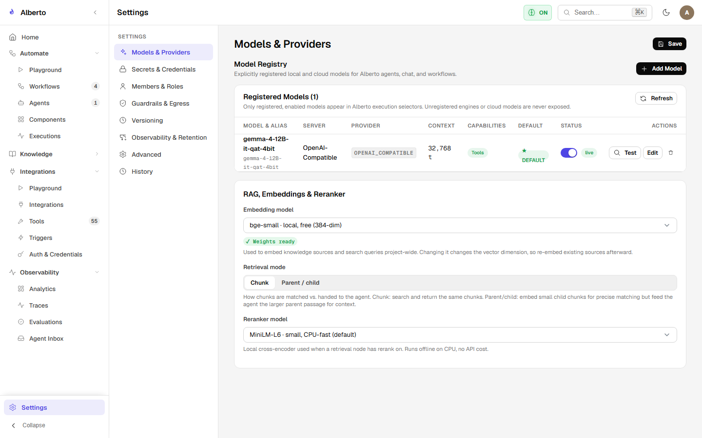

# LLM Providers & Model Architecture

Alberto decouples agent reasoning logic from specific AI model vendors. The platform can operate with local inference engines, proprietary cloud APIs, or a hybrid configuration.

{: .doc-screenshot }
<p class="doc-caption">Figure 5.1: Model provider settings console displaying discovered endpoints, registered models, and active assignments.</p>

---

## Supported Providers Matrix

| Provider | Type | Transport Protocol | Default Endpoint | Verified Supported Models |
| :--- | :--- | :--- | :--- | :--- |
| **Ollama** | Local | HTTP JSON API | `http://127.0.0.1:11434` | `llama3.2`, `llama3.1`, `qwen2.5-coder`, `mistral`, `deepseek-r1` |
| **vLLM** | Local / Self-Hosted | OpenAI-Compatible REST | `http://127.0.0.1:8000/v1` | Any HuggingFace causal LM (e.g. `meta-llama/Llama-3.1-8B-Instruct`) |
| **OpenAI** | Cloud | Official REST SDK | `https://api.openai.com/v1` | `gpt-4o`, `gpt-4o-mini`, `o1-preview`, `o1-mini` |
| **Anthropic** | Cloud | Official REST SDK | `https://api.anthropic.com/v1` | `claude-3-5-sonnet-20241022`, `claude-3-5-haiku-20241022` |
| **Google Gemini**| Cloud | Google GenAI SDK | `https://generativelanguage.googleapis.com` | `gemini-1.5-pro`, `gemini-1.5-flash`, `gemini-2.0-flash` |

---

## Provider Abstraction Layer

Inside `backend/alberto/model_catalog.py`, models are represented as unified descriptors:

```python
class ModelDescriptor:
    provider: str        # "ollama", "vllm", "openai", "anthropic", "google"
    model_id: str        # e.g., "llama3.2:3b" or "gpt-4o"
    context_window: int  # e.g., 128000 or 8192
    supports_tools: bool # True if native JSON tool calling is supported
    cost_per_input_token: float
    cost_per_output_token: float
```

The application instantiates standard LangChain chat models (`ChatOpenAI`, `ChatAnthropic`, `ChatGoogleGenerativeAI`, `ChatOllama`) transparently behind this catalog interface.

---

## In This Section

- [Local Models (Ollama & vLLM)](local-models.md) — Setting up private local inference on CPU and GPU hardware.
- [Cloud Models](cloud-models.md) — Configuring API keys and rate limits for OpenAI, Anthropic, and Gemini.
- [Catalog & Token Metrics](catalog-and-metrics.md) — Tracking tokens-per-second, prompt/completion token usage, and operational costs.
