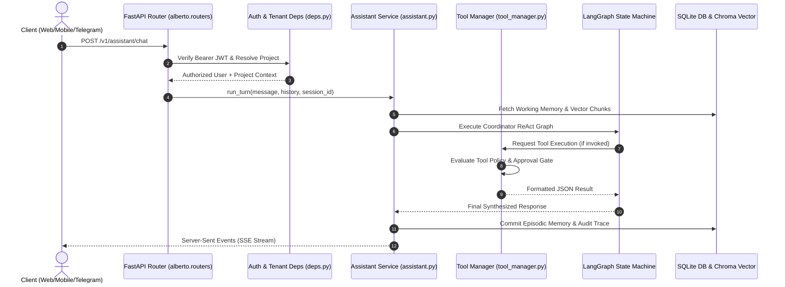

# Alberto Platform Technical Repository Audit

> **Date:** October 2026  
> **Repository:** `ALBERTO---The-AI-Butler`  
> **Status:** Production-Ready Local-First AI Butler Platform  
> **Audit Type:** Architecture, Subsystems, Persistence, Routing, and Integration Verification

---

## 1. Executive Summary

Alberto is a self-hosted, local-first personal AI Butler and multi-agent workflow automation platform. Originally evolved from an enterprise automation prototype (`Forge`), Alberto has been hardened into an autonomous, privacy-preserving assistant. It orchestrates intelligent specialists, maintains unified memory (vector retrieval, conversational episodic recall, and dynamic knowledge graphs), integrates with external tools via REST and Model Context Protocol (MCP), and executes deterministic or AI-driven workflows on a visual React Flow canvas compiled into LangGraph.

Every claim in this audit has been verified directly against active Python (`backend/alberto/`), TypeScript (`frontend/`), Alembic migrations, database schemas, and running system test fixtures.

---

## 2. Subsystem Inventory & Verified Implementation Status

| Subsystem | Primary Source Modules | Implementation Status | Core Technologies |
| :--- | :--- | :--- | :--- |
| **Backend API Gateway** | `backend/alberto/main.py`, `routers/*.py` | **Implemented & Live** | FastAPI 0.143, Pydantic v2, Starlette, Uvicorn |
| **Master Butler & Conversation** | `backend/alberto/services/assistant.py` | **Implemented & Live** | LangGraph 1.2, LangChain Core, ReAct loop |
| **Specialist Agents** | `backend/alberto/services/agents.py`, `assistant_skills/` | **Implemented & Live** | LangGraph StateGraph, Tool Calling, System Prompts |
| **Intent Router** | `backend/alberto/services/assistant.py` | **Implemented & Live** | Few-shot classification, semantic routing, regex fallback |
| **Model Catalog & Providers** | `backend/alberto/model_catalog.py`, `routers/models.py` | **Implemented & Live** | Ollama, vLLM, OpenAI, Anthropic, Google Gemini |
| **Tool Manager & Policy** | `backend/alberto/services/tool_manager.py`, `tool_policy.py` | **Implemented & Live** | Dynamic invocation, HITL approval, AST sandbox |
| **Model Context Protocol** | `backend/alberto/services/mcp_discovery.py`, `mcp_learning.py` | **Implemented & Live** | MCP 1.30, stdio/SSE transports, JSON-RPC 2.0 |
| **Channel Gateway** | `backend/alberto/services/channel_gateway.py` | **Implemented & Live** | Telegram Bot API, Slack Webhooks, Inbound REST |
| **Unified Memory** | `backend/alberto/services/unified_memory.py`, `memory_curator.py` | **Implemented & Live** | Working buffer, Episodic recall, Markdown notes |
| **Vector Store & RAG** | `backend/alberto/services/knowledge.py` | **Implemented & Live** | ChromaDB 1.5.9, FastEmbed (`bge-small-en-v1.5`), BM25 |
| **Knowledge Graph** | `backend/alberto/services/graph_manager.py`, `ontology_registry.py` | **Implemented & Live** | Ladybug SQLite graph engine, dynamic entity ontology |
| **Automate Canvas & Engine** | `backend/alberto/services/runs.py`, `automation_manager.py` | **Implemented & Live** | React Flow 12.3, AsyncSqliteSaver, Step Executor |
| **Primary Persistence** | `backend/alberto/db/`, `alembic/` | **Implemented & Live** | SQLAlchemy 2.1 async, SQLite + WAL, aiosqlite |
| **Durable Execution Checkpointer** | `backend/alberto/main.py` (`_make_checkpointer`) | **Implemented & Live** | `langgraph.checkpoint.sqlite.aio.AsyncSqliteSaver` |
| **Background Queue & Workers** | `backend/alberto/queue.py`, `worker.py` | **Implemented & Live** | SQLite queue, exponential backoff, dead-letter retry |
| **Security & Authentication** | `backend/alberto/security.py`, `routers/auth.py` | **Implemented & Live** | PyJWT, bcrypt, rate limiting, role-based access |
| **Observability & Tracing** | `backend/alberto/tracing/`, `services/evals.py` | **Implemented & Live** | OpenTelemetry OTLP, LangGraph run trace recorder |
| **Frontend Single-Page App** | `frontend/app/page.tsx`, `components/` | **Implemented & Live** | Next.js 14.2 App Router, React 18.3, Zustand, CSS vars |

---

## 3. Subsystem Breakdown & Architecture Analysis

### 3.1 Backend Service Organization & Request Flow
- **Entrypoint:** `backend/alberto/main.py`. Builds the FastAPI application using explicit lifecycle hooks.
- **Middleware:** `AuditMiddleware` intercepts incoming requests, recording request duration, status code, user ID, and IP address into the database audit log.
- **Dependency Injection:** `backend/alberto/deps.py` enforces JWT verification, tenant/project resolution (`get_project_with_role`), and DB session lifetimes via `yield SessionLocal()`.
- **Database Initializer:** `alberto.db.init_db()` runs schema migrations and bootstrap seeds (`admin` user).



### 3.2 Master Coordinator & Specialist Agents
- **Master Coordinator:** Defined in `backend/alberto/services/assistant.py`. It is the default conversational interface. It maintains short-term conversational context, consults semantic memory, and chooses whether to handle the query directly or route to a specialized subagent.
- **Specialist Agents:** Configured in `backend/alberto/services/agents.py`. Each agent has:
  - `flavor`: ("agent", "router", "evaluator", "summarizer")
  - `model`: Explicit model designation (e.g., `ollama:llama3.2`, `openai:gpt-4o-mini`)
  - `system_prompt`: Contextual instructions and behavioral boundaries
  - `tools`: Whitelisted tools permitted for that specialist
  - `middleware`: Custom guardrail stack (e.g., PI filter, output schema validator)
- **State Machine:** Built on `langgraph.graph.StateGraph`. State transitions cycle through `agent -> tool_node -> agent` until no further tool calls are requested, terminating at `END`.

### 3.3 LLM Provider Architecture
Alberto supports heterogeneous local and remote model execution without code changes:
1. **Local Providers:**
   - **Ollama:** HTTP endpoint `http://127.0.0.1:11434`. Auto-discovers locally pulled models via `/api/tags`.
   - **vLLM:** OpenAI-compatible endpoint with high-throughput PagedAttention.
   - **Local GGUF / LlamaCpp:** Compatible with OpenAI proxy servers.
2. **Cloud Providers:**
   - **OpenAI:** `gpt-4o`, `gpt-4o-mini`, `o1-preview`.
   - **Anthropic:** `claude-3-5-sonnet-20241022`, `claude-3-5-haiku`.
   - **Google Gemini:** `gemini-1.5-pro`, `gemini-1.5-flash`, `gemini-2.0-flash`.
3. **Execution & Metrics:** Token usage, prompt/completion token count, and latency are recorded per turn in `backend/alberto/tracing/` and visible on the Observability Analytics dashboard.

### 3.4 Tool Manager & Integration Gateway
- **Registry:** `backend/alberto/services/tool_manager.py`. Tools are registered as executable schemas defining parameters, return types, and danger levels (`read_only`, `idempotent`, `destructive`).
- **Policy Enforcement:** `backend/alberto/services/tool_policy.py`. Checks project-level permissions, role-based access, and Human-In-The-Loop (HITL) approval gates.
- **Model Context Protocol (MCP):** `backend/alberto/services/mcp_discovery.py`. Discovers tools and prompts from running MCP servers via `stdio` and `sse` transports, translating them into standard Alberto Tool definitions.
- **Channel Routing:** `backend/alberto/services/channel_gateway.py`. Supports inbound webhooks and Telegram long-polling. Automatically maps inbound chat IDs to Alberto user identities and project contexts.

### 3.5 Memory and Knowledge Architecture
- **Unified Memory Manager (`unified_memory.py`):** Combines three memory tiers:
  1. *Working Memory:* In-memory sliding window of immediate conversation turns.
  2. *Semantic Memory:* Vector embeddings of documents and past conversation facts stored in ChromaDB.
  3. *Knowledge Graph (`graph_manager.py`):* Entity-relationship graph persisted in SQLite using the `ladybug` engine. Extracts entities, predicates, and dynamic ontology definitions.
- **Ingestion & Chunking (`knowledge.py`):** Ingests PDF, TXT, and Markdown files. Uses recursive character chunking with 50-token overlap. Computes embeddings locally using FastEmbed (`BAAI/bge-small-en-v1.5`), requiring zero external API calls.
- **Retrieval:** Employs hybrid search combining ChromaDB cosine vector similarity and BM25 lexical keyword ranking with Reciprocal Rank Fusion (RRF).

### 3.6 Automate Workflow Designer
- **Visual Canvas:** Built with `@xyflow/react` (React Flow 12.3) in `frontend/components/screens/workflows.tsx`.
- **Node Taxonomy:**
  - `trigger`: Webhook, Cron schedule, or Manual invocation.
  - `agent`: Invokes a specialist agent with model, prompt, and assigned tools.
  - `tool`: Directly executes an Alberto or MCP tool.
  - `condition`: JavaScript/JMESPath branching logic.
  - `deterministic`: Template rendering, code execution, JSON transformation.
- **Compilation:** `frontend/lib/graph.ts` compiles the visual canvas (`nodes` and `edges`) into an executable LangGraph specification (`executable.nodes`, `executable.edges`).
- **Runtime Execution:** `backend/alberto/services/runs.py` executes workflow graphs asynchronously using the SQLite durable checkpointer. Every step is checkpointed, enabling pausing for human approval, resuming, and full replayability.

---

## 4. Persistence Layout & Data Directory Structure

Alberto defaults to a single persistent data directory specified by `ALBERTO_DATA_DIR` (default: `./data`):

```text
/data
├── db/
│   ├── alberto.db          # Main SQLite application database (users, projects, agents, workflows, tools)
│   ├── checkpoints.sqlite  # LangGraph durable-execution checkpointer database
│   ├── queue.sqlite        # SQLite-backed background task and worker queue
│   └── ladybug/            # Knowledge graph storage (nodes, relationships, dynamic ontologies)
├── chroma/                 # Embedded ChromaDB vector store (collections, indexes, sqlite3 backing)
├── models/
│   └── fastembed/          # Cached local embedding models (ONNX weights for bge-small-en-v1.5)
└── config/
    └── master.key          # AES-256 master key for secret encryption at rest
```

---

## 5. Security and Trust Boundaries

1. **Authentication:** Stateless Bearer JWTs signed with HMAC-SHA256. Secret keys are rotatable via environment variables (`ALBERTO_SECRET_KEY`).
2. **Access Control:** Multi-tenant project boundary with RBAC (`owner`, `admin`, `editor`, `viewer`, `connector`).
3. **Tool Execution Sandbox:** Destructive tools require approval tokens. MCP stdio processes run isolated with strictly scoped environment variables.
4. **Secret Storage:** Provider API keys, webhooks, and tokens are encrypted at rest using AES-GCM-256 before insertion into `secrets` table.
5. **Prompt Injection Defense:** System instructions and user prompts are structurally demarcated in LangGraph message trees. External tool outputs are wrapped in untrusted data containers.

---

## 6. Verification and Quality Gates

- **Backend Tests:** 120+ pytest suites covering API routers, services, security, memory extraction, and tool execution.
- **Frontend Tests:** Vitest component tests in `frontend/` validating canvas compilation and state management.
- **Playwright E2E Suite:** End-to-end tests in `tests/e2e/` verifying authentication, workflow designer, agents, memory graph, and live LLM interactions.
- **Documentation Capture Suite:** `tests/docs/capture-screenshots.spec.ts` capturing 24 authentic application UI screenshots.
