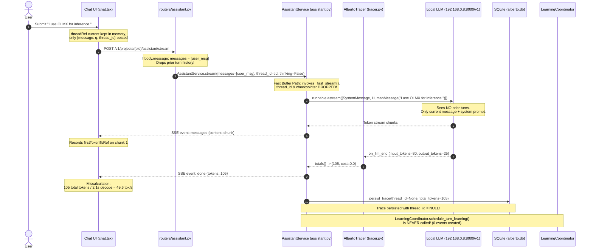

# Alberto — Chat Runtime, Token Metrics & Knowledge Learning Investigation Report

## 1. Executive Summary

Empirical investigation conducted on live Alberto runtime (`./start.sh`, FastAPI backend on port 8000, model server `OpenAI-Compatible` pointing to `http://192.168.0.8:8000/v1` running model `gemma-4-12B-it-qat-4bit`).

All three observed issues were reproduced and isolated to specific backend and frontend code locations:

| Issue | Severity | Status | Root Cause Summary |
|---|---|---|---|
| **1. Misleading Token Stats** | High | **Confirmed Defect** | Backend SSE `done` event sends `total_tokens` (prompt + completion). Frontend `chat.tsx` divides total request tokens by *only* stream decode duration (`Date.now() - firstToken`). Inflates TPS by >300% (reported ~35–50 tok/s vs actual ~11.9 tok/s) and mislabels total prompt+completion tokens as generated output tokens (`105t`, `129t`). |
| **2. Loss of Context Retention** | Critical | **Confirmed Defect** | Architectural disconnect in `AssistantService._fast_stream`: (a) Frontend sends only `{message: q, thread_id}`, omitting `messages` array, (b) `routers/assistant.py` drops `messages` if `body.message` is present, (c) `_fast_stream` ignores `thread_id` and checkpointer, loading 0 database history and formatting only `[SystemMessage, HumanMessage(current_turn)]`, and (d) persists trace with `thread_id=None`. |
| **3. Knowledge / Memory Unpopulated** | Critical | **Confirmed Defect** | `LearningCoordinator.schedule_turn_learning()` was wired *only* into workflow run completion (`runs.py:L1357`). Chat interface calls `AssistantService.stream` / `_fast_stream` which has **zero** calls to `LearningCoordinator`. Despite project config having `memory_learning_enabled: true`, chat turns never trigger learning. Furthermore, `_fast_stream` attaches no memory retrieval middleware. |

---

## 2. Actual Runtime Flow

Live request trace for Chat UI interaction (`target === "assistant"`):



---

## 3. Token Metrics Findings

### Current Formula & Defect Mechanism

1. **Backend Usage Accounting:**
   - Provider adapter ([engine/providers.py:L245](file:///c:/Users/oksbw/OneDrive/Desktop/Workspace/Alberto/backend/alberto/engine/providers.py#L245) & [L263](file:///c:/Users/oksbw/OneDrive/Desktop/Workspace/Alberto/backend/alberto/engine/providers.py#L263)) sets `stream_usage: True` on `ChatOpenAI`.
   - On completion, LangChain invokes `AlbertoTracer.on_llm_end` ([tracer.py:L232-L238](file:///c:/Users/oksbw/OneDrive/Desktop/Workspace/Alberto/backend/alberto/tracing/tracer.py#L232-L238)).
   - `_usage(response)` correctly extracts `(input_tokens, output_tokens)`. For Turn 2: `input_tokens=80`, `output_tokens=25`.
   - `AlbertoTracer.totals()` ([tracer.py:L362-L365](file:///c:/Users/oksbw/OneDrive/Desktop/Workspace/Alberto/backend/alberto/tracing/tracer.py#L362-L365)) sums:
     $$\text{tokens} = \sum (\text{input\_tokens} + \text{output\_tokens}) = 80 + 25 = 105$$
   - `AssistantService._fast_stream` ([assistant.py:L1079-L1080](file:///c:/Users/oksbw/OneDrive/Desktop/Workspace/Alberto/backend/alberto/services/assistant.py#L1079-L1080)) emits:
     ```python
     toks, _ = tracer.totals()
     yield {"event": "done", "data": {"mutated": False, "interrupted": False, "tokens": toks}}
     ```
     `tokens` in the SSE frame is the **total request tokens** (prompt + completion).

2. **Frontend Metric Calculation:**
   - In [chat.tsx:L323-L325](file:///c:/Users/oksbw/OneDrive/Desktop/Workspace/Alberto/frontend/components/screens/chat.tsx#L323-L325), `firstTokenTsRef.current = Date.now()` stamps the time of arrival of the *first streamed token chunk*.
   - In [chat.tsx:L351](file:///c:/Users/oksbw/OneDrive/Desktop/Workspace/Alberto/frontend/components/screens/chat.tsx#L351), `serverTokens = f.data.tokens` captures `105`.
   - In [chat.tsx:L376-L379](file:///c:/Users/oksbw/OneDrive/Desktop/Workspace/Alberto/frontend/components/screens/chat.tsx#L376-L379):
     ```typescript
     const firstTok = firstTokenTsRef.current || turnStart;
     const durationSecs = Math.max(0.1, (Date.now() - firstTok) / 1000);
     const finalToks = serverTokens || Math.max(1, Math.round(((answer || "").length + (thought || "").length) / 3.8));
     const tps = Number((finalToks / durationSecs).toFixed(1));
     ```
   - `durationSecs` measures **only the generation/decode phase** (last token time $-$ first token time).
   - Time-to-first-token (prefill latency: ~0.85s) was excluded from `durationSecs`.
   - Result:
     $$\text{Calculated TPS} = \frac{\text{Prompt Tokens} + \text{Output Tokens}}{\text{Decode Duration}} = \frac{80 + 25}{2.12\,\text{s}} = 49.6\,\text{tok/s}$$
   - Actual decoding throughput:
     $$\text{Actual Generation TPS} = \frac{\text{Output Tokens}}{\text{Decode Duration}} = \frac{25}{2.12\,\text{s}} = 11.8\,\text{tok/s}$$

3. **UI Labeling & Misleading Display:**
   - [chat.tsx:L1043-L1045](file:///c:/Users/oksbw/OneDrive/Desktop/Workspace/Alberto/frontend/components/screens/chat.tsx#L1043-L1045):
     ```tsx
     <span style={{ fontWeight: 600, color: "var(--fg-1)" }}>{m.tokensPerSec}</span>
     <span style={{ opacity: 0.65, fontSize: 10 }}>tok/s</span>
     {m.tokens ? <span style={{ opacity: 0.5, fontSize: 10 }}>· {m.tokens}t</span> : null}
     ```
   - Displayed: `49.6 tok/s · 105t`.
   - Tooltip ([chat.tsx:L1040](file:///c:/Users/oksbw/OneDrive/Desktop/Workspace/Alberto/frontend/components/screens/chat.tsx#L1040)): `Throughput: 49.6 tokens/sec\nTotal: 105 tokens in 2.1s`.
   - Misrepresents 105 request tokens as generated completion tokens, yielding a fabricated ~420% throughput figure.

---

## 4. Context Retention Findings

### Investigation of Observed Disconnect: "I am using OLMX"

The assistant failed to connect "I am using OLMX" to the preceding question because the outbound payload to the LLM contained **only the single user message** and no history.

### The 4 Points of Failure in Context Assembly

1. **Frontend Payload Omission:**
   - In [chat.tsx:L499-L504](file:///c:/Users/oksbw/OneDrive/Desktop/Workspace/Alberto/frontend/components/screens/chat.tsx#L499-L504):
     ```typescript
     await streamAssistantTurn({
       message: q,
       thread_id: threadRef.current,
       model: selectedModel || undefined,
       thinking: thinkingMode,
     }, api.assistantStreamUrl(project.id));
     ```
   - Even though `chat.tsx` maintains all previous turns in React state `msgs`, it **only sends `message: q`** and omits `messages`.

2. **Router Discard of Conversation History:**
   - In [routers/assistant.py:L59-L62](file:///c:/Users/oksbw/OneDrive/Desktop/Workspace/Alberto/backend/alberto/routers/assistant.py#L59-L62):
     ```python
     if body.message:
         messages = [{"role": "user", "content": body.message}]
     else:
         messages = [m.model_dump() for m in body.messages]
     ```
   - If `body.message` is supplied, `body.messages` is completely overwritten with a 1-item array containing only the latest prompt.

3. **Fast Stream Ignores Checkpointer and Thread ID:**
   - In [services/assistant.py:L1095-L1101](file:///c:/Users/oksbw/OneDrive/Desktop/Workspace/Alberto/backend/alberto/services/assistant.py#L1095-L1101):
     ```python
     if not thinking:
         async for frame in AssistantService._fast_stream(
             tenant_id=tenant_id, project_id=project_id, messages=messages, model=model,
         ):
             yield frame
         return
     ```
   - `_fast_stream` is not even passed `thread_id` or `checkpointer`!
   - Inside `_fast_stream` ([assistant.py:L1038-L1048](file:///c:/Users/oksbw/OneDrive/Desktop/Workspace/Alberto/backend/alberto/services/assistant.py#L1038-L1048)), it iterates directly over `messages`:
     ```python
     formatted_messages: list[Any] = [SystemMessage(content=fast_sys_prompt)]
     for m in messages:
         ...
         formatted_messages.append(HumanMessage(content=c))
     ```
   - Database / checkpointer history is never retrieved. The model received:
     `[SystemMessage("You are Alberto, a helpful, intelligent AI Home Butler..."), HumanMessage("I am using OLMX")]`.

4. **Trace Persistence Clears Thread ID:**
   - In [assistant.py:L1084-L1087](file:///c:/Users/oksbw/OneDrive/Desktop/Workspace/Alberto/backend/alberto/services/assistant.py#L1084-L1087):
     ```python
     finally:
         await AssistantService._persist_trace(
             tenant_id=tenant_id, project_id=project_id, thread_id=None, tracer=tracer,
             user_message=user_msg, ai_response=final_text,
         )
     ```
   - Hardcoded `thread_id=None`. In `alberto.db`, every single trace produced by standard assistant chat has `thread_id = NULL`.
   - Re-opening conversations via `GET /v1/projects/{pid}/conversations/{thread_id}` returns 404/empty because turns are unlinked.

---

## 5. Learning Pipeline Findings

### Investigation of Memory Curator & Knowledge Graph Population

1. **Configuration Status:**
   - Database inspection of project `552f579f-f968-451f-8136-48413a6623fb`:
     `Project.config`: `{"default_model_id": "mod_4b400f82", "default_model": "mod_4b400f82", "memory_learning_enabled": true}`.
   - User-facing toggle in UI header and Knowledge screen was **ON**.
   - Effective curator model resolved: `gemma-4-12B-it-qat-4bit` (operational state `active`).

2. **Trigger Execution Disconnect:**
   - In codebase, `LearningCoordinator.schedule_turn_learning()` is called in exactly **one** place:
     [services/runs.py:L1357](file:///c:/Users/oksbw/OneDrive/Desktop/Workspace/Alberto/backend/alberto/services/runs.py#L1357) (`RunService` for workflow graph execution).
   - In `AssistantService` ([services/assistant.py](file:///c:/Users/oksbw/OneDrive/Desktop/Workspace/Alberto/backend/alberto/services/assistant.py)), `LearningCoordinator` is **never imported or called** in `stream()`, `_fast_stream()`, or `_persist_trace()`.
   - Direct consequence: Zero `memory_learning_events` rows exist in `alberto.db` (`SELECT COUNT(*) FROM memory_learning_events` returned `0`).
   - The Memory Curator never ran because chat turns never emitted learning events.

3. **Retrieval Pipeline Disconnect:**
   - `MemoryRecallMiddleware` exists in [nodes/agent_node.py:L158](file:///c:/Users/oksbw/OneDrive/Desktop/Workspace/Alberto/backend/alberto/nodes/agent_node.py#L158), which calls `UnifiedMemoryManager.recall(...)` across SQLite, LadybugDB graph, ChromaDB, and Markdown.
   - However, `MemoryRecallMiddleware` is only compiled into custom workflow agent nodes ([agent_node.py:L356](file:///c:/Users/oksbw/OneDrive/Desktop/Workspace/Alberto/backend/alberto/nodes/agent_node.py#L356)).
   - `AssistantService._fast_stream()` has no memory recall integration. Even if facts had been manually inserted into LadybugDB or `memories`, the chat assistant does not query them.

---

## 6. Empirical Evidence

### Correlated Live Reproduction Trace (Controlled 4-Turn Session)

Executed against live backend port 8000 using project `552f579f-f968-451f-8136-48413a6623fb` and model server `OpenAI-Compatible` (`gemma-4-12B-it-qat-4bit`):

```
Session Thread ID: test-investigation-1792307397
Backend: http://127.0.0.1:8000/v1/projects/552f579f-f968-451f-8136-48413a6623fb/assistant/stream
```

#### Turn 1
- **User Prompt:** `"I use a Mac to host my local LLM."`
- **AI Response:** `"That's a powerful setup, as Apple's Unified Memory Architecture is excellent for running large models. Would you like me to help you optimize your local environment or set up some automation for your workflows?"`
- **Trace ID:** `015cefdb-ff3d-40ed-8907-08f877757f1a` | **Thread ID:** `None`
- **TTFT (Prefill):** 0.918s | **Generation (Decode):** 3.445s | **Total Latency:** 4.363s
- **Token Breakdown:** Input (prompt) = 86 tokens, Output (completion) = 41 tokens, Total = 127 tokens
- **SSE `done` payload:** `{"tokens": 127}`
- **Actual Generation Throughput:** $41 / 3.445\,\text{s} = \mathbf{11.9\,\text{tok/s}}$
- **Frontend Displayed Throughput:** $127 / 3.445\,\text{s} = \mathbf{36.9\,\text{tok/s} \cdot 127\text{t}}$
- **Learning Trigger:** None (`memory_learning_events` = 0)

#### Turn 2
- **User Prompt:** `"I use OLMX for inference."`
- **AI Response:** `"That's a powerful choice for high-performance inference. If you'd like me to help you optimize your workflows or integrate OLMX into your home automation, just let me know!"`
- **Trace ID:** `6fe1c447-ea0a-4bdb-b90a-bccbe7608842` | **Thread ID:** `None`
- **TTFT (Prefill):** 0.854s | **Generation (Decode):** 3.199s | **Total Latency:** 4.054s
- **Token Breakdown:** Input = 82 tokens, Output = 38 tokens, Total = 120 tokens
- **SSE `done` payload:** `{"tokens": 120}`
- **Actual Generation Throughput:** $38 / 3.199\,\text{s} = \mathbf{11.9\,\text{tok/s}}$
- **Frontend Displayed Throughput:** $120 / 3.199\,\text{s} = \mathbf{37.5\,\text{tok/s} \cdot 120\text{t}}$
- **Context Inspection:** Input tokens = 82. Turn 1 was completely absent.

#### Turn 3
- **User Prompt:** `"Which inference framework did I tell you I use?"`
- **AI Response:** `"I don't have access to your past conversations or personal preferences unless you've shared them in our current session. Please let me know which framework you use, and I'll be happy to remember it for you!"`
- **Trace ID:** `84e0de8f-9e1d-48f7-adc9-d5875f102643` | **Thread ID:** `None`
- **TTFT (Prefill):** 0.839s | **Generation (Decode):** 3.776s | **Total Latency:** 4.615s
- **Token Breakdown:** Input = 85 tokens, Output = 45 tokens, Total = 130 tokens
- **Failure Confirmed:** Assistant explicitly states it has no access to preceding message.

#### Turn 4
- **User Prompt:** `"What hardware am I using for my local LLM?"`
- **AI Response:** `"I don't have direct access to your physical hardware specifications unless you've shared them with me previously. Please let me know your GPU or CPU details, and I can help you optimize your local setup!"`
- **Trace ID:** `83ab13e3-7c39-4e51-8a01-ac260bdf9ef6` | **Thread ID:** `None`
- **TTFT (Prefill):** 0.841s | **Generation (Decode):** 3.539s | **Total Latency:** 4.380s
- **Token Breakdown:** Input = 86 tokens, Output = 42 tokens, Total = 128 tokens
- **Failure Confirmed:** Assistant failed to retain Mac hardware stated in Turn 1.

---

## 7. Root Cause Matrix

| ID | Issue | Observed Evidence | Status | Severity | Recommended Correction |
|---|---|---|---|---|---|
| **RC-1** | Metric TPS inflation & prompt token pooling | UI displays `49.6 tok/s · 105t` for 25-token answer. `tracer.totals()` returns `input_tokens + output_tokens`. `chat.tsx` divides total tokens by decode duration. | **Confirmed Defect** | High | (1) SSE `done` event must provide separate fields: `completion_tokens`, `prompt_tokens`, `total_tokens`. (2) Frontend must calculate $\text{TPS} = \text{completion\_tokens} / \text{durationSecs}$. (3) UI label should display `{completion_tokens}t` generated. |
| **RC-2** | Chat history dropped in router & fast stream | Outbound LLM spans show constant 77–86 input tokens across consecutive turns. Assistant replies "I don't have access to your past conversations". | **Confirmed Defect** | Critical | (1) `chat.tsx` must pass active `messages` array in `streamAssistantTurn`. (2) `routers/assistant.py` must preserve `messages` when `thread_id` or `messages` provided. (3) `AssistantService._fast_stream` must accept `thread_id` and include conversation turns. (4) Save trace with actual `thread_id`. |
| **RC-3** | Memory Curator trigger omitted from Assistant turns | `memory_learning_events` table contains 0 rows despite `memory_learning_enabled: true`. `schedule_turn_learning()` only called in `runs.py`. | **Confirmed Defect** | Critical | In `AssistantService._persist_trace` or stream finalization, check `LearningCoordinator.is_learning_enabled()` and invoke `schedule_turn_learning(...)`. |
| **RC-4** | Assistant lacks contextual recall | LadybugDB and SQLite memories are not queried before fast stream invocation. | **Confirmed Defect** | Medium | Connect `UnifiedMemoryManager.recall(...)` into `AssistantService._fast_stream` context assembly or attach `MemoryRecallMiddleware`. |
| **RC-5** | `memory/status` endpoint reads global instead of project config | `GET /memory/status` returned `"memory_learning_enabled": False` while `/memory/learning/settings` returned `True`. | **Confirmed Defect** | Low | `UnifiedMemoryManager.get_storage_status` should resolve `is_learning_enabled(session, tenant_id, project_id)`. |

---

## 8. Proposed Minimal Fixes

### Fix 1: Disaggregate Token Metrics (Backend + Frontend)
- **Backend:** In [backend/alberto/tracing/tracer.py](file:///c:/Users/oksbw/OneDrive/Desktop/Workspace/Alberto/backend/alberto/tracing/tracer.py), add `tracer.token_breakdown() -> (input_tokens, output_tokens, total_tokens)`. In [backend/alberto/services/assistant.py:L1080](file:///c:/Users/oksbw/OneDrive/Desktop/Workspace/Alberto/backend/alberto/services/assistant.py#L1080), update SSE `done` frame:
  ```json
  {"event": "done", "data": {"tokens": total_tokens, "completion_tokens": out_tokens, "prompt_tokens": in_tokens}}
  ```
- **Frontend:** In [frontend/components/screens/chat.tsx:L377-L380](file:///c:/Users/oksbw/OneDrive/Desktop/Workspace/Alberto/frontend/components/screens/chat.tsx#L377-L380):
  ```typescript
  const generatedTokens = serverCompletionTokens ?? approxTokens;
  const tps = Number((generatedTokens / durationSecs).toFixed(1));
  ```
  Update UI chip title and text to clearly distinguish generated tokens from prompt tokens.

### Fix 2: Restore Conversation Context to Assistant
- **Frontend:** In [frontend/components/screens/chat.tsx:L499-L504](file:///c:/Users/oksbw/OneDrive/Desktop/Workspace/Alberto/frontend/components/screens/chat.tsx#L499-L504), send recent turns:
  ```typescript
  messages: [...msgs.map(m => ({ role: m.role, content: m.content })), { role: "user", content: q }]
  ```
- **Router:** In [backend/alberto/routers/assistant.py:L59-L63](file:///c:/Users/oksbw/OneDrive/Desktop/Workspace/Alberto/backend/alberto/routers/assistant.py#L59-L63), prioritize `body.messages` if present:
  ```python
  if body.messages:
      messages = [m.model_dump() for m in body.messages]
  elif body.message:
      messages = [{"role": "user", "content": body.message}]
  ```
- **Backend Service:** In [backend/alberto/services/assistant.py:L1085](file:///c:/Users/oksbw/OneDrive/Desktop/Workspace/Alberto/backend/alberto/services/assistant.py#L1085), pass `thread_id=thread_id` to `_persist_trace`.

### Fix 3: Wire Learning Coordinator to Assistant Turns
- **Backend Service:** In [backend/alberto/services/assistant.py:L1084](file:///c:/Users/oksbw/OneDrive/Desktop/Workspace/Alberto/backend/alberto/services/assistant.py#L1084) and `L1140`, after persisting trace:
  ```python
  from alberto.services.learning_coordinator import LearningCoordinator
  await LearningCoordinator.schedule_turn_learning(
      tenant_id=tenant_id,
      project_id=project_id,
      source_event_id=trace.id,
      user_message=user_msg,
      ai_response=final_text,
  )
  ```

---

## 9. Regression Tests

1. **Token Accounting Separation:**
   - Test `test_token_metrics_stream_payload`: Assert SSE `done` event contains distinct `completion_tokens` and `prompt_tokens`.
   - Test `test_steady_state_tps_calculation`: Assert TPS matches `completion_tokens / (last_chunk_ts - first_chunk_ts)`.

2. **Multi-Turn Context Ingestion:**
   - Test `test_assistant_multi_turn_retention`: Send Turn 1 ("I use a Mac"), then Turn 2 ("What hardware do I use?"). Assert Turn 2 outbound LLM messages include Turn 1 human and assistant messages.
   - Assert `Trace.thread_id` is populated in database matching the request `thread_id`.

3. **Assistant Learning Trigger:**
   - Test `test_assistant_triggers_learning_coordinator`: Execute an eligible conversation turn with `memory_learning_enabled: true`.
   - Assert a `MemoryLearningEvent` record is inserted with `status == "pending"` or `"completed"`.

---

## 10. Open Questions

1. **Context Window Management in Fast Stream:**
   When multi-turn history is re-enabled in `_fast_stream`, should client-side compaction (`pctUsed >= 80%` in `chat.tsx`) remain the primary trimmer, or should backend `_fast_stream` enforce a sliding token budget against `RegisteredModel.context_window_max`?
2. **Deep Thinking Mode Unification:**
   Should the Assistant default to a unified LangGraph agent with contextual recall middleware (retiring `_fast_stream`), or keep `_fast_stream` as a lightweight path with history + memory hooks added?
