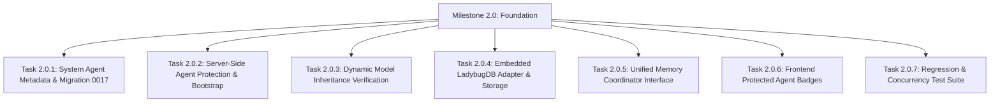

# Alberto — Phase 2 Architecture & Readiness Audit
**Protected System Subagents, Model Inheritance, Embedded Knowledge Graph (LadybugDB), Unified Memory, and Autonomous Evolution**

---

## 1. Executive Summary

Milestones 1.5 and 1.6 completed single-container delivery, release engineering, execution engine safety limits, worker lease recovery, and streaming reliability. Phase 2 extends Alberto from an execution runtime into an intelligent, autonomous Home Butler capable of durable structured memory, continuous learning, and self-managed knowledge graph operations.

This audit evaluates existing code, schemas, and runtime behaviour across backend, frontend, database, and container boundaries. It defines the exact minimal, backward-compatible design for Milestone 2.0 (Foundation), Milestone 2.1 (Intelligent Memory), and Milestone 2.2 (Continuous Learning).

### Executive Findings Table

| Area | Status | Priority | Finding / Architecture Reality | Action Required |
|---|---|---|---|---|
| **Subagent Execution Architecture** | Implemented | **P0** | LangGraph + `deepagents.SubAgentMiddleware` in [`agent_node.py:156-181`](file:///c:/Users/oksbw/OneDrive/Desktop/Workspace/Alberto/backend/alberto/nodes/agent_node.py#L156-L181) already runs subagents via `task` tool with safety limits. | Reuse existing engine. No second agent runner. Add `is_system` protection. |
| **Model Inheritance** | Implemented | **P0** | `resolve_model(None, ctx)` in [`models.py:80-90`](file:///c:/Users/oksbw/OneDrive/Desktop/Workspace/Alberto/backend/alberto/engine/models.py#L80-L90) and `build_subagents()` already dynamically inherit context default model. | Verify precedence (Explicit Override > Tenant Default > System Default). No provider rewrite. |
| **Knowledge Graph (Existing)** | Missing (Greenfield) | **P0** | No SQLite knowledge graph tables exist in `alberto.db`. Phase 2 KG is a greenfield integration, not a data migration. | Deploy clean schema in embedded LadybugDB. No SQLite graph data to backfill. |
| **LadybugDB Concurrency Constraint** | Risk | **P0** | LadybugDB enforces an **exclusive file lock across OS processes**. Concurrent writes from FastAPI and standalone worker fail with IO error. | Mandate single-process write ownership (in-process worker or API gateway pattern). |
| **Unified Memory Coordinator** | Partial | **P1** | Memory split across SQLite (`memories`, `qa_pairs`), ChromaDB (`forge_mem`, `forge_kb`, `forge_qa`), and checkpointer (`checkpoints.sqlite`). | Wrap in single `MemoryManager` facade without removing underlying engines. |
| **Protected System Agents** | Partial | **P1** | `Agent` entity in [`entities.py:152-161`](file:///c:/Users/oksbw/OneDrive/Desktop/Workspace/Alberto/backend/alberto/models/entities.py#L152-L161) lacks `is_system` flag. Frontend allows deleting any preset. | Add `is_system: bool` (migration 0017), server-side deletion block, idempotent bootstrap. |
| **MCP Tool Learning** | Missing / Design | **P2** | MCP tools discovered dynamically; execution traces captured in `spans`/`traces`. No automated learning yet. | Restrict to explicit, user-configured workflows and permitted tool operations. Zero polling loops. |
| **Container & Resource Ceiling** | Partial / Risk | **P2** | ChromaDB + ONNX FastEmbed + LadybugDB columnar buffer run in same container. | Cap LadybugDB buffer manager memory (`256MB`). Keep all storage under `/data`. |

---

## 2. Existing Architecture Dependency Map

Alberto's runtime architecture operates locally in a single Docker container with embedded storage engines:

```
+---------------------------------------------------------------------------------------+
|                                    Next.js Frontend                                   |
|   - Chat UI (chat.tsx)          - Agents Config (agents.tsx)    - Knowledge (knowledge.tsx)  |
|   - Model Registry (settings)   - Traces Waterfall (traces.tsx) - Canvas (workflows.tsx) |
+---------------------------------------------------------------------------------------+
                                           | HTTP / SSE
                                           v
+---------------------------------------------------------------------------------------+
|                                  FastAPI Backend Core                                 |
|  - Lifecycle & Bootstrap (main.py)           - Router Layer (routers/*.py)            |
|  - Auth & RBAC (deps.py, security.py)        - Secret Decryption (secrets/store.py)   |
|  - Single-container Process Owner             - CompileContext Assembly (runtime.py)   |
+---------------------------------------------------------------------------------------+
        |                                  |                                  |
        v                                  v                                  v
+-----------------------+      +-----------------------+      +-----------------------+
| LangGraph Execution   |      | Model Resolution Layer|      | Memory & Knowledge    |
| - StateGraph Compiler |      | - ModelRegistry DB    |      | - MemoryService       |
| - ReAct / deep_agent  |      | - Provider Adapters   |      | - KnowledgeService    |
| - SubAgentMiddleware  |      | - Dynamic Inheritance |      | - SemanticCacheService|
| - Safety Middleware   |      | - Connection Pool     |      | - Hybrid BM25 + RRF   |
+-----------------------+      +-----------------------+      +-----------------------+
        |                                  |                                  |
        +----------------------------------+----------------------------------+
                                           |
                                           v
+---------------------------------------------------------------------------------------+
|                              Persistent Storage Layer (/data)                         |
|  - SQLite (alberto.db): Entities, Traces, Spans, Runs, Jobs, Settings                 |
|  - SQLite (checkpoints.sqlite): LangGraph turn checkpoints                            |
|  - SQLite (queue.sqlite): Background worker task queue                                |
|  - ChromaDB (/data/chroma): Vector collections (forge_mem, forge_kb, forge_qa)        |
|  - Target Embedded Graph (/data/db/ladybug): LadybugDB property graph (Phase 2)       |
+---------------------------------------------------------------------------------------+
```

### File & Component Tracing

- **Application Lifecycle**: [`backend/alberto/main.py:148-220`](file:///c:/Users/oksbw/OneDrive/Desktop/Workspace/Alberto/backend/alberto/main.py#L148-L220)
- **Compile Context Builder**: [`backend/alberto/services/runtime.py:43-145`](file:///c:/Users/oksbw/OneDrive/Desktop/Workspace/Alberto/backend/alberto/services/runtime.py#L43-L145)
- **Agent Node & Subagents**: [`backend/alberto/nodes/agent_node.py:156-181, 355-400`](file:///c:/Users/oksbw/OneDrive/Desktop/Workspace/Alberto/backend/alberto/nodes/agent_node.py#L156-L181)
- **Model Resolution**: [`backend/alberto/engine/models.py:71-160`](file:///c:/Users/oksbw/OneDrive/Desktop/Workspace/Alberto/backend/alberto/engine/models.py#L71-L160)
- **Memory Service**: [`backend/alberto/services/memory.py:18-66`](file:///c:/Users/oksbw/OneDrive/Desktop/Workspace/Alberto/backend/alberto/services/memory.py#L18-L66)
- **Knowledge & RAG Service**: [`backend/alberto/services/knowledge.py:118-977`](file:///c:/Users/oksbw/OneDrive/Desktop/Workspace/Alberto/backend/alberto/services/knowledge.py#L118-L977)
- **Chroma Storage Engine**: [`backend/alberto/knowledge/store.py:149-200`](file:///c:/Users/oksbw/OneDrive/Desktop/Workspace/Alberto/backend/alberto/knowledge/store.py#L149-L200)
- **Tracing & Subagent Spans**: [`backend/alberto/tracing/tracer.py:40-54, 86-135`](file:///c:/Users/oksbw/OneDrive/Desktop/Workspace/Alberto/backend/alberto/tracing/tracer.py#L40-L54)

---

## 3. Subagent Framework Assessment

### 3.1 Existing Implementation

1. **Persistence Model**:
   - Stored in `agents` table ([`backend/alberto/models/entities.py:152-161`](file:///c:/Users/oksbw/OneDrive/Desktop/Workspace/Alberto/backend/alberto/models/entities.py#L152-L161)).
   - Columns: `id`, `tenant_id`, `project_id`, `name`, `config` (JSON), `created_by`, `created_by_email`, `created_at`, `updated_at`.
   - Node JSON schema ([`backend/schemas/alberto/nodes/agent.json:103-145`](file:///c:/Users/oksbw/OneDrive/Desktop/Workspace/Alberto/backend/schemas/alberto/nodes/agent.json#L103-L145)) specifies `subagents` as a list of `SubAgent` definitions.
2. **Registration and Discovery**:
   - `AgentService` ([`backend/alberto/services/agents.py:12-53`](file:///c:/Users/oksbw/OneDrive/Desktop/Workspace/Alberto/backend/alberto/services/agents.py#L12-L53)) provides CRUD and JSON-schema validation against `forge/nodes/agent`.
   - Router endpoints in [`backend/alberto/routers/agents.py:25-90`](file:///c:/Users/oksbw/OneDrive/Desktop/Workspace/Alberto/backend/alberto/routers/agents.py#L25-L90).
3. **Execution through LangGraph**:
   - Deep agent supervisors compile with LangChain/LangGraph + `deepagents.SubAgentMiddleware` ([`backend/alberto/nodes/agent_node.py:365-393`](file:///c:/Users/oksbw/OneDrive/Desktop/Workspace/Alberto/backend/alberto/nodes/agent_node.py#L365-L393)).
   - Subagents are transformed into runtime specs by `build_subagents()` ([`backend/alberto/nodes/agent_node.py:156-181`](file:///c:/Users/oksbw/OneDrive/Desktop/Workspace/Alberto/backend/alberto/nodes/agent_node.py#L156-L181)).
   - Parent supervisor invokes subagents using the standard `task` tool:
     `{"subagent_type": "<subagent_name>", "description": "<instruction>"}`.
4. **Safety & Runtime Limits**:
   - Subagents inherit safety middleware automatically via `_ensure_safety_middleware()` ([`backend/alberto/nodes/agent_node.py:122-153`](file:///c:/Users/oksbw/OneDrive/Desktop/Workspace/Alberto/backend/alberto/nodes/agent_node.py#L122-L153)):
     - `ModelCallLimitMiddleware(run_limit=settings.max_model_calls_per_run)`
     - `ToolCallLimitMiddleware(run_limit=settings.max_tool_calls_per_run)`
     - `RepeatedToolCallMiddleware(max_repeats=settings.max_repeated_no_progress_calls)`
5. **Observability**:
   - `ForgeTracer` ([`backend/alberto/tracing/tracer.py:40-54, 246-250`](file:///c:/Users/oksbw/OneDrive/Desktop/Workspace/Alberto/backend/alberto/tracing/tracer.py#L40-L54)) inspects `task` arguments, parses `subagent_type`, and emits a named span (`kind="subagent"`, name=`subagent · <name>`) in the execution trace waterfall.

### 3.2 Framework Suitability for Protected System Agents

The existing subagent framework is **fully capable** of supporting built-in protected system agents. No parallel execution architecture is required.

### 3.3 Required Changes for Milestone 2.0

To support protected system agents cleanly:

1. **Schema Extension**:
   - Add `is_system: Mapped[bool] = mapped_column(Boolean, default=False, server_default="0")` to `Agent` model in [`backend/alberto/models/entities.py:152`](file:///c:/Users/oksbw/OneDrive/Desktop/Workspace/Alberto/backend/alberto/models/entities.py#L152).
   - Generate Alembic migration `0017_system_agents.py`.
2. **Server-Side Protection**:
   - In [`backend/alberto/routers/agents.py:77-84`](file:///c:/Users/oksbw/OneDrive/Desktop/Workspace/Alberto/backend/alberto/routers/agents.py#L77-L84) and [`backend/alberto/services/agents.py:40-43`](file:///c:/Users/oksbw/OneDrive/Desktop/Workspace/Alberto/backend/alberto/services/agents.py#L40-L43):
     ```python
     if getattr(agent, "is_system", False):
         raise HTTPException(status_code=400, detail="Protected system agent cannot be deleted")
     ```
   - In `update_agent`, prevent modifying `name` if `is_system` is true (reserved identity cannot be renamed). Allow tuning instructions, system prompt, or model override.
3. **Automatic Idempotent Provisioning**:
   - In [`backend/alberto/main.py:173`](file:///c:/Users/oksbw/OneDrive/Desktop/Workspace/Alberto/backend/alberto/main.py#L173) (during bootstrap / project creation):
     Add `ensure_system_agents(session, tenant_id, project_id)`.
   - Checks if `memory_curator` and `graph_manager` exist in `agents` table. If absent, provisions them with `is_system=True`.

### 3.4 Representation of System Agents

- `memory_curator`:
  ```json
  {
    "name": "memory_curator",
    "description": "Reviews conversation turns, deduplicates, verifies confidence and updates long-term memory.",
    "system_prompt": "You are Alberto's Memory Curator. You review dialogue facts, maintain long-term preferences, verify confidence, and store durable facts.",
    "tools": ["remember", "recall", "memory_list", "memory_delete"],
    "model": null
  }
  ```
- `graph_manager`:
  ```json
  {
    "name": "graph_manager",
    "description": "Manages Alberto's knowledge graph in LadybugDB. Traverses relations, canonicalises entities, and executes Cypher updates.",
    "system_prompt": "You are Alberto's Knowledge Graph Manager. You manage entities and relations in the embedded property graph using Cypher.",
    "tools": ["graph_query", "graph_traverse", "graph_insert_node", "graph_insert_rel"],
    "model": null
  }
  ```

Leaving `"model": null` guarantees dynamic model inheritance.

---

## 4. Model Provider and LLM Configuration Assessment

### 4.1 Existing Infrastructure

- **Entities**:
  - `ModelServer` ([`backend/alberto/models/entities.py:586-596`](file:///c:/Users/oksbw/OneDrive/Desktop/Workspace/Alberto/backend/alberto/models/entities.py#L586-L596)): records provider endpoint (`ollama`, `lm_studio`, `vllm`, `openai_compatible`, `openai`, `anthropic`, `google`).
  - `RegisteredModel` ([`backend/alberto/models/entities.py:598-615`](file:///c:/Users/oksbw/OneDrive/Desktop/Workspace/Alberto/backend/alberto/models/entities.py#L598-L615)): model instance with parameters (`temperature`, `top_p`, `max_output_tokens`, `supports_tools`).
- **Resolution Pipeline**:
  - `resolve_model()` ([`backend/alberto/engine/models.py:71-160`](file:///c:/Users/oksbw/OneDrive/Desktop/Workspace/Alberto/backend/alberto/engine/models.py#L71-L160)) resolves in order:
    1. Direct instance (`BaseChatModel`)
    2. Fallback to `ctx.default_model_id` or `ctx.default_model` or `settings.default_model` if ref is `None` or `""`
    3. `fake:` offline model
    4. Alberto Model Registry (`RegisteredModel` bound to `ModelServer`)
    5. Legacy custom provider ref (`custom:<id>:<model>`)
    6. Legacy cloud provider strings (`openai:...`, `anthropic:...`)
- **Connection Keep-Alive**:
  - HTTP connection pooling is shared via `shared_llm_async_client()` in [`backend/alberto/engine/providers.py:242-253`](file:///c:/Users/oksbw/OneDrive/Desktop/Workspace/Alberto/backend/alberto/engine/providers.py#L242-L253).

### 4.2 Dynamic Inheritance Evaluation

- In [`backend/alberto/nodes/agent_node.py:176`](file:///c:/Users/oksbw/OneDrive/Desktop/Workspace/Alberto/backend/alberto/nodes/agent_node.py#L176):
  ```python
  "model": resolve_model(sa["model"], ctx) if sa.get("model") else (default_model or resolve_model(None, ctx))
  ```
- Subagents with `sa.get("model") == None` inherit `default_model` (parent deep agent) or `resolve_model(None, ctx)` (project default).
- When a user updates the project's default model in the Model Registry, `build_compile_context()` ([`backend/alberto/services/runtime.py:91-97`](file:///c:/Users/oksbw/OneDrive/Desktop/Workspace/Alberto/backend/alberto/services/runtime.py#L91-L97)) updates `ctx.default_model_id` and `ctx.default_model` on the next turn.
- Inheriting agents and subagents immediately run on the new default model **without modifying or reprovisioning agent definitions**.

**Conclusion:** Dynamic model inheritance is already architecturally supported. No new provider registry or rewrite is necessary.

---

## 5. Knowledge Graph Audit & LadybugDB Feasibility

### 5.1 Existing Graph Investigation

An exhaustive audit of Alberto's SQLite databases, migrations, and services reveals:

1. **Schema Check**:
   - `alberto.db` contains 35 tables (Section 1).
   - Zero tables exist for graph entities, relationships, edges, or triples.
2. **Services & APIs**:
   - Zero graph services, endpoints, traversal functions, or entity deduplication exist.
   - References to "graph" in existing code refer strictly to **LangGraph execution flow graphs** (`StateGraph`, `CompiledStateGraph`, nodes, edges).
3. **Conclusion**:
   - There is no legacy SQLite knowledge graph data to migrate.
   - The knowledge graph in Phase 2 is a **clean greenfield feature**.

### 5.2 LadybugDB Technical Feasibility

LadybugDB (active successor/fork of Kùzu / KùzuDB) was evaluated against runtime requirements:

| Capability | Requirement | LadybugDB Status | Notes |
|---|---|---|---|
| **Packaging & Wheels** | Python 3.11 - 3.13 | **Verified** | Pre-compiled wheels on PyPI (`ladybug`): `manylinux_2_28` (x86_64, aarch64), Windows x86_64, macOS Universal. Compatible with `python:3.12-slim`. |
| **Embedded Storage** | Local persistent file/dir under `/data` | **Verified** | Runs embedded in-process (`db = ladybug.Database('/data/db/ladybug')`). Zero server daemon required. |
| **Query Language** | Cypher | **Verified** | Standard Cypher: `MATCH`, `CREATE`, `MERGE`, `DELETE`, `WITH`, `RETURN`. |
| **Multi-hop Traversal** | Variable-length relationships | **Verified** | Native `-[*1..N]->` syntax with bounded hop limits (default 30). |
| **Shortest Paths** | Native graph traversal | **Verified** | Native `* SHORTEST 1..N` and `* ALL SHORTEST 1..N` using breadth-first search. |
| **Vector Search** | Hybrid semantic graph | **Verified** | Native HNSW vector index support. |
| **Full-Text Search** | Keyword lookup | **Verified** | Native FTS extension available. |
| **ACID Transactions** | Read/write consistency | **Verified** | Serializable ACID within a single process. |
| **Multi-Process Concurrency** | Shared access | **BLOCKED / RISK** | **Exclusive OS file lock on write connections**. Second process gets IO error: *"Could not set lock on file"*. |

### 5.3 Concurrency Architecture Solution

Because LadybugDB forbids concurrent multi-process writes to the same database directory:

1. **Single-Process Owner**:
   - The FastAPI backend process (`uvicorn alberto.main:app`) is the **sole writer** to `/data/db/ladybug`.
   - Thread-safe connection pooling is achieved by initializing a single `ladybug.Database` instance at startup (`app.state.graph_db`) and sharing lightweight `Connection` objects per thread/async worker.
2. **Worker Concurrency Rule**:
   - Background runs executing in-process (the default Docker configuration) access `app.state.graph_db` safely.
   - If a standalone CLI worker (`python -m alberto.worker`) is deployed in a separate container/process, it must **not** open `/data/db/ladybug` in write mode directly. It must perform graph mutations via internal HTTP requests to the FastAPI backend or run in read-only mode (`ladybug.Database('/data/db/ladybug', read_only=True)`).

### 5.4 Graph Storage Adapter Design

Implement `LadybugGraphAdapter` in `backend/alberto/knowledge/graph.py`:

```sql
-- Schema initialization:
CREATE NODE TABLE Entity(
    id STRING,
    tenant_id STRING,
    project_id STRING,
    name STRING,
    canonical_name STRING,
    kind STRING,
    description STRING,
    confidence DOUBLE,
    source STRING,
    created_at INT64,
    PRIMARY KEY(id)
);

CREATE REL TABLE RelatesTo(
    FROM Entity TO Entity,
    kind STRING,
    confidence DOUBLE,
    provenance STRING,
    created_at INT64
);
```

Native capabilities replace custom Python logic:
- Multi-hop traversal: `MATCH (a:Entity {canonical_name: $start})-[r:RelatesTo*1..3]->(b:Entity) RETURN b, r`
- Shortest path: `MATCH p = (a:Entity {id: $id1})-[r:RelatesTo* SHORTEST 1..5]->(b:Entity {id: $id2}) RETURN p`

---

## 6. Existing Memory Architecture & Responsibility Matrix

### 6.1 Storage Systems Inventory

1. **SQLite Checkpoints (`checkpoints.sqlite`)**:
   - Managed by `langgraph-checkpoint-sqlite` (`AsyncSqliteSaver`).
   - Stores serialized execution thread state and multi-turn conversational history.
2. **SQLite Database (`alberto.db`)**:
   - `memories` table ([`entities.py:393-404`](file:///c:/Users/oksbw/OneDrive/Desktop/Workspace/Alberto/backend/alberto/models/entities.py#L393-L404)): long-term agent notes and preferences (`id`, `tenant_id`, `project_id`, `scope`, `text`, `kind`).
   - `qa_pairs` table ([`entities.py:215-225`](file:///c:/Users/oksbw/OneDrive/Desktop/Workspace/Alberto/backend/alberto/models/entities.py#L215-L225)): curated FAQ questions and answers.
   - `kb_sources` table ([`entities.py:184-213`](file:///c:/Users/oksbw/OneDrive/Desktop/Workspace/Alberto/backend/alberto/models/entities.py#L184-L213)): knowledge base sources (files, urls, crawls).
   - `traces` & `spans` ([`entities.py:282-313, 460-478`](file:///c:/Users/oksbw/OneDrive/Desktop/Workspace/Alberto/backend/alberto/models/entities.py#L282-L313)): complete execution history, user messages, AI replies, tool inputs/outputs, costs.
3. **ChromaDB (`/data/chroma`)**:
   - Managed by `ChromaStore` ([`backend/alberto/knowledge/store.py:149-200`](file:///c:/Users/oksbw/OneDrive/Desktop/Workspace/Alberto/backend/alberto/knowledge/store.py#L149-L200)).
   - Collections keyed by embedding dimension:
     - `forge_mem_<dim>`: semantic vectors for `MemoryService` long-term recall.
     - `forge_kb_<dim>`: chunk vectors for RAG document retrieval.
     - `forge_qa_<dim>`: question vectors for FAQ semantic matching and deflection.
     - `forge_cache_<dim>`: semantic cache vectors for repeat questions.
4. **Markdown Directory (`/data/memory`)**:
   - Created on boot (`ensure_dirs()`), currently empty (`.gitkeep`). No service writes markdown files.

### 6.2 Storage Responsibility Matrix

| Information Type | Authoritative Primary Engine | Indexing / Vector Engine | Scope / Isolation | Redundancy Assessment |
|---|---|---|---|---|
| **Thread Conversation State** | SQLite (`checkpoints.sqlite`) | In-memory LangGraph state | Thread ID | None. Single source of truth. |
| **Long-Term User Notes** | SQLite `memories` table | ChromaDB `forge_mem_<dim>` | Tenant, Project, Scope | Stored in SQLite; vectorized in Chroma. Necessary for listing + semantic query. |
| **Curated FAQ / Q&A** | SQLite `qa_pairs` table | ChromaDB `forge_qa_<dim>` | Tenant, Project, Kind | Duplicate `q_embedding` in SQLite JSON column; Chroma handles search. Safe to prune JSON column in future. |
| **Knowledge Documents** | SQLite `kb_sources` metadata | ChromaDB `forge_kb_<dim>` | Tenant, Project, Folder | Document text stored in source meta/file; chunk text stored in Chroma. Clean separation. |
| **Structured Facts & Relations** | LadybugDB (Phase 2 Target) | Native LadybugDB HNSW/FTS | Tenant, Project | None. Greenfield. |
| **Execution Observability** | SQLite `traces`, `spans` | None | Tenant, Project, Run ID | Turn inputs/outputs persisted for audit/history. |
| **Semantic Response Cache** | ChromaDB `forge_cache_<dim>` | ChromaDB cosine similarity | Tenant, Project, Scope | Ephemeral with TTL. Clean separation. |

---

## 7. Unified Memory Manager Recommendation

Existing memory services (`MemoryService`, `KnowledgeService`, `SemanticCacheService`) are functionally isolated. They should not be rewritten. Instead, wrap them in a single coordinating interface:

### 7.1 Unified Memory Coordinator: `MemoryManager`

Located at `backend/alberto/services/unified_memory.py`:

```python
class MemoryManager:
    """Lightweight coordinator across Alberto's storage engines."""

    @staticmethod
    async def recall(
        session, tenant_id: str, project_id: str, query: str,
        *, scope: str = "default", sources: list[str] | None = None, top_k: int = 5,
    ) -> list[UnifiedMemoryRecord]:
        """Query across memory, Q&A, knowledge base, and knowledge graph."""
        ...

    @staticmethod
    async def remember(
        session, tenant_id: str, project_id: str, content: str,
        *, target: str = "auto", scope: str = "default", metadata: dict | None = None,
    ) -> str:
        """Route storage to MemoryService, Q&A, or GraphManager."""
        ...
```

- **Reuses existing functions**:
  - `MemoryService.recall()` ([`memory.py:41`](file:///c:/Users/oksbw/OneDrive/Desktop/Workspace/Alberto/backend/alberto/services/memory.py#L41))
  - `KnowledgeService.top_qa()` ([`knowledge.py:915`](file:///c:/Users/oksbw/OneDrive/Desktop/Workspace/Alberto/backend/alberto/services/knowledge.py#L915))
  - `KnowledgeService.search()` ([`knowledge.py:591`](file:///c:/Users/oksbw/OneDrive/Desktop/Workspace/Alberto/backend/alberto/services/knowledge.py#L591))
  - `LadybugGraphAdapter.query()` (Phase 2)
- Coordinator normalizes results into `UnifiedMemoryRecord(source, text, score, metadata, provenance)`.

---

## 8. Future Memory Curator Readiness

### 8.1 Existing Infrastructure Available for Reuse

- **Conversation Input**: `Trace` rows capture `user_message`, `ai_response`, and `thread_id` in [`backend/alberto/models/entities.py:308-311`](file:///c:/Users/oksbw/OneDrive/Desktop/Workspace/Alberto/backend/alberto/models/entities.py#L308-L311).
- **Storage Target**: `MemoryService.remember()` in [`backend/alberto/services/memory.py:24`](file:///c:/Users/oksbw/OneDrive/Desktop/Workspace/Alberto/backend/alberto/services/memory.py#L24).
- **Filtering**: `settings.memory_recall_min_score` filters noise by cosine similarity floor.

### 8.2 Boundary: Deterministic Logic vs LLM Reasoning

| Memory Curator Function | Execution Mechanism | Implementation Design |
|---|---|---|
| **Fact Candidate Extraction** | LLM Reasoning | Structured JSON output prompt (`extract_facts(user_msg, ai_reply)`). |
| **Durable vs Ephemeral Classification** | LLM Reasoning | Few-shot classification (Preferences/Rules = Durable; Session context = Ephemeral). |
| **Conflict & Staleness Detection** | Hybrid (Deterministic + LLM) | Cosine recall of top-3 related memories; LLM decides replace/keep/augment. |
| **Exact Deduplication** | Deterministic | Canonical text hashing (MD5/SHA256 after whitespace normalisation). |
| **Provenance Stamp** | Deterministic | Stamped with `source_trace_id`, `thread_id`, timestamp, and caller identity. |
| **Confidence Scoring** | Deterministic Floor | Enforce minimum confidence threshold (e.g. >= 0.75) before writing. |

---

## 9. Future Graph Manager Readiness

### 9.1 Division of Responsibilities

1. **Native LadybugDB Capabilities**:
   - Directed edge storage, multi-hop relationship traversal, shortest-path calculation, vector/FTS indexing.
2. **Existing Alberto Services**:
   - FastEmbed embedding generation, Tenant/Project isolation contexts, SQLite audit logging.
3. **Deterministic Application Logic**:
   - Entity canonicalisation: lowercasing, stripping punctuation, generating deterministic IDs (`hash(tenant_id, project_id, canonical_name)`).
   - Foreign key & referential integrity checks before edge creation.
4. **Future LLM Reasoning**:
   - Extracting entity triples `(subject, predicate, object)` from conversational turns.
   - Disambiguating aliases (e.g. "my wife", "Sarah", "Mom").

---

## 10. MCP and Tool Learning Readiness

### 10.1 Existing Mechanisms

- **MCP Client Registration**: `McpClient` table in [`entities.py:227-245`](file:///c:/Users/oksbw/OneDrive/Desktop/Workspace/Alberto/backend/alberto/models/entities.py#L227-L245).
- **Tool Discovery**: `_client_and_tools()` in [`backend/alberto/tools/mcp.py:414-466`](file:///c:/Users/oksbw/OneDrive/Desktop/Workspace/Alberto/backend/alberto/tools/mcp.py#L414-L466) loads tool schemas asynchronously from remote SSE/HTTP servers.
- **Trace Capture**: `SpanRecord` ([`backend/alberto/tracing/tracer.py:86-135`](file:///c:/Users/oksbw/OneDrive/Desktop/Workspace/Alberto/backend/alberto/tracing/tracer.py#L86-L135)) logs inputs, outputs, errors, and latency.

### 10.2 Architectural Guardrails for Learning

- **No Continuous Background Polling**: Discovery and schema inspection must run only during connector installation, explicit refresh, or user-configured scheduled workflows (`Trigger` schedule).
- **Execution-Based Learning**: High-confidence tool results (e.g. device state changes, user details returned from APIs) can be emitted as candidates to the Memory Curator.
- **Approval Gate**: In Milestone 2.2, tool-learned entities require either explicit user confirmation or automated validation against trusted schema contracts.

---

## 11. Security, Privacy and Ownership

1. **Tenant & Household Isolation**:
   - All LadybugDB queries must include `WHERE n.tenant_id = $tenant_id AND n.project_id = $project_id`.
   - Node and relationship tables partition data by project.
2. **System Agent Tool Permissions**:
   - Protected system agents **do not receive wildcards**.
   - `memory_curator` is restricted to memory tools.
   - `graph_manager` is restricted to graph tools.
3. **Audit Trail**:
   - All mutations to memories or the knowledge graph write an `AuditLog` row ([`backend/alberto/models/entities.py:420-436`](file:///c:/Users/oksbw/OneDrive/Desktop/Workspace/Alberto/backend/alberto/models/entities.py#L420-L436)) recording actor, source turn, and change diff.

---

## 12. Performance and Resource Assessment

### 12.1 Single-Container Resource Profile

- **Memory Constraints**:
  - FastAPI + Uvicorn: ~150 MB RSS.
  - ChromaDB: ~120 MB RSS.
  - FastEmbed (BGE-small ONNX): ~180 MB RSS.
  - LadybugDB (Target): Columnar engine with configurable buffer manager. Set `buffer_pool_size = 256 * 1024 * 1024` (256 MB) to bound RAM under 1.5 GB total container budget.
- **Concurrency & Concurrency Gate**:
  - `_tenant_concurrency` gate in [`backend/alberto/services/runs.py`](file:///c:/Users/oksbw/OneDrive/Desktop/Workspace/Alberto/backend/alberto/services/runs.py) limits concurrent active graph executions.
  - Thread-level connection pooling for LadybugDB within the single Uvicorn process ensures non-blocking query execution.

---

## 13. Frontend and Configuration Readiness

### 13.1 Screen Extensions for Milestone 2.0

1. **Agents Screen (`frontend/components/screens/agents.tsx`)**:
   - Inspect `a.is_system`.
   - If true: render a `System` pill badge, disable the `trash` delete button, display tooltip *"Protected system agent"*, and prevent renaming the agent slug.
2. **Settings Screen (`frontend/components/screens/settings.tsx`)**:
   - Display effective LLM resolution hierarchy: Global Default Model vs Subagent Override.
3. **Knowledge Screen (`frontend/components/screens/knowledge.tsx`)**:
   - Show available memory sources: Documents (RAG), Q&A (FAQ), Long-term Memory (Notes), and Knowledge Graph (LadybugDB placeholder status).

---

## 14. Data Migration and Upgrade Compatibility

### 14.1 Alembic Migration 0017

- Target: `backend/migrations/versions/0017_system_agents_and_unified_memory.py`
- Operations:
  - Add column `is_system` (`Boolean`, `nullable=False`, `server_default=sa.text('0')`) to `agents` table.
- Upgrades preserve all existing `agents` rows without downtime or data corruption.
- Clean backward rollback: `op.drop_column('agents', 'is_system')`.

### 14.2 Storage Location Integrity

- All persistent files must reside in the `/data` volume:
  - SQLite: `/data/db/alberto.db`, `/data/db/checkpoints.sqlite`, `/data/db/queue.sqlite`
  - Chroma: `/data/chroma`
  - LadybugDB: `/data/db/ladybug`
  - Logs: `/data/logs`
  - Config: `/data/config`

---

## 15. Risk Register

| Risk ID | Severity | Area | Risk Description | Remediation Strategy |
|---|---|---|---|---|
| **R1** | **P0** | Database Concurrency | LadybugDB exclusive file locking prevents concurrent write access across separate OS processes. | Design single-process write ownership (FastAPI application instance owns the database handle). |
| **R2** | **P1** | Container Memory | Concurrent embedded engines (FastEmbed + ChromaDB + LadybugDB) could exceed container RAM on memory-constrained devices (e.g. 4GB SBCs). | Clamp LadybugDB buffer pool to 256MB; enforce streaming/batch query caps. |
| **R3** | **P1** | Platform Wheels | LadybugDB C++ wheels must build/run seamlessly in Debian bookworm runner without runtime compilation. | Verify `pip install ladybug` pre-compiled wheels in `python:3.12-slim` Docker build. |
| **R4** | **P1** | Agent Deletion Race | Malicious or accidental API call deleting system agent breaks core butler functions. | Enforce server-side check in `AgentService.delete()` and DB level safeguards. |
| **R5** | **P2** | Hallucinated Memory Writes | Future LLM memory extraction writes corrupt or contradictory preferences. | Gate all writes behind deterministic validation, cosine deduplication, and confidence thresholds. |

---

## 16. Prioritised Milestone 2.0 Implementation Plan

### Milestone 2.0: Protected System Subagents & Unified Memory Foundation



#### Task 2.0.1: System Agent Metadata & Migration 0017
- Add `is_system` field to `Agent` model in [`backend/alberto/models/entities.py`](file:///c:/Users/oksbw/OneDrive/Desktop/Workspace/Alberto/backend/alberto/models/entities.py).
- Generate and execute Alembic migration `0017_system_agents.py`.
- Update `AgentOut` DTO in [`backend/alberto/schemas/dto.py`](file:///c:/Users/oksbw/OneDrive/Desktop/Workspace/Alberto/backend/alberto/schemas/dto.py).

#### Task 2.0.2: Server-Side Agent Protection & Idempotent Bootstrap
- Modify [`backend/alberto/services/agents.py`](file:///c:/Users/oksbw/OneDrive/Desktop/Workspace/Alberto/backend/alberto/services/agents.py) and [`backend/alberto/routers/agents.py`](file:///c:/Users/oksbw/OneDrive/Desktop/Workspace/Alberto/backend/alberto/routers/agents.py) to reject deletion or renaming of system agents.
- Add `ensure_system_agents()` in startup lifecycle to provision `memory_curator` and `graph_manager`.

#### Task 2.0.3: Dynamic Model Inheritance Verification
- Ensure subagents without explicit model refs resolve dynamically to `CompileContext.default_model` at invocation time.
- Write unit tests verifying that changing the global default model immediately updates subagent model execution.

#### Task 2.0.4: Embedded LadybugDB Adapter & Storage Integration
- Add `ladybug` dependency to `pyproject.toml`.
- Implement `LadybugGraphAdapter` in `backend/alberto/knowledge/graph.py` with single-process connection management.
- Initialize database at `/data/db/ladybug`. Define `Entity` and `RelatesTo` tables.

#### Task 2.0.5: Unified Memory Coordinator Interface
- Create `MemoryManager` in `backend/alberto/services/unified_memory.py`.
- Expose consolidated `recall()` and `remember()` methods wrapping `MemoryService`, `KnowledgeService`, and `LadybugGraphAdapter`.

#### Task 2.0.6: Frontend System Agent Distinction
- In [`frontend/components/screens/agents.tsx`](file:///c:/Users/oksbw/OneDrive/Desktop/Workspace/Alberto/frontend/components/screens/agents.tsx), display a `System` pill for system agents and disable the delete icon.

#### Task 2.0.7: Regression & Concurrency Tests
- Add tests for: system agent immutability, dynamic model resolution, LadybugDB node/edge creation, Cypher path traversal, and unified memory retrieval.

---

## 17. Milestone 2.1 & 2.2 Roadmap

### Milestone 2.1: Intelligent Memory & Graph Manager
- **Scope**:
  - LLM-based fact extraction from completed conversations.
  - Entity-relation extraction from conversation turns.
  - Entity resolution and deduplication against LadybugDB.
  - Confidence scoring and provenance tracking.
  - Activation of `memory_curator` and `graph_manager` subagents in ReAct turns.
- **Acceptance Criteria**:
  - "My wife's birthday is June 4" creates structured entity `Sarah` and relation `BIRTHDAY` in LadybugDB and note in `memories`.

### Milestone 2.2: Continuous Learning & Tool Intelligence
- **Scope**:
  - Post-execution learning hooks on tool spans.
  - Discovering entities and capabilities from connected MCP integrations.
  - User confirmation workflows for ambiguous facts.
  - Scheduled, non-polling synchronization triggers.
- **Acceptance Criteria**:
  - Device states or user details discovered during tool execution feed into candidate memory review without polling loops.

---

## 18. Final Recommendation

1. **Adopt Existing Subagent Runtime**: Alberto already possesses a complete subagent infrastructure in LangGraph (`deepagents.SubAgentMiddleware` + `ForgeTracer` + ReAct safety limiters). **Do not build a second subagent runner.**
2. **Treat Knowledge Graph as Greenfield**: There are zero existing SQLite graph tables to migrate. Start with a clean LadybugDB property graph schema under `/data/db/ladybug`.
3. **Respect LadybugDB Concurrency Constraints**: Maintain single-process write ownership in the FastAPI core to prevent multi-process file locking collisions.
4. **Preserve Milestone 1.5 & 1.6 Stability**: Keep changes surgical and strictly backward-compatible.
