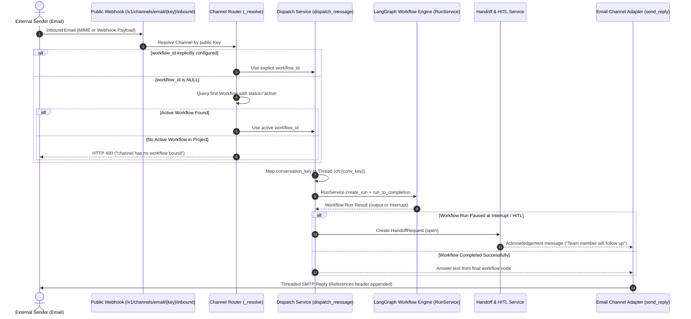
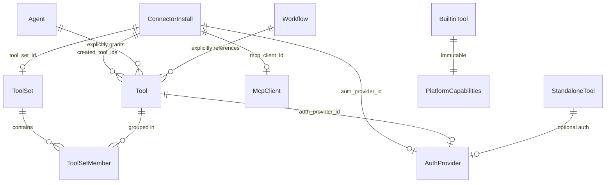
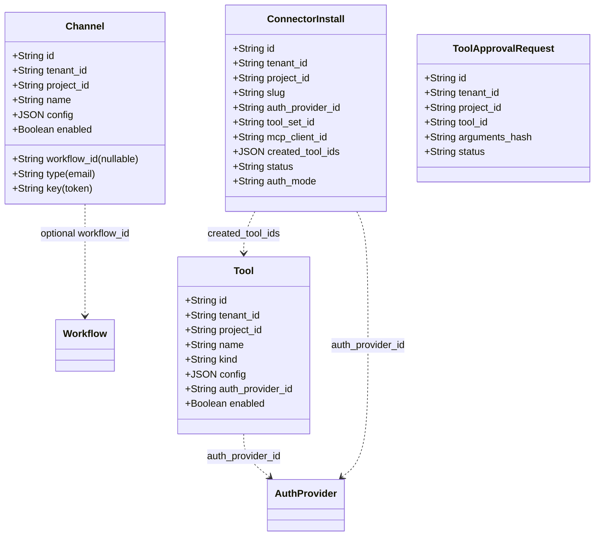
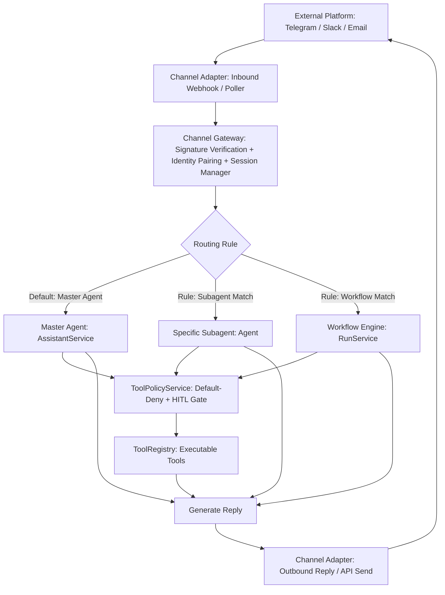

# Alberto — Channels, Integrations & Tools Architecture Audit

**Document Status:** Complete & Verified (Read-Only Audit)  
**Date:** 2026-10-19  
**Scope:** Channels Architecture, Workflow Dependency Coupling, Integrations & Tools Relationships, Identity & Security, and Consolidation Roadmap.

---

## 1. Executive Summary

This read-only audit examines Alberto's existing **Channels** implementation, its deep coupling with **Workflows**, and its architectural relationship to **Integrations, Tools, Subagents, and Master Agent**.

### Key Findings
1. **Coupling Source (VERIFIED):** Channels are currently designed exclusively as *inbound email triggers for workflows*. While the database schema (`channels.workflow_id` nullable) and Pydantic CRUD models treat `workflow_id` as optional, the runtime router (`backend/alberto/routers/channels.py`) and dispatch pipeline (`backend/alberto/services/dispatch.py`) strictly require a workflow. If no workflow is explicitly configured, it silently resolves the project's first active workflow; if none exists, incoming messages are rejected with HTTP 400 (`"channel has no workflow bound"`).
2. **Master Agent & Subagent Isolation (VERIFIED):** Channels have zero routing pathways to the Master Agent (`AssistantService`) or standalone Subagents (`Agent`). All incoming communication bypasses the Copilot/Assistant harness entirely.
3. **Channel Types Supported (VERIFIED):** Currently, only `email` is implemented (`CHANNEL_TYPES = ("email",)`). Telegram, Slack, WhatsApp, and generic chat webhooks do not exist in the codebase.
4. **Integration → Tool Relationship (VERIFIED):** Alberto implements an **Integration 1 → Many Tools** pattern via `ConnectorInstall.created_tool_ids`, `AuthProvider`, and `ToolSet`. Tools can also exist completely independently as standalone custom (Python, SQL, REST) or platform built-in tools without a parent integration.
5. **Security & Identity Gaps (VERIFIED):** External channel senders (e.g. email `From`) are not mapped to Alberto users; incoming webhook requests lack HMAC cryptographic signature verification; and no pairing or access control model exists for external channel participants.

---

## 2. Current Architecture & Source File Map

### Source File Map

| Component / Layer | Source File | Lines / Size | Status | Verification |
|---|---|---|---|---|
| **Channel DB Model** | [`backend/alberto/models/entities.py`](file:///c:/Users/oksbw/OneDrive/Desktop/Workspace/Alberto/backend/alberto/models/entities.py#L377-L391) | 377–391 | Active | **VERIFIED** |
| **Channel CRUD & Inbound Router** | [`backend/alberto/routers/channels.py`](file:///c:/Users/oksbw/OneDrive/Desktop/Workspace/Alberto/backend/alberto/routers/channels.py) | 1–170 / 8 KB | Active | **VERIFIED** |
| **Channel Service** | [`backend/alberto/services/channels.py`](file:///c:/Users/oksbw/OneDrive/Desktop/Workspace/Alberto/backend/alberto/services/channels.py) | 1–85 / 3.1 KB | Active | **VERIFIED** |
| **Email Channel Adapter** | [`backend/alberto/channels/email.py`](file:///c:/Users/oksbw/OneDrive/Desktop/Workspace/Alberto/backend/alberto/channels/email.py) | 1–239 / 10.7 KB | Active | **VERIFIED** |
| **Channel Retry Engine** | [`backend/alberto/channels/retry.py`](file:///c:/Users/oksbw/OneDrive/Desktop/Workspace/Alberto/backend/alberto/channels/retry.py) | 1–70 / 2.9 KB | Active | **VERIFIED** |
| **Message Dispatch Service** | [`backend/alberto/services/dispatch.py`](file:///c:/Users/oksbw/OneDrive/Desktop/Workspace/Alberto/backend/alberto/services/dispatch.py#L81-L150) | 81–150 | Active | **VERIFIED** |
| **Handoff & HITL Interruption** | [`backend/alberto/services/handoff.py`](file:///c:/Users/oksbw/OneDrive/Desktop/Workspace/Alberto/backend/alberto/services/handoff.py) | 1–180 | Active | **VERIFIED** |
| **Master Agent Service** | [`backend/alberto/services/assistant.py`](file:///c:/Users/oksbw/OneDrive/Desktop/Workspace/Alberto/backend/alberto/services/assistant.py#L898-L1446) | 898–1446 | Active (Unlinked to Channels) | **VERIFIED** |
| **Tool Policy Service** | [`backend/alberto/services/tool_policy.py`](file:///c:/Users/oksbw/OneDrive/Desktop/Workspace/Alberto/backend/alberto/services/tool_policy.py) | 1–841 | Active (Unlinked to Channels) | **VERIFIED** |
| **Channels Frontend Screen** | [`frontend/components/screens/platform.tsx`](file:///c:/Users/oksbw/OneDrive/Desktop/Workspace/Alberto/frontend/components/screens/platform.tsx#L80-L142) | 80–142 | Active (`/channels`) | **VERIFIED** |
| **Unified Integrations Screen** | [`frontend/components/screens/integrations.tsx`](file:///c:/Users/oksbw/OneDrive/Desktop/Workspace/Alberto/frontend/components/screens/integrations.tsx) | 1–1265 | Active (`/integrations`) | **VERIFIED** |
| **Frontend API Layer** | [`frontend/lib/api.ts`](file:///c:/Users/oksbw/OneDrive/Desktop/Workspace/Alberto/frontend/lib/api.ts#L460-L490) | 460–490 | Active | **VERIFIED** |

---

## 3. Existing Channel Configuration Lifecycle

### 3.1 Channel Model & Storage (VERIFIED)
In SQLite table `channels` ([`backend/alberto/models/entities.py:377-391`](file:///c:/Users/oksbw/OneDrive/Desktop/Workspace/Alberto/backend/alberto/models/entities.py#L377-L391)):
```python
class Channel(PkTimestamp, Base):
    __tablename__ = "channels"
    tenant_id: Mapped[str] = mapped_column(String(36), index=True)
    project_id: Mapped[str] = mapped_column(String(36), index=True)
    workflow_id: Mapped[str | None] = mapped_column(String(36), nullable=True)
    type: Mapped[str] = mapped_column(String(20)) # Only 'email'
    name: Mapped[str] = mapped_column(String(120))
    key: Mapped[str | None] = mapped_column(String(64), index=True, nullable=True) # Unguessable webhook token
    config: Mapped[dict] = mapped_column(JSON, default=dict)
    enabled: Mapped[bool] = mapped_column(Boolean, default=True)
```

### 3.2 Channel Creation & Credentials (VERIFIED)
- Endpoint: `POST /v1/projects/{project_id}/channels`
- Role required: `editor` or higher.
- A 64-character unguessable hex key (`key = uuid.uuid4().hex`) is generated upon creation.
- Inbound URL generated: `{public_base_url}/v1/channels/email/{key}/inbound`.
- Secrets: Outbound SMTP passwords are not stored in plaintext; `config["smtp"]["password_ref"]` stores a reference (e.g. `secret://proj/smtp_password`) resolved through `SecretStore` ([`backend/alberto/channels/email.py:217-224`](file:///c:/Users/oksbw/OneDrive/Desktop/Workspace/Alberto/backend/alberto/channels/email.py#L217-L224)).

### 3.3 Channel Adapter Implementation: Email (VERIFIED)
Located in [`backend/alberto/channels/email.py`](file:///c:/Users/oksbw/OneDrive/Desktop/Workspace/Alberto/backend/alberto/channels/email.py):
- **Inbound Parser (`parse_inbound`):** Accepts raw RFC-822 MIME byte stream or parsed provider form/JSON fields (SendGrid, Mailgun, Postmark).
- **HTML Sanitization (`_html_to_text`):** Uses Python stdlib `HTMLParser` to extract plain text without ReDoS vulnerability.
- **Thread Tracking (`_thread_ref`):** Derives conversation thread reference from `References` or `In-Reply-To` headers.
- **Outbound Reply (`send_reply`):** Formats RFC-5322 threaded email message with `References` chaining and dispatches via Python `smtplib.SMTP` wrapped in `asyncio.to_thread` with exponential retry backoff ([`retry.py`](file:///c:/Users/oksbw/OneDrive/Desktop/Workspace/Alberto/backend/alberto/channels/retry.py)).

---

## 4. Exact Channel-to-Workflow Dependency Analysis

| Question | Answer | Code Evidence & Verification |
|---|---|---|
| **1. Is workflow ID mandatory in frontend UI?** | **No, but UI forces a workflow fallback** | In [`platform.tsx:123`](file:///c:/Users/oksbw/OneDrive/Desktop/Workspace/Alberto/frontend/components/screens/platform.tsx#L123), dropdown option is `""` with label *"First active workflow"*. UI design assumes an active workflow is always needed. (**VERIFIED**) |
| **2. Is dependency enforced by backend schema?** | **No** | In [`routers/channels.py:33-45`](file:///c:/Users/oksbw/OneDrive/Desktop/Workspace/Alberto/backend/alberto/routers/channels.py#L33-L45), Pydantic `ChannelIn` has `workflow_id: str \| None = None`. (**VERIFIED**) |
| **3. Does database require a workflow association?** | **No** | In [`models/entities.py:385`](file:///c:/Users/oksbw/OneDrive/Desktop/Workspace/Alberto/backend/alberto/models/entities.py#L385), `workflow_id` column is `nullable=True`. (**VERIFIED**) |
| **4. Does inbound message handling launch a workflow?** | **Yes, exclusively** | In [`routers/channels.py:155`](file:///c:/Users/oksbw/OneDrive/Desktop/Workspace/Alberto/backend/alberto/routers/channels.py#L155), `email_inbound` passes `workflow_id` into `dispatch_message`. (**VERIFIED**) |
| **5. Can Channel receive/respond without workflow?** | **No** | If `ch.workflow_id` is missing, `ChannelService.resolve_workflow_id` searches for an active workflow. If none exists, `_resolve` raises `HTTP 400 ("channel has no workflow bound")`. (**VERIFIED**) |
| **6. What happens if associated workflow is deleted?** | **Inbound crashes with 404** | `dispatch_message` calls `run_service.create_run(..., workflow_id=workflow_id)`, which fails lookup. If `workflow_id` is unlinked and no workflows exist, inbound fails with HTTP 400. (**VERIFIED**) |
| **7. Can Channel route to Master Agent?** | **No** | No routing logic, configuration schema, or bridge connects `email_inbound` to `AssistantService`. (**VERIFIED**) |
| **8. Architectural or UI design decision?** | **Runtime Router Coupling** | Database and API schemas are decoupled, but the execution pipeline in `routers/channels.py` and `services/dispatch.py` hardcodes `RunService.create_run`. (**VERIFIED**) |

---

## 5. Inbound and Outbound Message Execution Flows

### 5.1 Current Inbound Execution Flow (Mermaid)



### 5.2 Outbound Delivery (VERIFIED)
- Outbound delivery is triggered exclusively as an immediate synchronous callback inside `email_inbound` after the workflow run finishes.
- Standalone programmatic outbound delivery (e.g. sending an email from an agent, tool, or API without an inbound email trigger) is not exposed as a general channel service.

---

## 6. Current Integrations → Tools Relationship

### 6.1 Conceptual Model: Integration 1 → Many Tools (VERIFIED)
Alberto models integrations and tools as follows:



### 6.2 Key Architectural Characteristics (VERIFIED)
1. **Parent-Child Linkage:**
   - [`ConnectorInstall`](file:///c:/Users/oksbw/OneDrive/Desktop/Workspace/Alberto/backend/alberto/models/entities.py#L643-L682) stores `created_tool_ids: list` (JSON array of tool UUIDs) and `tool_set_id`.
   - `Tool` table itself does not have a hard foreign key `integration_id`. It is decoupled so tools can exist without integrations.
2. **Reversible Lifecycle:**
   - Uninstalling an integration (`ConnectorInstaller.uninstall`) removes the records listed in `created_tool_ids`, the associated `ToolSet`, the `AuthProvider`, and created secrets.
3. **Standalone & Built-in Tool Independence:**
   - Custom REST, Code, SQL, and Built-in tools have no `ConnectorInstall` reference and remain fully functional.
4. **ToolSets as Logical Groupings:**
   - `ToolSet` and `ToolSetMember` provide a many-to-many relationship independent of connector installation boundaries.

---

## 7. Current Channel and Tool Permission Model

### 7.1 Channel Permissions & Security (VERIFIED)
- **Management:** Creating, updating, or deleting channels requires `CurrentUser = Depends(require_role("editor"))`.
- **Public Inbound Verification:**
  - Authenticated solely by the 64-character unguessable URL token (`/v1/channels/email/{key}/inbound`).
  - Rate-limited to 120 requests/60s via in-memory leaky-bucket limiter.
  - **Security Gap:** There is **no webhook HMAC signature verification** for SendGrid, Mailgun, Postmark, etc. Anyone possessing the URL can post forged incoming messages.
- **Identity Mapping:**
  - The external sender email (`from_addr`) is not verified or paired to an Alberto user.
  - The workflow run executes with `end_user=None`. Consequently, per-user credential resolution fails unless run as a project-level trigger owner.

### 7.2 Tool Permissions & ToolPolicyService (VERIFIED)
- Enforces default-deny tool access ([`backend/alberto/services/tool_policy.py`](file:///c:/Users/oksbw/OneDrive/Desktop/Workspace/Alberto/backend/alberto/services/tool_policy.py)):
  1. Tool registered and active (`enabled == True`).
  2. Caller explicitly associated (Agent `config["tools"]` or Workflow `tool_call` node).
  3. Master Agent must delegate through `ToolManagerService`.
  4. User entitlements satisfied.
  5. Human-in-the-loop (HITL) approval required for `write`/`delete` or `high`/`critical` risk tools, persisted in SQLite and consumed atomically.

---

## 8. Database / Schema Relationships



---

## 9. Frontend Navigation & Duplicated Functionality

### 9.1 Current Navigation Layout
In [`frontend/lib/data.ts:391-403`](file:///c:/Users/oksbw/OneDrive/Desktop/Workspace/Alberto/frontend/lib/data.ts#L391-L403), the sidebar groups these under "Integrations":
```
Integrations (Section)
├── Integrations (/integrations) -> Unified IntegrationsScreen
├── Tools (/tools) -> ToolsScreen
├── Auth Providers (/auth) -> AuthProvidersScreen
├── Triggers (/triggers) -> TriggersScreen
└── Channels (/channels) -> ChannelsScreen (in platform.tsx)
```

### 9.2 Duplication & Fragmentation (VERIFIED)
1. **Fragmented Connection Surfaces:** An operator configures REST/MCP connectors in `/integrations`, but configures Email in `/channels`.
2. **Missing In-Context Diagnostics:** `/channels` only shows a list of names and URLs; it provides no delivery history, error logs, or health status.
3. **Dead Route Redirection:** `/connectors` and `/mcp` both route to `IntegrationsScreen`, but `connectors.tsx` and `mcp.tsx` remain in the repository as orphaned components.

---

## 10. Gap Analysis (P0 / P1 / P2)

### P0 (Architectural & Functional Blockers)
- **GAP-CH-01 (P0): Inability to Route Inbound Channel Messages to Master Agent or Subagents.**
  - *Location:* [`backend/alberto/routers/channels.py:155`](file:///c:/Users/oksbw/OneDrive/Desktop/Workspace/Alberto/backend/alberto/routers/channels.py#L155) & [`backend/alberto/services/dispatch.py:81`](file:///c:/Users/oksbw/OneDrive/Desktop/Workspace/Alberto/backend/alberto/services/dispatch.py#L81)
  - *Finding:* Inbound messages strictly invoke `dispatch_message` with `workflow_id`. There is no gateway to invoke `AssistantService.stream` or subagent reasoning. (VERIFIED)
- **GAP-CH-02 (P0): Strict Runtime Requirement for a Workflow.**
  - *Location:* [`backend/alberto/routers/channels.py:106-107`](file:///c:/Users/oksbw/OneDrive/Desktop/Workspace/Alberto/backend/alberto/routers/channels.py#L106-L107)
  - *Finding:* `if not workflow_id: raise HTTPException(400, "channel has no workflow bound")`. Channels cannot function as standalone communication interfaces. (VERIFIED)
- **GAP-CH-03 (P0): Lack of External User Identity Mapping & Security Isolation.**
  - *Location:* [`backend/alberto/routers/channels.py:155`](file:///c:/Users/oksbw/OneDrive/Desktop/Workspace/Alberto/backend/alberto/routers/channels.py#L155)
  - *Finding:* Channel messages run anonymously (`end_user=None`). Any user emailing the channel executes with trigger/system permissions, with no pairing, access control, or role validation. (VERIFIED)

### P1 (Operational & Platform Gaps)
- **GAP-CH-04 (P1): Missing Webhook Signature Verification.**
  - *Location:* [`backend/alberto/routers/channels.py:141`](file:///c:/Users/oksbw/OneDrive/Desktop/Workspace/Alberto/backend/alberto/routers/channels.py#L141)
  - *Finding:* No HMAC validation for webhook payloads from email providers. The unguessable URL is the only defense. (VERIFIED)
- **GAP-CH-05 (P1): Only Email Channel Supported.**
  - *Location:* [`backend/alberto/services/channels.py:16`](file:///c:/Users/oksbw/OneDrive/Desktop/Workspace/Alberto/backend/alberto/services/channels.py#L16)
  - *Finding:* `CHANNEL_TYPES = ("email",)`. Telegram, Slack, WhatsApp adapters are completely absent. (VERIFIED)
- **GAP-CH-06 (P1): Fragmented UI Across Integrations and Channels.**
  - *Location:* [`frontend/components/screens/platform.tsx:83`](file:///c:/Users/oksbw/OneDrive/Desktop/Workspace/Alberto/frontend/components/screens/platform.tsx#L83)
  - *Finding:* Channels UI is sequestered in `platform.tsx` rather than consolidated within `integrations.tsx`. (VERIFIED)

### P2 (Ergonomics & Cleanup)
- **GAP-CH-07 (P2): No Standalone Outbound Channel Send API.**
  - *Location:* [`backend/alberto/channels/email.py:206`](file:///c:/Users/oksbw/OneDrive/Desktop/Workspace/Alberto/backend/alberto/channels/email.py#L206)
  - *Finding:* Outbound sending is only implemented as an immediate reply to an incoming message. (VERIFIED)
- **GAP-CH-08 (P2): Orphaned UI Files.**
  - *Location:* `frontend/components/screens/connectors.tsx` and `mcp.tsx`. (VERIFIED)

---

## 11. Proposed Target Architecture

### 11.1 Proposed Workflow-Independent Channel Flow (Mermaid)



### 11.2 Architectural Changes Required
1. **Channel Schema Update (Non-destructive):**
   - Add `target_type` column to `channels` table: `"master_agent"` (default), `"subagent"`, `"workflow"`.
   - Add `target_id` column: stores `agent_id` or `workflow_id` when targeting specific entities.
   - Keep `workflow_id` column for 100% backward compatibility (read fallback).
2. **Channel Gateway Service:**
   - Introduce `ChannelGatewayService` that validates incoming signatures, maps external IDs (e.g. `telegram_user_id` or `email`) to an authorized paired identity, loads/maintains persistent chat thread, and dispatches to the configured target.
3. **Master Agent Invocation:**
   - Channel messages default to calling `AssistantService.stream` with persistent thread and user context.

---

## 12. Minimal Migration & Refactoring Strategy

1. **Database Schema:**
   - Add Alembic migration adding `target_type: str = "master_agent"` and `target_id: str | None = None` to `channels`.
   - Data migration: for existing channels where `workflow_id IS NOT NULL`, set `target_type = "workflow"`, `target_id = workflow_id`.
2. **Backward Compatibility:**
   - If an existing channel has `workflow_id` populated, router routes to workflow, preserving all current behavior.
   - If `target_type == "master_agent"`, routes to `AssistantService`.
3. **Frontend Consolidation:**
   - Incorporate Channels into `IntegrationsScreen` as a specialized section ("Messaging Channels") alongside REST and MCP.
   - Keep `/channels` route redirected or aliased to `IntegrationsScreen?tab=channels`.

---

## 13. Functionality That Must Be Preserved

1. **Email SMTP/IMAP Threading:** Preserve RFC-5322 `References` and `In-Reply-To` threading logic in [`backend/alberto/channels/email.py`](file:///c:/Users/oksbw/OneDrive/Desktop/Workspace/Alberto/backend/alberto/channels/email.py).
2. **Handoff & Human Escalation:** Preserve `HandoffRequest` integration and email acknowledgment when an HITL pause occurs.
3. **Egress & Secret Reference Resolution:** Preserve `SecretStore.read_ref` for all channel credentials (`password_ref`).
4. **Existing Workflow Triggers:** Pre-existing email channels explicitly tied to workflows must continue executing those workflows without disruption.
5. **Default-Deny Tool Policy:** Inbound channel messages must not bypass `ToolPolicyService` when agents execute tools.

---

## 14. Recommended Implementation Sequence

```
Phase 1: Channel Gateway & Routing Decoupling
├── 1.1 Alembic Migration: Add target_type & target_id to channels table
├── 1.2 ChannelGatewayService: Abstract dispatch to Master Agent vs Workflow
└── 1.3 Update email_inbound route to use ChannelGatewayService with Master Agent default

Phase 2: External Identity, Pairing & Security
├── 2.1 External Identity Pairing model (mapping Telegram/Email sender -> Alberto User)
├── 2.2 Webhook HMAC cryptographic signature verification middleware
└── 2.3 Per-user entitlement validation on channel-invoked tools

Phase 3: Additional Channel Adapters
├── 3.1 Telegram Channel Adapter (Webhook & Long-polling bot)
└── 3.2 Slack / Generic Webhook Adapter

Phase 4: Unified Integrations UI Consolidation
├── 4.1 Add Channels to IntegrationsScreen (Explore Catalog + Installed cards)
├── 4.2 Channel Detail view: Destination routing picker (Master Agent / Subagent / Workflow)
├── 4.3 Channel Detail view: Paired users management & Inbound/Outbound delivery log
└── 4.4 Deprecate standalone platform.tsx ChannelsScreen & dead mcp.tsx/connectors.tsx
```
