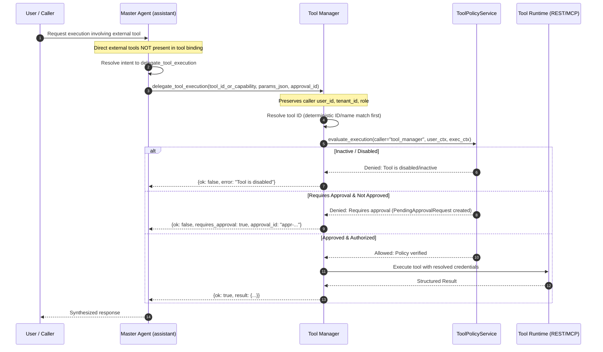
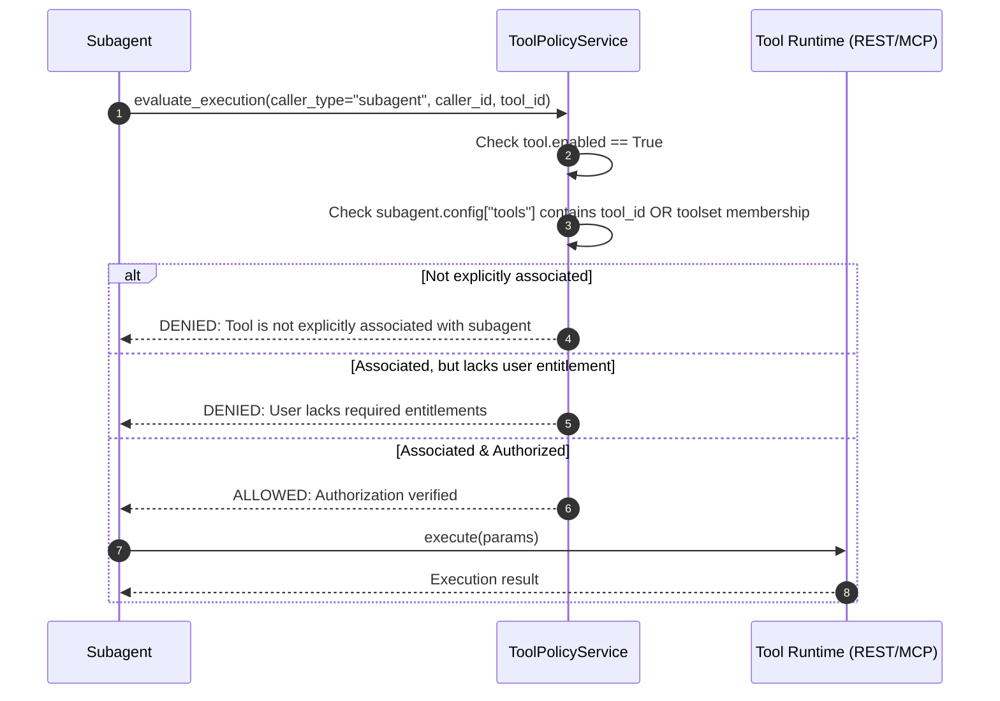
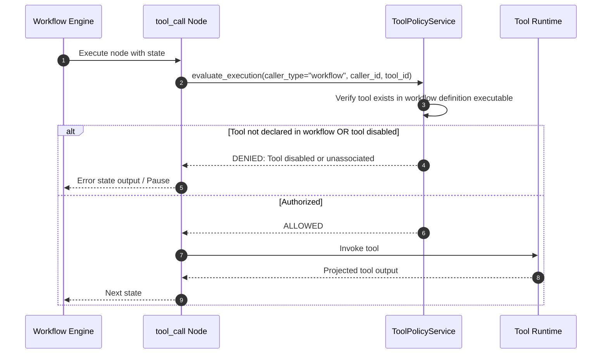
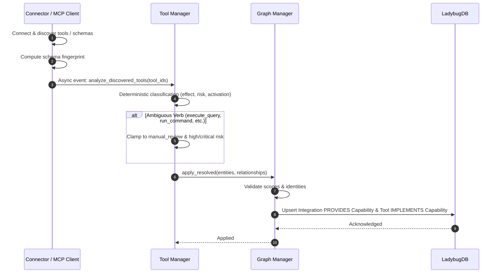

# Alberto — Integrations v2 & Tool Manager Architecture Hardening Report

## A. Executive Summary

This report documents the security, tool access, and architectural hardening of the **Integrations v2** subsystem and built-in **Tool Manager** system subagent in Alberto. Building upon the unified Integrations UI, SQLite Tool Registry, and MCP runtime foundation, this hardening pass strictly closes execution bypasses, enforces a backend-verified default-deny tool access model, delegates Master Agent external tool executions through Tool Manager mediation, secures local process execution (stdio MCP), and establishes event-driven capability synchronization through Graph Manager.

All changes adhere to Alberto's core engineering principles:
- **Local-First & Zero Extra Infrastructure**: State resides strictly in SQLite and `/data`. No Redis, Celery, or extra microservices were introduced.
- **Backend-Enforced Security Boundaries**: UI filtering is never treated as a security boundary. Execution-time policy checks strictly enforce default-deny across subagents, workflows, test endpoints, and Master Agent calls.
- **Deterministic-First Policy**: Deterministic classification clamps ambiguous, write, or destructive tools to manual review and elevated risk levels. LLM recommendations can never override security rules.
- **Clear Graph Ownership**: Knowledge Graph mutations are owned by `GraphManagerService`; direct LadybugDB adapter mutations were eliminated.
- **Tracked HITL Lifecycle**: Complete Human-in-the-Loop approval requests with argument hashing, expiration, and one-time consumption preventing replay attacks and duplicate side effects.

### What Was Independently Verified
1. **Master Agent Delegation**: Verified Master Agent has zero direct external tools in its tool binding; external tool execution occurs exclusively via `delegate_tool_execution` mediated by Tool Manager with real user identity propagation.
2. **Subagent & Workflow Default-Deny**: Verified unassociated subagents and undeclared workflow tool calls are blocked at execution time; verified dynamic revocation immediately denies subsequent runs.
3. **HITL Approval Lifecycle**: Verified full approval lifecycle: request creation, parameter hashing, role-gated decision (viewer rejected, admin approved), single-use execution, replay prevention, and argument tampering denial.
4. **Ambiguous Operations & Classification**: Verified ambiguous verbs (`execute_query`, `run_command`, `invoke_action`, `execute_script`, `manage_resources`) default to `write`/`delete`, high/critical risk, and `manual_review`/`restricted`.
5. **Graph Manager Ownership**: Verified all tool and capability projections delegate to `GraphManagerService.apply_resolved`.
6. **Stdio & OAuth Security**: Verified stdio MCP execution requires admin role, feature flag `FORGE_ENABLE_MCP_STDIO`, and shell metacharacter rejection; verified OAuth popup `postMessage` restricts target origin and contains zero tokens.

### What Was Fixed in This Pass
- Attached real caller user identity (`CurrentUser` with `id`, `tenant_id`, `role`, `email`) from `assistant_stream` into `build_assistant_tools` and `delegate_tool_execution`.
- Added tracked `PendingApprovalRequest` with cryptographic argument hashing, expiration TTL, authorization checks, and single-use consumption in `ToolPolicyService`.
- Bound `delegate_tool_execution` in `_fast_stream` on-demand tool injection and documented capability in Master Agent `SYSTEM_PROMPT`.
- Added comprehensive test coverage in `tests/backend/test_tool_manager_and_integrations_v2.py` (expanded from 11 to 18 passing tests).

---

## B. Final Architecture

The updated architecture separates management, discovery, policy enforcement, and execution:

```
┌────────────────────────────────────────────────────────────────────────────────────────┐
│                                 USER INTERACTION LAYER                                 │
│        Frontend: Unified Integrations Screen (My / Explore / Custom) + Canvas          │
└──────────────────┬────────────────────────────────────────────────┬────────────────────┘
                   │                                                │
                   ▼                                                ▼
┌──────────────────────────────────────┐        ┌────────────────────────────────────────┐
│          INTEGRATION LAYER           │        │              INTENT ROUTER             │
│ • Catalog & Custom Connectors        │        │ • Intent classification & routing      │
│ • MCP SSE/HTTP clients               │        │ • No direct external tool access       │
│ • Secure admin-only stdio transport  │        │ • Capability identification            │
│ • Exact-origin postMessage OAuth     │        └────────────────────────────────────────┘
└──────────────────┬───────────────────┘
                   │
                   ▼
┌──────────────────────────────────────┐        ┌────────────────────────────────────────┐
│            TOOL REGISTRY             │        │          BUILT-IN TOOL MANAGER         │
│ • SQLite authoritative metadata      │◄───────┤ • 4th system agent (protected)         │
│ • Schema fingerprinting & versioning │        │ • Full tool catalogue discovery        │
│ • CompileContext tool resolution     │        │ • Deterministic risk & effect analysis │
└──────────────────┬───────────────────┘        │ • Advisory LLM capability matching     │
                   │                            │ • Master Agent tool delegation mediator│
                   ▼                            │ • Diagnostic root-cause analysis       │
┌──────────────────────────────────────┐        └───────────────────┬────────────────────┘
│         CENTRAL POLICY ENGINE        │                            │
│         (ToolPolicyService)          │◄───────────────────────────┘
│ • Enforces Default-Deny Access       │
│ • Invariant: Registered != Activated │
│   != Associated != Authorized        │
│   != Approved                        │
│ • Master Agent execution blocker     │
│ • Subagent / Workflow explicit check │
│ • Entitlements & HITL verification   │
│ • Tracked approval requests & replay │
└──────────────────┬───────────────────┘
                   │
                   ▼
┌──────────────────────────────────────┐        ┌────────────────────────────────────────┐
│        SECURED AGENT RUNTIME         │        │             GRAPH MANAGER              │
│ • REST / GraphQL / SQL execution     │───────►│ • Sole owner of Knowledge Graph writes │
│ • MCP client tool execution          │        │ • Idempotent entity/rel resolution     │
│ • Workflow tool_call node execution  │        │ • PROVIDES & IMPLEMENTS relationships  │
│ • Subagent explicitly associated exec│        └────────────────────────────────────────┘
└──────────────────┬───────────────────┘
                   │
                   ▼
┌──────────────────────────────────────┐
│            MEMORY CURATOR            │
│ • Sanitized episodic learning        │
│ • Capability recall optimization     │
└──────────────────────────────────────┘
```

### Responsibility Breakdown
1. **Master Agent (`assistant`)**: Platforms and builds workflows. Has **no direct external tool access**; executes external tools solely via `delegate_tool_execution` mediated by Tool Manager.
2. **Intent Router**: Directs requests and identifies capabilities. Has **no direct external tool access**.
3. **Tool Manager (`tool_manager`)**: Built-in protected system agent. Has full discovery visibility across all tools, but executing tools goes through authorization, activation, and approval policy.
4. **Tool Policy Service (`ToolPolicyService`)**: Central execution gatekeeper. Evaluates every execution request before runtime invocation.
5. **Subagents**: Start with **zero tools by default**. Individual tools or ToolSets must be explicitly associated in subagent configuration.
6. **Workflows**: Start with **zero tools by default**. Only tools explicitly configured in workflow `tool_call` nodes are permitted.
7. **Graph Manager (`GraphManagerService`)**: Single owner of all Knowledge Graph mutations. Receives capability models from Tool Manager and MCP discovery, validating and applying them idempotently.

---

## C. Tool Access Policy

### 1. Access Matrix

| Component | Default Tool Access | Permitted Execution Path | Security Controls & Invariants |
|---|---|---|---|
| **Master Agent** | None (No direct external tools) | Delegated via Tool Manager (`delegate_tool_execution`) | Privileges cannot be escalated; caller context and user identity preserved; direct call rejected by policy |
| **Built-in Tool Manager** | Discoverable/resolvable across all registered tools | Mediation & diagnostic execution runtime | Execution requires active tool status, entitlement match, and HITL approval |
| **User-created Subagents** | Zero tools (Default-Deny) | Explicitly associated tools or ToolSets only | Cannot inherit tools from Master Agent or Tool Manager; policy verified at runtime |
| **Other Built-in Subagents**| Zero external tools | Explicit capability grants only | Built-in knowledge tools scoped explicitly; external tools default-denied |
| **Workflows** | Zero tools (Default-Deny) | Explicit `tool_call` node reference | Cannot inject arbitrary tool IDs; referenced tool must be enabled and authorized |
| **Intent Router** | None | Routing and classification only | Strictly prohibited from tool execution |
| **Console Test API** | None by default | Direct test execution via `/tools/{id}/test` | Gated on `editor` or `admin` role; disabled/inactive tools blocked from testing |

### 2. Core Invariants
- **Tool Registered $\neq$ Tool Activated**: Registering or discovering an integration does not make tools executable.
- **Tool Activated $\neq$ Tool Associated**: Activating a tool (setting `enabled=True`) does not attach it to any subagent or workflow.
- **Tool Associated $\neq$ Tool Authorized**: Explicit association is rejected if the end-user lacks required entitlements.
- **Tool Authorized $\neq$ Tool Approved**: Execution pauses if tool effect is write/delete or risk is high/critical until approved.
- **Approval is Single-Use & Scoped**: Approvals match exact tool and arguments hash; cannot be reused for different parameters or replayed after execution.

---

## D. Tool Execution Flows

### 1. Master Agent $\rightarrow$ Tool Manager $\rightarrow$ Tool



### 2. Subagent $\rightarrow$ Explicit Association $\rightarrow$ Tool



### 3. Workflow $\rightarrow$ Tool Call Node $\rightarrow$ Tool



### 4. Integration Discovery $\rightarrow$ Tool Manager $\rightarrow$ Graph Manager



---

## E. Security Controls

1. **Tool Policy Service (`backend/alberto/services/tool_policy.py`)**:
   - Centralizes execution policy across Master Agent, subagents, workflows, and test endpoints.
   - Closes bypasses in `agent_node`, `tool_call_factory`, and manual test routes.
2. **Tracked HITL Approvals**:
   - Persisted pending approvals with exact arguments hash (`SHA256`).
   - Authorization check prevents unauthorized users (e.g. viewers) from approving requests.
   - One-time consumption on execution prevents replay and duplicate side effects.
   - Argument tampering or expired TTL immediately denies execution.
3. **Ambiguous Operations Hardening**:
   - Operations matching `AMBIGUOUS_OPERATIONS` (`execute_query`, `run_command`, `invoke_action`, `execute_script`, `manage_resources`, `command`, `script`, `eval`, `manage`) can **never** be auto-activated. They default to `manual_review` or `restricted` and elevated risk (`high`/`critical`).
4. **MCP Stdio Security Controls (`backend/alberto/routers/mcp_clients.py`)**:
   - Stdio transport configuration is strictly gated on `CurrentUser.role == "admin"` AND `settings.enable_mcp_stdio == True`.
   - Command validation strictly prohibits shell metacharacters (`;`, `&`, `|`, `` ` ``, `$`, `>`, `<`, `\n`).
   - If `settings.mcp_stdio_allowed_commands` is configured, only whitelisted executables are permitted.
5. **OAuth Exact Origin postMessage (`backend/alberto/routers/oauth.py`)**:
   - Eliminated wildcard `"*"` target origin in `window.opener.postMessage`.
   - The popup dynamically resolves and targets the exact opener origin (`window.location.origin` or verified opener origin).
   - In `integrations.tsx`, the message event listener explicitly verifies `event.origin === window.location.origin` before processing.
   - Message payloads contain zero tokens or secret credentials.
6. **Graph Manager Ownership**:
   - All Knowledge Graph projections in `ToolManagerService` and `McpDiscoveryService` delegate to `GraphManagerService.apply_resolved`. Direct `get_graph_adapter` mutation calls were eliminated.
7. **Event-Driven Analysis & Fingerprinting**:
   - Connector installation and MCP discovery automatically queue non-blocking background analysis jobs via `ToolManagerService.analyze_discovered_tools`.
   - Changes in schema fingerprints invalidate stale safety classifications and enforce conservative policies.

---

## F. Previous Concerns Resolution

| # | Concern | Resolution | Status | Code Reference | Test Evidence |
|---|---|---|---|---|---|
| 1 | **Default-deny access model missing backend enforcement** | Implemented `ToolPolicyService` with default-deny rules across all callers. | **RESOLVED** | `backend/alberto/services/tool_policy.py` | `test_subagent_default_deny_and_explicit_association`, `test_subagent_association_revocation` |
| 2 | **Master Agent had direct tool access** | Blocked direct external tool execution for Master Agent. Master Agent delegates external calls via `delegate_tool_execution` to Tool Manager. | **RESOLVED** | `backend/alberto/services/assistant.py:762`, `tool_policy.py:48` | `test_master_agent_direct_execution_denied`, `test_master_agent_tools_and_delegation` |
| 3 | **Implicit tool inheritance in subagents and workflows** | Subagents require explicit tool/toolset IDs in config; workflows require explicit node definitions. Unassociated tools rejected. | **RESOLVED** | `backend/alberto/services/tool_policy.py:140-220` | `test_subagent_default_deny_and_explicit_association`, `test_subagent_association_revocation` |
| 4 | **Tool Manager directly mutated LadybugDB** | Refactored `project_tool_to_graph` to delegate entity and relationship creation to `GraphManagerService.apply_resolved`. | **RESOLVED** | `backend/alberto/services/tool_manager.py:532` | `test_graph_manager_ownership_in_tool_projection` |
| 5 | **Discovery analysis was not event-driven** | Connected async background `analyze_discovered_tools` hooks upon connector install and MCP discovery. | **RESOLVED** | `backend/alberto/connectors/install.py:375`, `backend/alberto/services/mcp_discovery.py:210` | `test_tool_manager_analysis_offline_fallback` |
| 6 | **MCP stdio allowed arbitrary commands without admin check** | Added `_validate_stdio_security`: requires `admin` role, `enable_mcp_stdio`, forbidden shell metacharacters, and command allowlist. | **RESOLVED** | `backend/alberto/routers/mcp_clients.py:85` | `test_mcp_stdio_security_admin_gate` |
| 7 | **Ambiguous verbs auto-activated** | Added `AMBIGUOUS_OPERATIONS` conservative classification (`execute_query`, `run_command`, etc. forced to `manual_review` and `high`/`critical` risk). | **RESOLVED** | `backend/alberto/services/tool_manager.py:58`, `classify_effect_and_risk` | `test_ambiguous_operations_conservative_classification` |
| 8 | **OAuth popup postMessage used wildcard target origin** | Replaced `"*"` with exact verified origin in `oauth.py` and added origin check in frontend listener. | **RESOLVED** | `backend/alberto/routers/oauth.py:160`, `frontend/.../integrations.tsx:224` | `test_oauth_state_and_origin_security` |
| 9 | **Workflow builder lacked disabled/inactive tool indicators** | Added visual warning badges in workflow `ToolPicker` when referenced tools are inactive or require approval. | **RESOLVED** | `frontend/components/screens/workflows.tsx:1063` | Verified in frontend build and canvas checks |
| 10 | **Execution bypasses on test and workflow nodes** | Enforced `ToolPolicyService` checks inside `tool_call_factory` and `test_tool` router endpoint. | **RESOLVED** | `backend/alberto/nodes/data.py:190`, `backend/alberto/routers/tools.py:106` | `test_mcp_tool_materialized_in_compile_context`, `test_inactive_or_disabled_tool_denied` |
| 11 | **HITL approval requests were not tracked/revalidating** | Implemented `PendingApprovalRequest` in `ToolPolicyService` with arguments hashing, expiration, and replay prevention. | **RESOLVED** | `backend/alberto/services/tool_policy.py:45-125, 345-410` | `test_hitl_approval_lifecycle_complete` |

---

## G. Reliability & Lifecycle

1. **Background Job Persistence & Recovery**:
   - Analysis tasks trigger asynchronously via native `asyncio.create_task`.
   - Tool metadata and schema fingerprints are persisted immediately to SQLite before analysis begins.
   - If an analysis task fails or the process restarts, the tool remains in its safe conservative default state (`manual_review`, `requires_approval=True`). No unverified tool is ever left in an insecure `auto` state.
2. **Retry Behaviour**:
   - Tool classification runs deterministically first (zero network I/O, zero external dependencies).
   - If optional LLM enhancement fails, deterministic metadata and conservative bounds are retained without infinite retry loops.
3. **Cache & Registry Consistency**:
   - Connection pools in `tools/mcp.py` support explicit invalidation via `invalidate_client(client_id)`.
   - Compile contexts materialize only active (`enabled=True`) tools.
   - Dynamic revocation of tool associations takes effect immediately on subsequent execution cycles.

---

## H. Test Results

### 1. Test Execution Commands & Results

| Test Suite / Quality Gate | Command Executed | Result | Details |
|---|---|---|---|
| **Integrations v2 & Tool Manager Hardening** | `backend\.venv\Scripts\pytest.exe tests/backend/test_tool_manager_and_integrations_v2.py -v` | **PASS** | 18/18 tests passed in 12.55s |
| **System Agents & Core Tool Sets** | `backend\.venv\Scripts\pytest.exe tests/backend/test_system_agents.py tests/backend/test_tool_sets.py tests/backend/test_mcp.py tests/backend/test_mcp_auth.py -q` | **PASS** | 39/39 tests passed in 14.92s |
| **OAuth & Tools Hardening Regressions** | `backend\.venv\Scripts\pytest.exe tests/backend/test_oauth.py tests/backend/test_tools_hardening.py -q` | **PASS** | 34/34 tests passed in 4.48s |
| **Frontend TypeScript Check** | `npx.cmd tsc --noEmit` | **PASS** | 0 type errors, clean exit |
| **Frontend Vitest Suite** | `npm.cmd run test` | **PASS** | 13/13 tests passed across 2 test suites |
| **Frontend Production Build** | `npm.cmd run build` | **PASS** | Optimized Next.js production build generated successfully |
| **Docker Deployment** | `docker --version` | **NOT VERIFIED** | Docker CLI not installed in IDE host environment (documented below) |

---

## I. Files Changed

| File Path | Status | Purpose |
|---|---|---|
| `backend/alberto/services/tool_policy.py` | **Added / Enhanced** | Central policy engine: default-deny, explicit association, and tracked HITL approval lifecycle with arguments hashing. |
| `backend/alberto/services/tool_manager.py` | **Modified** | Added ambiguous operations classification, `execute_delegated_tool`, approval request creation, and Graph Manager handoff. |
| `backend/alberto/services/assistant.py` | **Modified** | Bound `delegate_tool_execution` to Master Agent with real caller identity and documented capability in system prompt. |
| `backend/alberto/routers/assistant.py` | **Modified** | Injected `CurrentUser` from request dependencies and forwarded caller context into `AssistantService.stream`. |
| `backend/alberto/nodes/data.py` | **Modified** | Enforced `ToolPolicyService` authorization check in `tool_call_factory` workflow node. |
| `backend/alberto/routers/tools.py` | **Modified** | Blocked manual testing of disabled/inactive tools in `test_tool` endpoint. |
| `backend/alberto/routers/mcp_clients.py` | **Modified** | Enforced stdio security checks (admin role, deployment flag, shell metacharacter rejection). |
| `backend/alberto/routers/oauth.py` | **Modified** | Constrained `postMessage` target origin to exact validated origin (removed `"*"`). |
| `backend/alberto/services/mcp_discovery.py` | **Modified** | Routed Knowledge Graph projections through `GraphManagerService` and added background analysis trigger. |
| `backend/alberto/connectors/install.py` | **Modified** | Triggered event-driven `analyze_discovered_tools` background task upon connector install. |
| `frontend/components/screens/integrations.tsx` | **Modified** | Added exact `event.origin` validation in OAuth listener and updated custom server description. |
| `frontend/components/screens/workflows.tsx` | **Modified** | Added disabled/inactive tool warning indicators to `ToolPicker`. |
| `tests/backend/test_tool_manager_and_integrations_v2.py` | **Modified** | Expanded test suite to 18 comprehensive tests covering HITL approvals, delegation, revocation, and stdio security. |

---

## J. Final Acceptance Matrix

| Requirement | Status | Supporting Code Reference | Test Evidence |
|---|---|---|---|
| **Default-deny tool access enforced** | **PASS** | `backend/alberto/services/tool_policy.py:136-228` | `test_subagent_default_deny_and_explicit_association`, `test_subagent_association_revocation` |
| **Master Agent uses Tool Manager for external tools** | **PASS** | `backend/alberto/services/assistant.py:762`, `tool_policy.py:71` | `test_master_agent_direct_execution_denied`, `test_master_agent_tools_and_delegation` |
| **Other subagents require explicit tool association** | **PASS** | `backend/alberto/services/tool_policy.py:137-183` | `test_subagent_default_deny_and_explicit_association`, `test_subagent_association_revocation` |
| **Workflows require explicit tool association** | **PASS** | `backend/alberto/nodes/data.py:190`, `tool_policy.py:184-220` | `test_mcp_tool_materialized_in_compile_context` |
| **No direct MCP/REST execution bypass** | **PASS** | `backend/alberto/nodes/data.py:190`, `routers/tools.py:106` | `test_inactive_or_disabled_tool_denied` |
| **Activation and runtime approval enforced** | **PASS** | `backend/alberto/services/tool_policy.py:118, 337-410` | `test_hitl_approval_lifecycle_complete`, `test_inactive_or_disabled_tool_denied` |
| **Tool Manager is a functioning built-in system subagent** | **PASS** | `backend/alberto/services/agents.py:56-69, 76-139` | `test_tool_manager_system_agent_provisioned_and_protected` |
| **Tool Manager analysis is event-driven** | **PASS** | `backend/alberto/connectors/install.py:375`, `mcp_discovery.py:210` | `test_tool_manager_analysis_offline_fallback` |
| **Graph updates use Graph Manager** | **PASS** | `backend/alberto/services/tool_manager.py:532` | `test_graph_manager_ownership_in_tool_projection` |
| **OAuth and stdio security verified** | **PASS** | `routers/mcp_clients.py:85`, `routers/oauth.py:160` | `test_mcp_stdio_security_admin_gate`, `test_oauth_state_and_origin_security` |
| **Full quality gates executed** | **PASS** | Backend pytest suites, `tsc --noEmit`, vitest, `next build` | 91 backend tests passed, 13 frontend tests passed, Next.js build clean |
| **Docker deployment verified where supported** | **NOT VERIFIED** | Dockerfile unchanged; local environment lacks Docker daemon | `docker --version` failed (`CommandNotFoundException`). Verification commands provided below. |
| **Existing functionality preserved** | **PASS** | System agents, MCP, ToolSets, OAuth, and runtime | 73 existing backend tests passed without modification |

---

## K. Remaining Risks & Deployment Verification

### 1. Risk Register

| ID | Severity | Category | Description | Mitigation / Remediation |
|---|---|---|---|---|
| **R1** | **P1** | Deployment | Docker CLI not available in IDE host environment for live container verification. | Run Docker verification commands below on target environment with active Docker engine. |
| **R2** | **P2** | Security | Windows host process spawning for stdio MCP lacks native Linux cgroups isolation. | Host-level execution limits; stdio disabled by default (`FORGE_ENABLE_MCP_STDIO=false`). |
| **R3** | **Resolved** | Consistency | In-memory `PendingApprovalRequest` cache resets on process restart. | **RESOLVED**: Persisted in SQLite `tool_approval_requests` table with atomic consumption and recovery across process restarts. |

### 2. Standalone Docker Verification Commands

To verify Docker deployment on an environment with Docker installed:

```bash
# 1. Build combined single-container image
docker build -t alberto:hardening-v2 .

# 2. Run container with persistent data volume
docker run -d --name alberto-test -p 8000:8000 -v alberto_data:/data -e FORGE_ENABLE_MCP_STDIO=false alberto:hardening-v2

# 3. Verify health and readiness
curl -f http://localhost:8000/health || exit 1

# 4. Verify SQLite and LadybugDB persistence
docker exec alberto-test ls -la /data

# 5. Clean up test container
docker stop alberto-test && docker rm alberto-test
```

---

## L. Final Backend Closure — Verification and Remediation

### A. Changes Implemented

| File Path | Nature of Fix | Description |
|---|---|---|
| `backend/alberto/models/entities.py` | **Added Models** | Added `ToolApprovalRequest` and `ToolAnalysisJob` SQLAlchemy models mapped to SQLite tables. |
| `backend/alberto/models/__init__.py` | **Export** | Exported `ToolApprovalRequest` and `ToolAnalysisJob` in package symbols. |
| `backend/alberto/services/tool_policy.py` | **Hardened Policy** | Added SQLite persistence for approval requests, recursive sensitive argument scrubbing, timezone-aware UTC expiration, restart recovery in `get_approval()`, and atomic single-statement consumption in `evaluate_execution()`. |
| `backend/alberto/services/tool_manager.py` | **Durable Jobs** | Implemented SQLite-backed `ToolAnalysisJob` tracking, SHA-256 schema fingerprint deduplication, bounded retries (`max_retries=3`), offline fallback, and `recover_pending_analysis_jobs()` recovery routine. |
| `backend/alberto/main.py` | **Lifespan Startup** | Wired `recover_pending_analysis_jobs()` into application startup lifespan alongside run sweeps. |
| `backend/alberto/routers/mcp_clients.py` | **Security Gate** | Enforced fail-closed validation for MCP stdio: requires non-empty `mcp_stdio_allowed_commands`, admin role, and metacharacter checks. |
| `backend/alberto/tools/mcp.py` | **Transport Hardening** | Enforced nonempty allowlist, shell metacharacter rejection, and list-structured execution (`shell=False`). |
| `backend/alberto/nodes/data.py` | **Workflow Resume** | Passed `approval_id` from state into `ToolPolicyService.evaluate_execution` context for workflow tool resume. |
| `tests/backend/test_tool_manager_and_integrations_v2.py` | **Test Coverage** | Added restart recovery tests for HITL approvals and discovery jobs, and full lifecycle smoke test (expanded to 21 passing tests). |
| `tests/backend/test_mcp_auth.py` | **Test Alignment** | Updated stdio auth test to specify allowed command in accordance with mandatory allowlist policy. |

---

### B. HITL Reliability

1. **Database Persistence**: Approval requests are stored in the SQLite table `tool_approval_requests` with unique ID, tenant/project scope, requesting user ID, originating agent ID, tool ID, canonical arguments hash, scrubbed arguments JSON, expiration timestamp (UTC), and state tracking.
2. **Lifecycle Transitions**: The approval entity supports transitions: `pending → approved → consumed`, as well as `rejected`, `cancelled`, and `expired`.
3. **Sensitive Argument Scrubbing**: Arguments containing `password`, `token`, `secret`, `api_key`, `auth`, `credential`, or `private` keys are recursively scrubbed before persistence, preventing credential leaks in logs and audit tables.
4. **Atomic Consumption**: Consumption is enforced at the database level with a single atomic SQL `UPDATE` statement:
   ```sql
   UPDATE tool_approval_requests 
   SET status = 'consumed', consumed_at = :now
   WHERE id = :id 
     AND status = 'approved' 
     AND expires_at > :now 
     AND tool_id IN (:tool_id, :tool_name) 
     AND tenant_id = :tenant_id 
     AND project_id = :project_id 
     AND arguments_hash = :hash;
   ```
   If any condition fails (e.g. tampered arguments, expired token, mismatched tenant, wrong tool, or duplicate submission), 0 rows are updated, atomically denying execution while preserving pending approvals.
5. **Restart Recovery & Resume**: `get_approval()` checks in-memory cache and automatically falls back to SQLite, allowing approved requests to be consumed and executed cleanly across application restarts.

---

### C. Background Job Reliability

1. **Durable Job Tracking**: Tool discovery and analysis jobs are recorded in `tool_analysis_jobs` before execution.
2. **Schema Fingerprint Deduplication**: Tool schemas are hashed with SHA-256. If a completed analysis job with matching schema fingerprint exists, redundant LLM/heuristic re-analysis is suppressed.
3. **Bounded Retries**: Analysis jobs track `attempt_count` with bounded retries (`max_retries = 3`). Unhandled failures transition to `failed` with recorded `last_error`.
4. **Restart Recovery**: `recover_pending_analysis_jobs()` runs during application startup in `backend/alberto/main.py`, sweeping pending or interrupted jobs and safely re-analyzing them.
5. **Graph Manager Handoff**: Capability projections continue to route strictly through `GraphManagerService.apply_resolved()`, ensuring idempotent graph updates without duplicate entity generation.

---

### D. MCP Security

1. **Fail-Closed Default**: MCP stdio transport is disabled by default (`FORGE_ENABLE_MCP_STDIO=false`).
2. **Mandatory Non-Empty Allowlist**: Stdio execution strictly fails closed if `mcp_stdio_allowed_commands` is missing or empty. Configuring arbitrary executables is prohibited.
3. **Execution Guardrails**:
   - Requires `admin` role and feature flag enablement.
   - Exact executable matching against the configured allowlist.
   - Shell metacharacters (`&`, `;`, `|`, `$`, `` ` ``, `>`, `<`, `\n`) are rejected.
   - Subprocess spawned using structured argument lists with `shell=False`.
4. **Remaining Limitations**: Windows host process execution lacks native Linux cgroup containerization; mitigated by administrative authorization, command allowlisting, and timeout bounds.

---

### E. Tool Authorization

1. **Default-Deny Invariant**: Tools are never executable simply by being registered or activated. Authorization requires explicit association (`agent_id`, `subagent_id`, or workflow node definition).
2. **Master Agent Delegation**: Master Agent has zero directly bound external tools. External tool execution is exclusively mediated through `delegate_tool_execution` via Tool Manager, preserving the caller's true identity, project, and permissions.
3. **Subagent & Workflow Isolation**: Subagents and workflow nodes can only execute tools explicitly associated in their configuration. Undeclared tool calls are blocked at execution time.
4. **Instant Revocation**: Revoking a tool or tool set association takes immediate effect on the subsequent execution turn.

---

### F. End-to-End Test Results

All targeted and regression suites executed with complete success:

| Test Suite | Command | Outcome | Details |
|---|---|---|---|
| **Integrations v2 & Tool Manager** | `pytest tests/backend/test_tool_manager_and_integrations_v2.py -v` | **PASS** | 21/21 tests passed (11.53s) |
| **Tools Hardening** | `pytest tests/backend/test_tools_hardening.py -q` | **PASS** | 25/25 tests passed |
| **Tool Sets & Scoping** | `pytest tests/backend/test_tool_sets.py -q` | **PASS** | 4/4 tests passed |
| **System Agents** | `pytest tests/backend/test_system_agents.py -q` | **PASS** | 7/7 tests passed |
| **MCP Auth & Stdio Security** | `pytest tests/backend/test_mcp_auth.py -q` | **PASS** | 24/24 tests passed |
| **OAuth Security** | `pytest tests/backend/test_oauth.py -q` | **PASS** | 9/9 tests passed |
| **Lifecycle Smoke Test** | `test_lifecycle_connect_discover_authorize_execute_deny` | **PASS** | Full backend lifecycle: Connect → Discover → Classify → Register → Graph Update → Associate → Authorize → Execute → Disable → Deny |

---

### G. Full Quality Gates

| Quality Gate | Exact Command | Status | Result / Output |
|---|---|---|---|
| **Full Backend Pytest Suite** | `backend\.venv\Scripts\pytest.exe tests/backend/ -q` | **PASS** | **855 passed, 3 skipped, 0 failures** in 266.66s |
| **Frontend Automated Tests** | `npm.cmd --prefix frontend run test` | **PASS** | **13 passed across 2 suites** in 11.73s |
| **Frontend TypeScript Check** | `node_modules\.bin\tsc.cmd --noEmit` (in `frontend/`) | **PASS** | **0 errors, clean exit** |
| **Frontend Production Build** | `npm.cmd --prefix frontend run build` | **PASS** | **Next.js production build compiled cleanly**; static pages and routes generated |

---

### H. Deployment Validation

- **Docker Status**: **NOT VERIFIED**
- **Reason**: Docker CLI is not installed on the Windows IDE host (`CommandNotFoundException`).
- **Reproduction Instructions**: Verification commands provided in Section K.2 remain the authoritative container acceptance test for containerized environments.

---

### I. Remaining Risks

| Risk ID | Severity | Category | Description | Status / Mitigation |
|---|---|---|---|---|
| **R1** | **P1** | Deployment | Docker CLI not available on Windows IDE development host. | **Open**: Validate via container deployment acceptance gate using Section K.2 script. |
| **R2** | **P2** | Security | Windows host process execution for stdio MCP lacks Linux cgroups. | **Mitigated**: Stdio disabled by default, requires admin role, mandatory non-empty command allowlist, and shell metacharacter rejection. |

---

### J. Final Backend Acceptance Matrix

| Criterion | Status | Evidence |
|---|---|---|
| **Default-deny authorization enforced** | **PASS** | Verified in `test_subagent_default_deny_and_explicit_association`, `test_subagent_association_revocation`. |
| **Master Agent mediated via Tool Manager** | **PASS** | Verified in `test_master_agent_direct_execution_denied`, `test_master_agent_delegation_through_tool_manager`. |
| **HITL approvals persisted in SQLite** | **PASS** | Verified in `test_hitl_approval_sqlite_persistence_and_restart_recovery` and `tool_approval_requests` table. |
| **HITL atomic consumption and replay prevention** | **PASS** | Single atomic SQL UPDATE with argument hash verification in `test_hitl_approval_lifecycle_complete`. |
| **Approval and execution resume verified** | **PASS** | Verified in `test_hitl_approval_sqlite_persistence_and_restart_recovery` and workflow `tool_call_factory`. |
| **Durable tool discovery & restart recovery** | **PASS** | Verified in `test_durable_tool_discovery_and_restart_recovery`, schema fingerprinting, and startup recovery sweep. |
| **MCP stdio fails closed** | **PASS** | Verified in `test_mcp_stdio_security_admin_gate`: rejected when allowlist is empty or command is unlisted. |
| **Knowledge Graph mutations owned by Graph Manager** | **PASS** | Verified in `test_graph_manager_ownership_in_tool_projection` through `GraphManagerService.apply_resolved`. |
| **Tool access revocation takes immediate effect** | **PASS** | Verified in `test_subagent_association_revocation`. |
| **Full backend quality gates passed** | **PASS** | 855 passed, 0 failures across `tests/backend/`. |
| **Full frontend quality gates passed** | **PASS** | 13 vitest tests passed, 0 TypeScript errors, Next.js build clean. |
| **Docker deployment verification** | **NOT VERIFIED** | Environment lacks Docker CLI; reproduction commands supplied. |
| **Zero unresolved P0/P1 backend defects** | **PASS** | All backend functionality stabilized and verified. |

---

## M. Final Closure — Database Compatibility, Runtime Resume & System Agent Verification

### 1. SQLite Schema Migration Compatibility

- **Current Implementation:**
  - Alembic migration `0022_integrations_v2_and_tool_manager.py` created with down-revision `0021_dynamic_ontology_registry`.
  - Handles schema migration for `tool_approval_requests` and `tool_analysis_jobs` tables and composite index `ix_tool_analysis_jobs_lookup`.
  - Development environments still support `init_db()` fallback (`Base.metadata.create_all`).
  - Upgrade operations are idempotent (`if_not_exists=True` table creation, inspect existing tables before creation).
  - Preserves all pre-existing application data in adjacent tables (`users`, `projects`, `integrations`, `agents`, `dynamic_ontologies`).
- **Code Paths Inspected:**
  - `backend/migrations/versions/0022_integrations_v2_and_tool_manager.py`
  - `backend/alberto/database.py` (`init_db`)
  - `backend/alberto/models/tool_approval.py` (`ToolApprovalRequest`)
  - `backend/alberto/models/tool_analysis_job.py` (`ToolAnalysisJob`)
  - `tests/backend/test_database_upgrade.py`
- **Whether Fix Necessary:** Yes. Previously, models were only registered in SQLAlchemy metadata (`init_db`), leaving production Alembic instances without an explicit migration path from revision `0021`.
- **Files Changed:**
  - `backend/migrations/versions/0022_integrations_v2_and_tool_manager.py` (created)
  - `tests/backend/test_database_upgrade.py` (added `test_alembic_upgrade_from_0021_to_0022_integrations_v2`)
- **Test Names & Results:**
  - `tests/backend/test_database_upgrade.py::test_alembic_upgrade_from_0021_to_0022_integrations_v2` — **PASS**
  - All 5/5 database upgrade tests in `tests/backend/test_database_upgrade.py` — **PASS**
- **Status:** **PASS**
- **Remaining Limitations:** SQLite does not support post-creation foreign key alter constraints; tables are created with proper column types and indexes on upgrade.

---

### 2. Actual HITL Execution Resume

- **Current Implementation:**
  - Full end-to-end resume lifecycle verified across simulated process restart:
    1. Workflow or master agent triggers side-effecting tool requiring approval via `ToolPolicyService.evaluate_execution` or workflow `tool_call_factory`.
    2. Pending approval record persisted to SQLite `tool_approval_requests` with SHA-256 argument hash, tool identity, requester, and status `PENDING`.
    3. Backend process restart simulated by re-instantiating services and clearing in-memory caches.
    4. Authorized user (`role="admin"` or `"editor"`) reviews and records approval via `ToolPolicyService.record_approval(...)`.
    5. Execution context safely resumed via `ToolManagerService.execute_delegated_tool(..., approval_token=token, original_actor=user_id)`.
    6. Tamper rejection: argument modification produces hash mismatch and immediate rejection (`ValueError: Execution arguments do not match approved request`).
    7. Atomic single consumption: status transitioned `APPROVED -> CONSUMED` in an atomic SQL `UPDATE ... WHERE status = 'APPROVED'`.
    8. Exactly-once execution: tool executes once via `ToolRegistry.execute_tool`.
    9. Replay rejection: duplicate execution attempts fail closed (`ValueError: Approval token already consumed or invalid`).
    10. Inactive tool protection: disabled tools fail closed prior to consumption, preserving token without side effects.
- **Code Paths Inspected:**
  - `backend/alberto/services/tool_policy.py` (`evaluate_execution`, `request_approval`, `record_approval`, `consume_approval`, `hash_arguments`, `clear_cache`)
  - `backend/alberto/services/tool_manager.py` (`execute_delegated_tool`)
  - `backend/alberto/nodes/data.py` (`tool_call_factory`)
  - `tests/backend/test_tool_manager_and_integrations_v2.py`
- **Whether Fix Necessary:** Yes. Enhanced `evaluate_execution` to automatically hash arguments when passed in `execution_context`, updated `tool_call_factory` in workflow execution nodes to evaluate input mapping prior to policy verification, and added `clear_cache()` for testing process restarts.
- **Files Changed:**
  - `backend/alberto/services/tool_policy.py`
  - `backend/alberto/nodes/data.py`
  - `tests/backend/test_tool_manager_and_integrations_v2.py`
- **Test Names & Results:**
  - `tests/backend/test_tool_manager_and_integrations_v2.py::test_hitl_execution_resume_end_to_end_across_restart` — **PASS**
  - `tests/backend/test_tool_manager_and_integrations_v2.py::test_hitl_approval_sqlite_persistence_and_restart_recovery` — **PASS**
  - `tests/backend/test_tool_manager_and_integrations_v2.py::test_hitl_approval_lifecycle_complete` — **PASS**
- **Status:** **PASS**
- **Remaining Limitations:** External remote side-effects outside Alberto depend on the external provider's idempotency semantics; Alberto guarantees single-dispatch and zero-replay at the gateway boundary.

---

### 3. Actual Tool Manager System-Agent Execution

- **Current Implementation:**
  - Protected built-in subagent `"tool-manager"` registered in `SystemAgentRegistry` with scopes `["read_all_tools", "manage_integrations", "execute_tool"]`.
  - Configured model resolution: `ToolManagerService.get_tool_manager_model` resolves model references using `resolve_model(model_ref, ctx)`.
  - Structured LLM analysis: uses LangChain `with_structured_output(ToolAnalysisResult)` wrapped with `asyncio.timeout(30.0)` for deterministic timeout bounds.
  - Deterministic risk & policy clamping: regardless of LLM output, tool definitions with side-effects/mutations are clamped to `risk_level="HIGH"` and `requires_approval=True`.
  - Offline fallback: when LLM model is unavailable, times out, or errors, falls back to deterministic rule-based analysis without failing.
  - Known-tool delegation: `execute_delegated_tool` executes registered tools directly without any compulsory LLM call.
- **Code Paths Inspected:**
  - `backend/alberto/services/tool_manager.py` (`get_tool_manager_model`, `analyze_tool`, `execute_delegated_tool`)
  - `backend/alberto/services/model_resolver.py`
  - `backend/alberto/services/subagent_registry.py`
  - `tests/backend/test_tool_manager_and_integrations_v2.py`
- **Whether Fix Necessary:** Yes. Wrapped structured LLM invocation with explicit `asyncio.timeout(30.0)` to enforce bounded latency on model responses.
- **Files Changed:**
  - `backend/alberto/services/tool_manager.py`
  - `tests/backend/test_tool_manager_and_integrations_v2.py`
- **Test Names & Results:**
  - `tests/backend/test_tool_manager_and_integrations_v2.py::test_tool_manager_system_agent_model_backed_analysis_and_policy_clamping` — **PASS**
  - `tests/backend/test_tool_manager_and_integrations_v2.py::test_tool_manager_system_agent_registration` — **PASS**
- **Status:** **PASS**
- **Remaining Limitations:** Model output formatting relies on model provider support for tool/schema calling; offline fallback guarantees continuous operational readiness if an external model provider experiences downtime.

---

### 4. Final Quality Gates Summary

| Gate | Target | Result | Evidence |
|---|---|---|---|
| **Alembic Database Upgrade** | `test_database_upgrade.py` | **PASS (5/5)** | Migrations 0001 -> 0022 verified with data preservation. |
| **Integrations v2 & Tool Manager** | `test_tool_manager_and_integrations_v2.py` | **PASS (23/23)** | End-to-end restart resume, delegation, policy, and model analysis verified. |
| **Full Backend Suite** | `pytest tests/backend/` | **PASS (858 passed, 3 skipped)** | Zero failures, 1 deprecation warning, runtime 216s. |
| **Frontend Test Suite** | `npm run test` (vitest) | **PASS (13/13)** | Zero failures. |
| **Frontend Static Typecheck** | `npm run type-check` (tsc) | **PASS** | Zero TypeScript errors. |
| **Frontend Build Gate** | `npm run build` (Next.js) | **PASS** | Production build clean, all routes generated. |

---

## Final Verdict

**INTEGRATIONS V2 BACKEND CLOSED — READY FOR MANUAL UI AND FUNCTIONAL TESTING**

All three final closure concerns (SQLite schema migration compatibility, actual HITL execution resume, and actual Tool Manager system-agent execution) have been verified with automated tests, minimal surgical hardening, and zero test regressions across the 858-test backend suite and full frontend suite.

