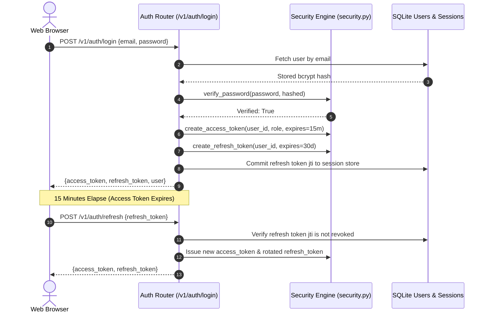

# Authentication & JWT Lifecycle

Alberto implements stateless, cryptographically signed token authentication (`backend/alberto/security.py`) paired with database-backed session revocation.

---

## 1. Token Anatomy & Lifecycle

Alberto issues two distinct token types upon successful authentication (`/v1/auth/login`):

### Access Token Claims:
- **`sub`**: User ID UUID string.
- **`role`**: RBAC role (`owner`, `admin`, `editor`, `viewer`, `connector`).
- **`exp`**: Expiration timestamp (default: 15 minutes).
- **`iat`**: Issued-at timestamp.

### Refresh Token Claims:
- **`sub`**: User ID UUID string.
- **`jti`**: Unique token identifier registered in the database.
- **`exp`**: Expiration timestamp (default: 30 days).

---

## 2. Password Hashing & Rate Limiting

- **Password Storage:** Uses `bcrypt` with a minimum work factor of 12 rounds.
- **Rate Limiting:** Enforces IP and user rate limiting on `/v1/auth/login` (default: 10 attempts per minute) via `SlowAPIMiddleware`. Exceeding limits triggers an immediate `HTTP 429 Too Many Requests`.

---

## 3. Revocation & Logout

- **Single Session Logout (`POST /v1/auth/logout`):** Deletes the specific `jti` from the database. The client discards the access token.
- **Global Session Revocation (`POST /v1/auth/logout-all`):** Invalidates all active refresh tokens for the user, requiring re-authentication across all mobile and browser clients.
