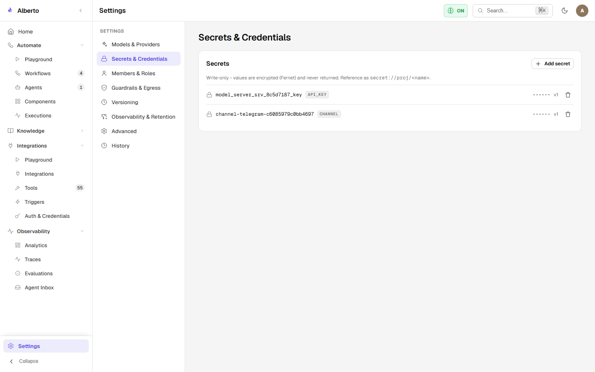

# Security Architecture & Threat Model

Alberto is engineered with defense-in-depth principles to protect user privacy, prevent unauthorized remote actions, and secure private APIs.

{: .doc-screenshot }

Figure 9.1: Credentials and secrets vault with encrypted storage and masked key inputs.

---

## 1. Security Architecture Principles

1. **Zero Cloud Telemetry:** No user conversations, document chunks, or model outputs are transmitted to Alberto maintainers or third parties.
2. **Encrypted Vault Storage:** All API tokens, MCP environment variables, and webhook secrets are encrypted at rest using AES-GCM-256 before storage in SQLite.
3. **Stateless Cryptographic Sessions:** Authentication utilizes signed HMAC-SHA256 JWTs with bounded lifetimes and refresh token rotation.
4. **Privilege Gating & HITL:** Destructive actions require explicit Human-In-The-Loop approval tokens.
5. **SSRF Egress Filtering:** Outbound HTTP connectors cannot target private network IP ranges or cloud metadata servers unless specifically whitelisted.

---

## 2. Threat Model & Mitigations

| Threat Vector | Potential Impact | Alberto Architectural Mitigation |
| :--- | :--- | :--- |
| **Prompt Injection** | Attacker tricks LLM into executing unauthorized tool calls. | Strict structural delimiter separation (`<untrusted_document_content>`), approval gates on destructive tools. |
| **Server-Side Request Forgery (SSRF)** | Attacker uses REST connector to scan private local network or AWS/GCP metadata. | Egress IP filter (`backend/alberto/util/http.py`) blocking private and link-local ranges by default. |
| **Subprocess Escape via MCP** | Compromised MCP server accesses unauthorized files. | MCP processes run under standard user permissions with explicit directory allowlists (`--allowed-dir`). |
| **Database Compromise** | Attacker reads SQLite file and steals third-party API keys. | Keys are stored encrypted using AES-GCM-256 with keys derived from `/data/config/master.key`. |
| **Tenant Cross-Talk** | User in Project A accesses documents from Project B. | Mandatory tenant isolation dependency (`deps.py`) on all API endpoints. |

---

## In This Section

- [Authentication & JWT Lifecycle](auth-and-jwt.md) — Token creation, signing algorithms, refresh rotation, and revocation.
- [Tool Authorization & Approval Gates](tool-authorization.md) — Human-in-the-loop approvals and destructive tool controls.
- [Prompt Injection Defenses](prompt-injection.md) — Context framing, delimiter tagging, and defensive prompting.
