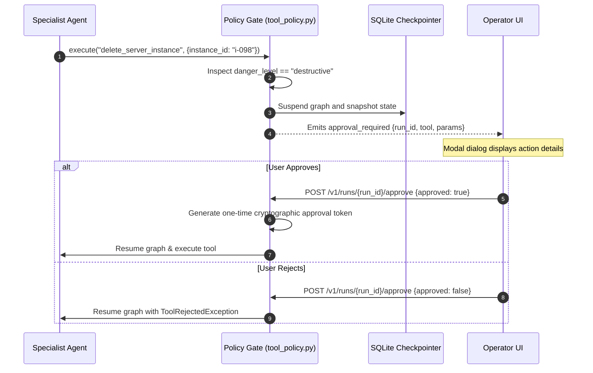

# Tool Authorization & Execution Sandboxing

Alberto treats every tool call as an action crossing an untrusted boundary. Implemented across `tool_manager.py` and `tool_policy.py`, the authorization engine enforces strict least-privilege controls.

---

## 1. Tool Scoping & Association

By default, newly installed integrations and tools are assigned **zero permissions**. They cannot be invoked until an administrator explicitly binds them:

1. **Per-Agent Whitelist:** Agents can only call tools explicitly listed in their configuration `tools: [...]` array.
2. **Project Boundary:** Connectors and tools registered in Project A are inaccessible to agents in Project B.
3. **Role Checks:** Non-admin users cannot trigger tools configured with elevated privileges.

---

## 2. Destructive Action Gating & Human Approval

---

## 3. Subprocess & AST Code Sandboxing

For dynamic Python code evaluation (e.g. in Automate code nodes):
- Alberto utilizes `RestrictedPython 8.5` to compile and execute Python code.
- Dangerous builtins (`__import__`, `eval`, `exec`, `open`, `os`, `sys`) are stripped from the execution namespace.
- Memory usage and CPU cycles are bounded by subprocess watchdog timers.
