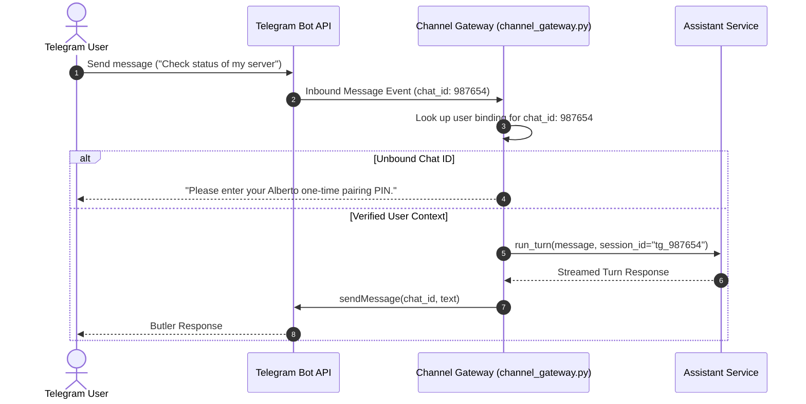

# Communication Channels: Telegram & Webhooks

Alberto's **Channel Gateway** (`backend/alberto/services/channel_gateway.py`) enables conversational interactions outside the web console—allowing users to message Alberto via Telegram, Slack, or generic webhooks.

---

## 1. Telegram Bot Integration

Alberto integrates directly with the Telegram Bot API via long-polling or webhooks.

### Setting Up Telegram

1. Open Telegram and message `@BotFather` to create a new bot:
   ```text
   /newbot
   Name: Alberto Personal Butler
   Username: my_alberto_butler_bot
   ```
2. Copy the generated Bot Token (`123456789:ABCdefGHIjkl...`).
3. In Alberto, navigate to **Integrations &rarr; Channels** and select **Telegram**.
4. Paste the bot token and click **Connect**.

### Inbound Identity Resolution



---

## 2. Generic Inbound Webhooks

You can trigger conversational turns or automate workflows from external services (e.g. GitHub, Stripe, Home Assistant, Uptime Kuma) via inbound webhooks:

### Endpoint:
`POST /v1/channels/webhooks/{webhook_token}`

### Payload:
```json
{
  "event": "alert",
  "service": "grafana",
  "severity": "critical",
  "message": "High CPU utilization on node-01 (94%)"
}
```

The webhook payload can either be forwarded directly to the Master Butler for analysis or bound to an Automate workflow trigger.
