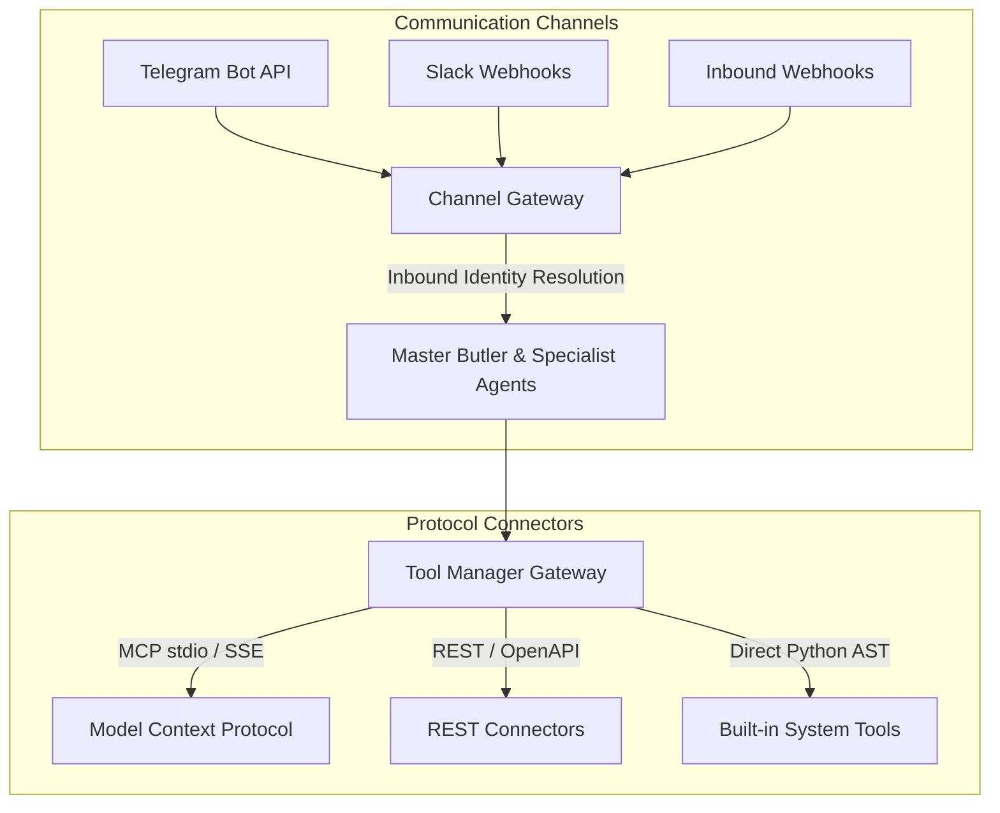

# Tools & Integration Gateway

The **Integration Gateway** connects Alberto's reasoning engine to local utilities, web services, external databases, smart home platforms, and communication channels.

{: .doc-screenshot }

Figure 6.1: Integrations console showing active REST connectors, MCP servers, and channel bindings.

---

## Architectural Taxonomy

---

## Integration Mechanisms

| Mechanism | Description | Example Targets |
| :--- | :--- | :--- |
| **Tool Manager** | Central gateway for schema registration, access control, and approval gating. | `calculator`, `knowledge_search`, `bash_exec` |
| **Model Context Protocol (MCP)** | Anthropics-designed protocol for secure, isolated tool subprocesses. | Filesystem server, SQLite MCP, Git MCP, Brave Search |
| **REST Connectors** | Declarative HTTP clients with parameter substitution and authentication. | Open-Meteo Weather, Home Assistant, Notion, GitHub |
| **Channels** | Inbound messaging gateways with independent identity mapping. | Telegram bots, Slack integrations, inbound webhooks |

---

## In This Section

- [Tool Manager & Policies](tool-manager.md) — Tool discovery, parameters, danger categorization, and approval enforcement.
- [Model Context Protocol (MCP)](mcp.md) — Connecting local and remote MCP servers via stdio and SSE transports.
- [REST Connectors](rest-integrations.md) — Designing declarative API connectors and managing credential headers.
- [Communication Channels](channels.md) — Telegram and webhook setup with conversational routing.
