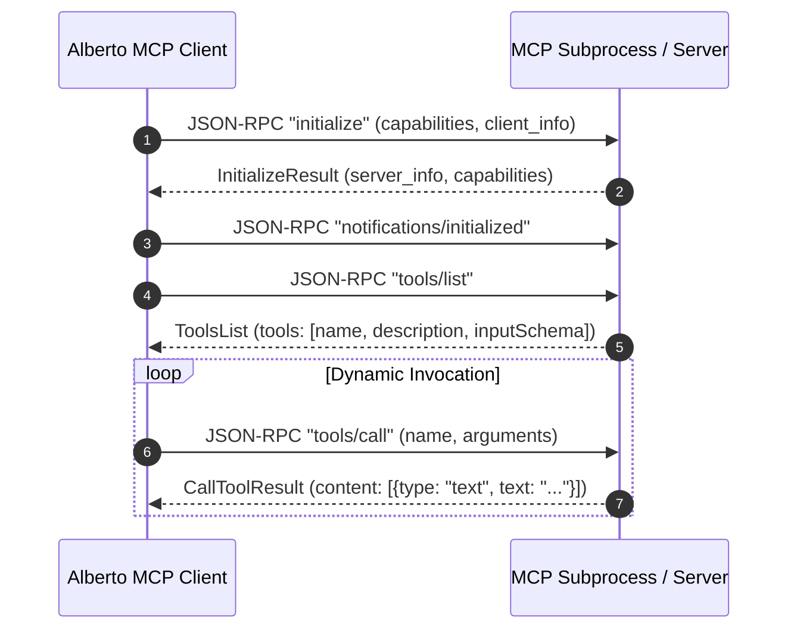

# Model Context Protocol (MCP)

Alberto natively implements the **Model Context Protocol (MCP)** specification (`mcp>=1.30.0`). MCP provides a secure, vendor-neutral protocol connecting LLMs to external data sources and execution sandboxes.

---

## 1. Supported Transports

Alberto supports both primary MCP transport mechanisms:

1. **`stdio` (Standard Input / Output):**
   - Launches the MCP server as an isolated subprocess on the host machine.
   - Communicates via JSON-RPC 2.0 messages over standard input and output streams.
   - Ideal for local filesystem operations, SQLite querying, and local git repositories.
2. **`sse` (Server-Sent Events over HTTP):**
   - Connects to a remote or long-running MCP daemon over HTTP with Server-Sent Events for bi-directional messaging.
   - Ideal for shared network tools and containerized microservices.

---

## 2. Server Discovery & Handshake Lifecycle

Implemented in `backend/alberto/services/mcp_discovery.py`:

Discovered MCP tools are dynamically ingested into the Alberto Tool Manager, allowing any Specialist Agent or Automate workflow node to execute them subject to standard policy gates.

---

## 3. Recommended Community MCP Servers

Alberto has been verified with standard community MCP servers:

| MCP Server | Transport | Command | Capability |
| :--- | :--- | :--- | :--- |
| **Filesystem** | `stdio` | `npx -y @modelcontextprotocol/server-filesystem <allowed_dir>` | Read, write, list files within directory sandbox. |
| **SQLite** | `stdio` | `uvx mcp-server-sqlite --db-path <path_to_db>` | Execute read and write SQL queries against databases. |
| **Git** | `stdio` | `uvx mcp-server-git --repository <repo_dir>` | Read commit history, stage changes, create diffs. |
| **Brave Search** | `stdio` | `npx -y @modelcontextprotocol/server-brave-search` | Web search and local business lookup. |
