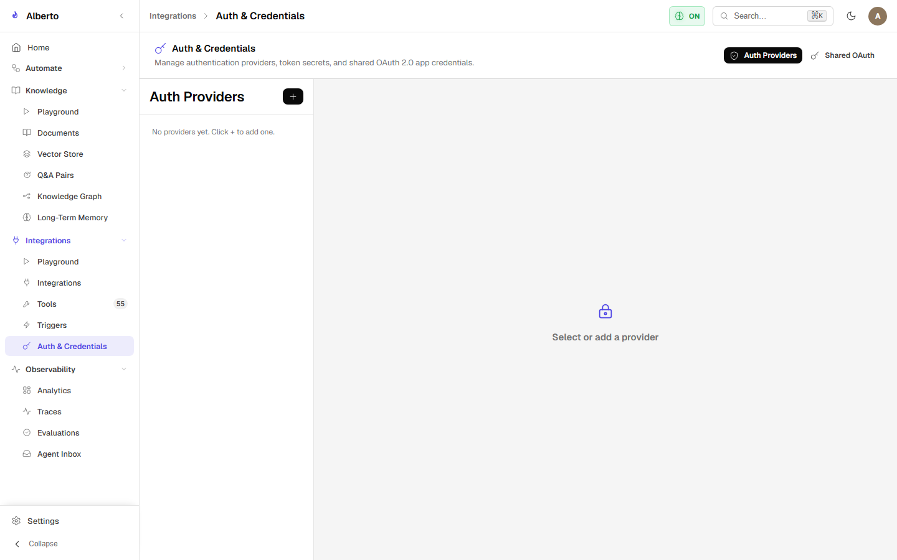

# REST Connectors & Web Integrations

For external web services without native MCP servers, Alberto provides declarative **REST Connectors**.

{: .doc-screenshot }
<p class="doc-caption">Figure 6.4: Credentials and secrets management console for API keys and connector authentication.</p>

---

## 1. Declarative Connector Schema

A REST connector represents an external HTTP service definition:

```json
{
  "name": "home_assistant",
  "base_url": "http://homeassistant.local:8123/api",
  "auth": {
    "type": "bearer",
    "secret_id": "sec_ha_token"
  },
  "endpoints": [
    {
      "operation_id": "get_state",
      "method": "GET",
      "path": "/states/{entity_id}",
      "description": "Fetch the current state of a Home Assistant entity.",
      "parameters": {
        "entity_id": { "type": "string", "required": true }
      }
    },
    {
      "operation_id": "turn_on_light",
      "method": "POST",
      "path": "/services/light/turn_on",
      "description": "Turn on a specified light entity.",
      "parameters": {
        "entity_id": { "type": "string", "required": true },
        "brightness": { "type": "integer", "required": false }
      },
      "danger_level": "idempotent"
    }
  ]
}
```

---

## 2. Dynamic Tool Generation

Upon saving the connector, Alberto automatically compiles each endpoint into an executable tool:

- **Naming Convention:** `<connector_name>:<operation_id>` (e.g. `home_assistant:get_state`).
- **Dynamic Inlining:** URL template parameters (`{entity_id}`) and query parameters are dynamically interpolated by the execution engine.
- **Header Injection:** Secrets stored in the credential vault are decrypted on the fly and injected into outgoing headers (`Authorization: Bearer ...`).

---

## 3. Network Egress Protection

All outgoing HTTP requests initiated by REST connectors pass through `backend/alberto/util/http.py`:
- Enforces request timeouts (default: 15s).
- Blocks access to private and link-local IP subnets unless explicitly permitted by `ALBERTO_EGRESS_ALLOW_PRIVATE_HOSTS`.
- Redacts authorization headers from audit and trace logs.
