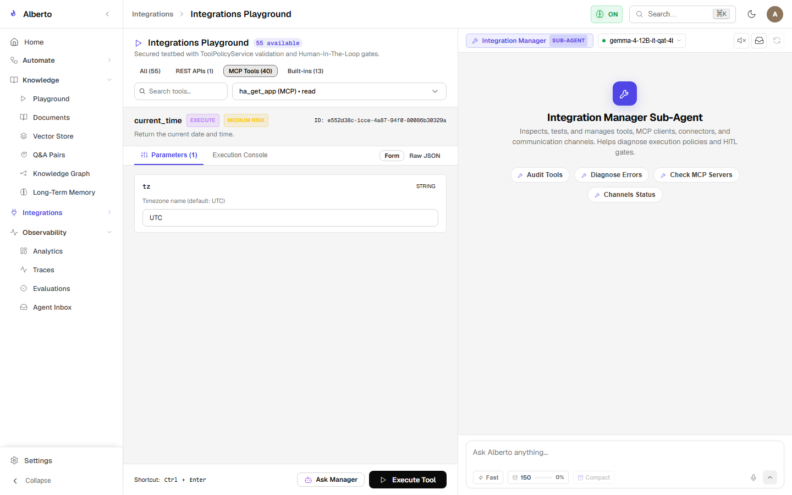
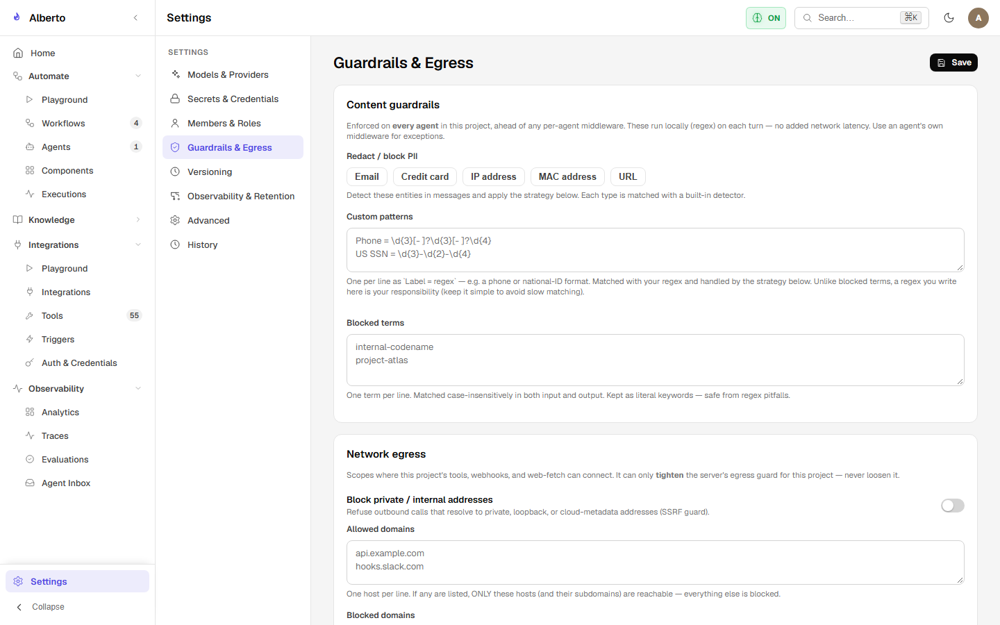
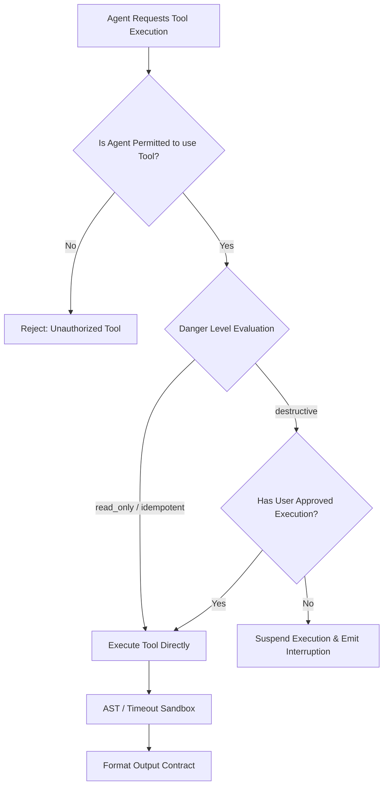

# Tool Manager & Policy Gates

Implemented in `backend/alberto/services/tool_manager.py` and `backend/alberto/services/tool_policy.py`, the **Tool Manager** provides a unified gateway through which all tool invocations must pass.

{: .doc-screenshot }
<p class="doc-caption">Figure 6.2: Tool Manager catalog displaying tool definitions, schemas, and danger ratings.</p>

---

## 1. Tool Schema & Parameter Validation

Every tool exposed to Alberto agents conforms to a JSON schema specification:

```json
{
  "name": "knowledge_search",
  "description": "Performs hybrid semantic and keyword search across ingested project documents.",
  "parameters": {
    "type": "object",
    "properties": {
      "query": {
        "type": "string",
        "description": "The search query string."
      },
      "limit": {
        "type": "integer",
        "default": 5,
        "description": "Maximum number of chunks to return."
      }
    },
    "required": ["query"]
  },
  "danger_level": "read_only"
}
```

When an agent requests a tool execution, arguments are validated against the Pydantic schema before invocation. Malformed inputs are rejected immediately with descriptive validation errors.

---

## 2. Policy Enforcement & Guardrails

{: .doc-screenshot }
<p class="doc-caption">Figure 6.3: Guardrails settings panel with default middleware and egress controls.</p>

The policy engine (`tool_policy.py`) enforces 4 sequential validation checks:



---

## 3. Human-In-The-Loop (HITL) Interruption

For destructive tools (e.g. `delete_document`, `send_slack_message`), Alberto suspends execution:
1. Emits an event with the tool name and exact parameters.
2. In the UI, a confirmation modal appears prompting the user to **Approve** or **Cancel**.
3. Upon approval, the client submits a cryptographic token back to `/v1/runs/{id}/approve`, resuming execution.
